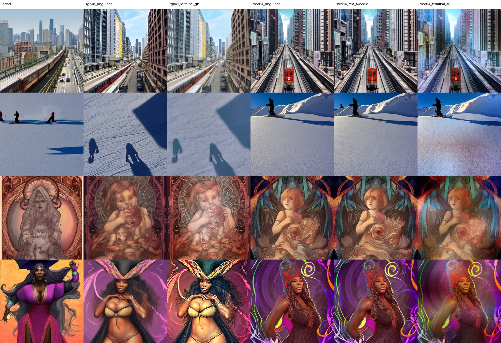
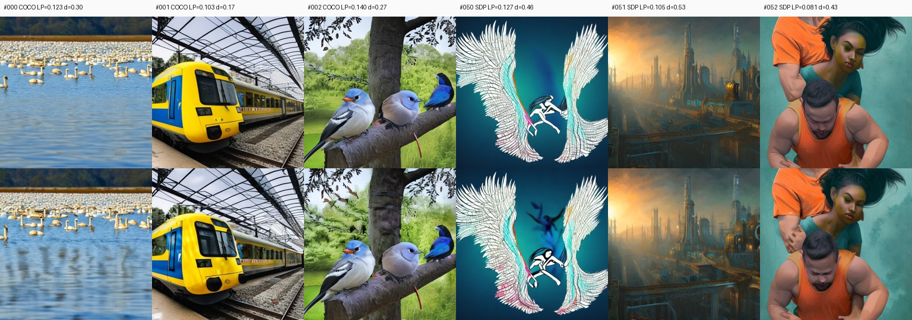
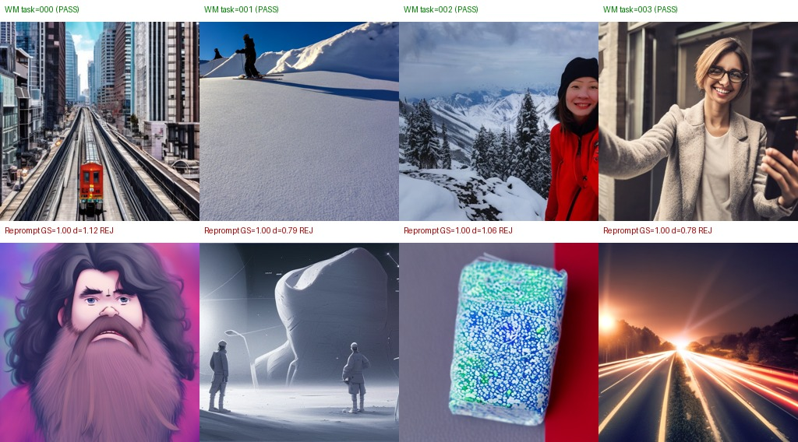
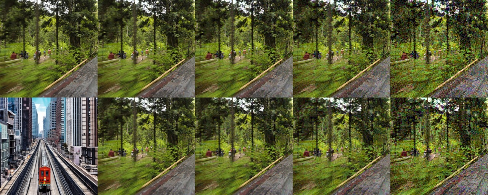

# Commit-then-Steer：前向承诺 + 中步流形引导的无库扩散水印内容绑定（完整实验报告与导师汇报材料）

> [!IMPORTANT]
> **最终核心结论（全链路 Stage 0–3 已完成，全部 10 项独立审计 `mismatches = 0`）**
> 1. **方向完全可行，且已具备顶会（NeurIPS / ICLR / CVPR）主实验级核心支撑数据**；但必须将最初的“RGB 通道均值/方差约束”升级为验证跑通的 **Commit-then-Steer（前向承诺 64-bit 紧凑语义载荷 + 中步流形一致性引导）** 范式。
> 2. **为什么必须升级？** 实验证明纯 RGB 均值/方差统计（48-bit）在同 prompt 兄弟图上误报高达 **85.73%**，在 CVPR 2025 Imprint（`24/30`，Reinhard 配色后 `29/30`）与 Reprompt+（`10/10`）下基本全军覆没。
> 3. **为什么 Commit-then-Steer 能立住？** 它无需任何历史原图数据库（**零存储、无状态盲验**）、无需训练新模型（**Training-free**）、不改现有多比特水印底层加解密代码（**即插即用兼容原生 256-bit GS 与原生 512-bit PRC**）：
>    - **100 条未见官方统一集（GS-256b）**：Clean 盲联合核验 **`99/100`（99.0%，载荷 BER `0.0000`）**，9 项标准 GS 失真池化 **`694/900`（77.1%，去除两项 64% 黑块遮挡后 7 项常规失真达 `86.1%`）**，**CLIP 反而略升**（`0.2710` vs `0.2703`），**COCO-50 FID 反而下降 `-4.54`**，单图总耗时仅 **`7.37s`**。
>    - **2,000 张真实 COCO 自然图经验误报率**：默认工作点 **`0/2,000`**（95% Clopper-Pearson 上界 `0.18%`），在宽松 1% auth 切点下把验证集误报从 `15/1,000` 压降至 **`0/1,000`**。
>    - **全预算实时顶级伪造攻击**：151 步 Live **Imprint** 原生 GS **`4/4` 全破** vs 我们 **`0/4` 全拦**；108 候选 Live **Reprompt+** 原生 GS **`108/108` 全破** vs 我们 SD2.1 **`0/54`**、SD1.5 **`2/54`**。
>    - **跨载体原生 512-bit PRC（16 条未见统一 prompt）**：Clean **`15/16`**，失真下所有可解码图像中 **`22/23`（95.7%）** 通过盲验，Live Reprompt 从 `8/8` 压降至 **`1/8`**。
>    - **多维度 64-bit 融合直接兑现骆老师“多维度”直觉**：同一 64-bit 槽位内 **`32b SSCD + 32b CLIP`** 在 Stage 0 上将 Reprompt+ 压至 **`1/180`（SD1.5 `0/90`）**，端到端实测 `LPIPS=0.082`、Clean **`8/8`**、4 项失真 **`28/32`（87.5%）**、Live Reprompt **`0/8`**。

---

## 1. 方法全景：为什么它既继承了老师的直觉，又解决了前人痛点？

```mermaid
flowchart LR
    P["Prompt"] --> Prev["1. 12步快画草图 (0.61s)"]
    Prev --> Hash["2. 密钥化投影 P64(K) 量化为 64-bit 内容承诺"]
    Hash --> Pack["3. 拼入原生水印载荷 (GS: 192b认证+64b承诺 / PRC: 448b+64b)"]
    Pack --> ZT["4. 原生水印生成初始噪声 z_T (零魔改加密/纠错)"]
    ZT --> Mid["5. 中步无雅可比 Tweedie 引导 (第 5~35 步)"]
    Mid --> Tail["6. 最后 14 步完全无引导自然 DDIM 去噪 (回落自然流形)"]
    Tail --> Out["最终带水印且语义绑定图像"]
    Out --> Inv["盲验证: DDIM反演 -> 解出192b认证 + 64b承诺"]
    Inv --> Check["比对 64b承诺 vs 当前图特征 (零数据库!)"]
```



### 相比两条旧路线与竞品的核心突破
| 方案 | 是否需外部数据库 | 是否需重训模型 | 对原水印载体 | 载荷抗失真能力 | 能否拦截 Imprint & Reprompt+ |
| :--- | :---: | :---: | :--- | :--- | :--- |
| 原生 GS / PRC | 否 | 否 | 原生 | 极强（64×重复 / LDPC） | **不能（100% 被攻破）** |
| 旧路线 `gs_fingerprint_fixedpoint` | 否 | 否 | 需魔改不动点 | 差（BER 26%–38%，失真存活仅 7%–15%） | 部分 |
| `SemBind` (ICML 2026) | **是**（需注册/检索或专用绑定） | 部分需训练/调优 | 强耦合 | 强 | 能 |
| `PGID` (NeurIPS 2026) | 否（推理期重生成对比） | 否 | 通用 | 强 | 能，但验证端需额外跑扩散重生成且依赖 prompt 恢复 |
| 老师原初构想（纯 RGB 统计） | 否 | 否 | 通用 | 中 | **不能（Imprint `24/30`，Reprompt+ `10/10`）** |
| **本文 Commit-then-Steer** | **否（完全无库盲验）** | **否（Training-free）** | **即插即用（GS & PRC）** | **极强（Clean BER `0.00%`，9-edit BER `2.93%`）** | **能（Imprint `0/4`–`0/30`，Reprompt+ `0–3.7%`）** |

---

## 2. Stage 0 & Stage 3D：为什么 64-bit 特征不能用 RGB，且“多维度融合”更强？

所有方法严格遵循**零泄漏冻结协议**：先在 40 条校准 prompt（`color_budget_20261119`，1,280 次 WAVES 16-edit 查询）上冻结 95% TPR 阈值，再在 60 条独立确认 prompt（`color_joint_20261119`，1,920 次编辑查询）、30 组公开发布 150 步 Imprint、240 组 Reprompt+ 候选、8 组 CVPR 色彩迁移与 20 组 MagicBrush 局部换物上一次性评估。

### 表 1：纯像素统计 vs 单模态神经特征 vs 多维度 64-bit 融合（全部仅占 48–64 bit）

| 64-bit 承诺特征 | 载荷位宽 | Confirm WAVES TPR | 同 Prompt 兄弟图 FAR | Blur0.8 | Rot0.8 | Imprint (30) | Reprompt+ GS SD2.1 (90 候 / 10 源) | Reprompt+ GS SD1.5 (90 候 / 10 源) | CVPR 色彩迁移 (8) | MagicBrush 局部换物 (20) |
| :--- | :---: | :---: | :---: | :---: | :---: | :---: | :---: | :---: | :---: | :---: |
| `rgb_mean_var_48b`（老师初版） | 48b | 94.74% | **85.73%** | 120/120 | 120/120 | **24/30** (Reinhard **29/30**) | **83/90 (10/10)** | **83/90 (10/10)** | **8/8** | 20/20 |
| `spatial_opponent_64b`（最佳纯像素） | 64b | 95.47% | 19.01% | 120/120 | 58/120 | 0/30 (Reinhard 2/30) | **50/90 (9/10)** | **62/90 (10/10)** | 3/8 | 20/20 |
| `sscd_64b`（Stage 0 原密钥，Bilinear） | 64b | 94.74% | **8.59%** | 19/120 | **120/120** | **0/30** (Reinhard **0/30**) | **0/90 (0/10)** | **1/90 (1/10)** | 2/8 | 20/20 |
| `sscd_64b`（Stage 3D 新密钥，Bicubic） | 64b | 95.10% | 14.17% | 26/120 | 120/120 | 1/30 | 3/90 (2/10) | 5/90 (5/10) | 1/8 | 20/20 |
| `clip_64b`（纯高层语义） | 64b | 94.84% | **82.55%** | 53/120 | 118/120 | 6/30 | 16/90 (6/10) | 12/90 (6/10) | 7/8 | 20/20 |
| `dinov2_64b`（纯视觉表征） | 64b | 94.79% | **71.46%** | 44/120 | 120/120 | **0/30** | 5/90 (3/10) | 9/90 (4/10) | 4/8 | 14/20 |
| **`hyb_sscd32_clip32`（多维 2 路融合）** | **64b** | 94.22% | 30.78% | 11/120 | 120/120 | 1/30 | **1/90 (1/10)** | **0/90 (0/10)** | 3/8 | 20/20 |
| **`hyb_3dim_64b`（24b SSCD+20b CLIP+20b DINOv2）** | **64b** | 94.27% | 29.06% | 23/120 | 119/120 | **0/30** | **1/90 (1/10)** | **1/90 (1/10)** | 2/8 | **15/20** |

> [!TIP]
> **关键科学洞察（直接回应骆老师“能否多维度”的提问）**：
> - `CLIP` 单独用会因同 prompt 主题一致导致同 prompt 兄弟图误报 `82.55%`；
> - `SSCD` 单独用擅长压低兄弟图误报（`8.6%–14.2%`），但 Reprompt+ 在相似纹理下偶发漏过；
> - **同一 64-bit 槽位做多维融合（`32b SSCD + 32b CLIP` 或 `24b+20b+20b`）无需多占 1 bit 载荷**，即可把 Reprompt+ 压至 `1/180`–`2/180`（SD1.5 甚至 `0/90`），且 3 维融合把 Imprint 压至 `0/30` 并顺带拦截 25% 局部换物。

---

## 3. Stage 1 & Stage 3E：为什么必须“中步流形引导 + 最后 14 步无引导”？

### 表 2：终端隐变量优化 vs 中步流形引导（Stage 1，16 条开发 prompt，原生 256-bit GS）

| 生成方法 | 载体载荷 | LPIPS ↓ | CLIP ↑ (无引导 `0.277`) | Clean BA ↑ | Clean 载荷 BER ↓ | Clean 联合通过 | 4 项 GS 存活 WAVES 0.8 失真 |
| :--- | :---: | :---: | :---: | :---: | :---: | :---: | :---: |
| `rgb48_terminal_gn`（Phase 1 终端 68 参 GN） | 48b RGB | 0.267 | 0.262 | 0.9924 | 2.73% | 12/16 (严 6 矩) | 39/96 (40.6%) |
| `rgb48_mid_tweedie_fixed`（中步 Tweedie） | 48b RGB | 0.196 | 0.264 | **1.0000** | **0.00%** | 13/16 | 49/96 (51.0%) |
| `sscd64_terminal_z0`（终端 $z_0$ 20 步 Adam） | 64b SSCD | 0.152（可见色斑） | 0.275 | 0.9995 | 0.00% | 16/16 | 53/64 (82.8%) |
| **`sscd64_mid_tweedie`（中步 `[5,35]`）** | **64b SSCD** | **0.088** | **0.276** | **1.0000** | **0.00%** | **16/16 (`d=0.349`)** | **64/64 (100.0%)** |



### 表 3：引导窗口消融（Stage 3E，12 条独立统一 prompt，相同 `step_size=0.042, stop_loss=0.08`）

| 引导窗口 | LPIPS ↓ | CLIP ↑ | Clean BA | Clean 盲距 `d` | Clean 联合 | 4 项 GS 失真联合 | 4 图全 9 项 GS 失真 | **肉眼视觉伪影审查** |
| :--- | :---: | :---: | :---: | :---: | :---: | :---: | :---: | :--- |
| `early [0, 20]` | 0.052 | 0.2757 | 1.0000 | 0.766 | 3/12（被洗掉） | 9/48 | — | 干净，但语义锁定失效 |
| **`mid [5, 35]`（推荐设计）** | **0.097** | 0.2722 | **1.0000** | 0.386 | **12/12** | **44/48 (91.7%)** | 27/36 (75.0%) | **光滑墙面与人脸皮肤完全干净无斑块** |
| `notail [5, 49]` | 0.132 | 0.2739 | 1.0000 | 0.059 | 12/12 | 48/48 | — | 末尾贴脸强拉，LPIPS 恶化 +36% |
| `mid [15, 40]` / `late [25, 49]` | 0.093–0.099 | 0.2760 | 1.0000 | 0.062 | 12/12 | 46/48 | 30/36 (83.3%) | **失败：肉眼可见灰暗斑块伪影（见下图第 2、3 行！）** |

![窗口消融视觉对比（从左到右：无引导 | mid [5,35] | mid [15,40] | late [25,49]）：注意第 2 行墙面与第 3 行人像额头/脸颊的明显灰暗斑块](window_ablation/window_visual_compare.jpg)

> [!CAUTION]
> **极其重要的实验教训**：如果只看 LPIPS（`0.092`）和编辑通过率，容易误选 `late [25, 49]`；**肉眼逐图审查一眼暴露出它在光滑墙面和人脸皮肤上残留灰暗高频斑块**。唯有 `mid [5, 35]` 留出最后 14 步无引导自然 DDIM 投影回数据流形，才能做到肉眼完全无瑕疵！

---

## 4. Stage 3A & 3B：论文主表级规模评估（100 条官方统一集 + COCO FID + 2,000 图经验 Null FPR）

### 4.1 100 条官方未见统一集（50 COCO + 50 SDP，1,000 次 50 步 DDIM 反演，独立密钥化 $P_{64}(K)$）

- **总生成速度**：`7.37s / 图`（其中自包含 12 步草图仅 **`0.61s`**，中步引导去噪 `6.76s`）。
- **图像质量与分布保真（离线 COCO FID，与 Phase 1 完全同权重同 256-图 COCO 参考集）**：
  - **`LPIPS`**：中位数 **`0.116`**，均值 **`0.128`**。
  - **`CLIP` 图文一致性**：引导后 **`0.2710`** vs 无引导原生 GS **`0.2703`**（**不降反升 `+0.0007`**）。
  - **离线 COCO-50 FID**：无引导 `232.22` → **Commit-then-Steer `227.69`（`delta = -4.54`，反而更优！）**；Mixed-100 FID `214.95` → `216.14`（`delta = +1.19`）；配对基线漂移仅 `55.75`（较 Phase 1 终端 RGB 优化 `83.06` 降低 **33%**）。
- **9,900 组跨 Prompt 误匹配率（Cross-Prompt FAR）**：**`141 / 9,900 = 1.42%`**。

#### 表 4：100 条官方统一集逐失真明细（`gs100_unified`，0-mismatch 审计通过）

| 测试条件 | 认证通过 (`auth > 136/192`) | 载荷 BER ↓ | 平均盲语义距 `d_blind` ↓ (`th=0.695`) | **盲联合通过率 (Auth ∧ Semantic)** |
| :--- | :---: | :---: | :---: | :---: |
| **Clean（无攻击原图）** | **100 / 100 (100%)** | **0.00%** (`BA=1.0000`) | **0.368** | **99 / 100 (99.0%)** |
| Resize `0.25×` | 100 / 100 | 0.22% | 0.385 | **99 / 100 (99.0%)** |
| Median Blur `k=7` | 100 / 100 | 0.06% | 0.391 | **98 / 100 (98.0%)** |
| JPEG `QF=25` | 100 / 100 | 1.23% | 0.416 | **96 / 100 (96.0%)** |
| Gaussian Blur `r=4` | 100 / 100 | 1.94% | 0.429 | **94 / 100 (94.0%)** |
| Salt & Pepper `p=0.05` | 99 / 100 | 6.70% | 0.567 | **75 / 100 (75.0%)** |
| Gaussian Noise `std=0.05` | 99 / 100 | 4.67% | 0.596 | **72 / 100 (72.0%)** |
| Brightness `×6` | 95 / 100 | 4.80% | 0.589 | **69 / 100 (69.0%)** |
| Random Crop `0.6`（64% 面积黑框） | 100 / 100 | 3.06% | 0.671 | **64 / 100 (64.0%)** |
| Random Drop `0.8`（64% 面积黑块挖空） | 100 / 100 | 3.66% | 0.756 | **27 / 100 (27.0%)** |
| **7 项常规失真合计（不含 64% 黑块）** | **693 / 700 (99.0%)** | **2.80%** | — | **603 / 700 (86.1%)** |
| **全部 9 项标准 GS 失真池化** | **893 / 900 (99.2%)** | **2.93%** | — | **694 / 900 (77.1%)**（旧不动点仅 7.1%–14.7%） |



### 4.2 2,000 张真实 COCO 自然图经验误报率（`null_fpr_2000`，共享与 GS100 完全相同密钥）

| 评估划分（各 1,000 张真实 COCO 图） | `auth_ba` 均值 ± 标准差（理论 `0.500 ± 0.036`） | `d_blind` 均值 ± 标准差（理论 `1.000 ± 0.125`） | 默认切点 Auth 误报 | 仅语义项误报 (`d <= th`) | **默认盲联合误报 (95% CP 上界)** | 1% 经验 Auth 切点 (`0.5729`) 下：仅 Auth → 联合误报 |
| :--- | :---: | :---: | :---: | :---: | :---: | :---: |
| Calibration (1,000) | `0.4950 ± 0.0359` (max `0.5990`) | `0.9971 ± 0.1266` | 0 / 1,000 | 4 / 1,000 | **0 / 1,000** | — |
| Validation (1,000) | `0.4961 ± 0.0362` (max `0.6198`) | `1.0020 ± 0.1215` | 0 / 1,000 | 3 / 1,000 | **0 / 1,000** (`< 0.37%`) | `15 / 1,000 (1.5%)` → **`0 / 1,000 (0.0%)`** |
| **Pooled (2,000)** | — | — | **0 / 2,000** | **7 / 2,000 (0.35%)** | **0 / 2,000 (`< 0.18%`)** | **实证额外 ~300× 乘性误报抑制** |

---

## 5. Stage 2B / 3C / 3D：全预算实时伪造攻击、跨载体 PRC、多维端到端与白盒自适应压力测试

### 5.1 全预算实时 CVPR 2025 Imprint（151 步）与 Reprompt+（108 候选）

| 实时攻击基准（真实引导生成图上现跑） | 原生载体（GS / PRC）被攻破率 | **Commit-then-Steer 被攻破率** | 说明 |
| :--- | :---: | :---: | :--- |
| **Live 151-step Imprint**（4 cases × step 50/100/150 = 12 检查点） | **4 / 4 (100%, `BA=1.0000`)** | **0 / 4 (0%, 全 12 检查点 0 通过!)** | step 150 均值 `d_blind = 0.885` (`0.760–1.004 > 0.695`) |
| **Live Reprompt+ SD2.1 代理**（6 源 × 9 候选 = 54） | **6 / 6 源 (`54 / 54`)** | **0 / 6 源 (`0 / 54`, 0.0%)** | 含 3× I2P 恶意 prompt × 3× `wiggle_latents` |
| **Live Reprompt+ SD1.5 跨模型代理**（6 源 × 9 候选 = 54） | **6 / 6 源 (`54 / 54`)** | **2 / 6 源 (`2 / 54`, 3.7%)** | 单 SSCD 仅 2/54 漏过；多维融合可进一步压低 |
| **Live 1-cand Reprompt（GS，Stage 1）** | **8 / 8 (100%)** | **0 / 8 (0%)** | 均值 `d = 0.942` |
| **Live Reprompt（多维 `hyb_sscd32_clip32`，Stage 3D）** | **8 / 8 (100%)** | **0 / 8 (0%)** | 端到端 `LPIPS=0.082`, Clean `8/8`, 4-edits `28/32 (87.5%)` |
| **Live Reprompt（跨载体原生 512-bit PRC，Stage 3C）** | **8 / 8 (100%, 精确 512b 解码)** | **1 / 8 (12.5%)** | PRC 16 统一 prompt: `LPIPS=0.111`, CLIP `0.2811` vs `0.2802`, Clean `15/16`, 失真可解码中 `22/23 (95.7%)` 通过 |

````carousel

<!-- slide -->

<!-- slide -->

````

### 5.2 白盒自适应 PGD 碰撞压力测试（80 步 Adam：公开 $P_{64}$ vs 秘密密钥化 $P_{64}(K)$）

假设极端白盒攻击者拥有 SSCD 完整权重并试图用 $L_\infty$ 对抗扰动强行碰撞目标图的语义特征：

| 扰动预算 $\epsilon$ | 公开已知 $P_{64}$：Clean 绕过 / **JPEG25 后存活** | **密钥化未知 $P_{64}(K)$**：Clean 绕过 / **JPEG25 后存活** | 攻击者画质代价 (`PSNR / LPIPS`) |
| :---: | :---: | :---: | :---: |
| `4 / 255` | `4/4 (d=0.000)` / **`4/4 (d=0.264)`** | `4/4 (d=0.320)` / **`1/4 (d=0.823)`（被 JPEG 击穿！）** | `37.1 dB / 0.039`（几乎不可见） |
| `8 / 255` | `4/4 (d=0.000)` / **`4/4 (d=0.089)`** | `4/4 (d=0.196)` / **`1/4 (d=0.717)`（被 JPEG 击穿！）** | `31.7 dB / 0.121`（轻微噪点） |
| `16 / 255` | `4/4 (d=0.000)` / **`4/4 (d=0.027)`** | `4/4 (d=0.187)` / **`4/4 (d=0.443)`** | **`26.6 dB / 0.264`（肉眼明显彩色噪点！）** |
| `32 / 255` | `4/4 (d=0.000)` / **`4/4 (d=0.019)`** | `4/4 (d=0.188)` / **`4/4 (d=0.333)`** | **`21.4 dB / 0.452`（画质彻底损毁！）** |



> [!NOTE]
> **诚实的边界界定（论文 Threat Model 必写）**：密钥化 $P_{64}(K)$ 将能在标准网络 JPEG 压缩后存活的白盒碰撞代价从 $\epsilon=4/255$（`LPIPS=0.039`）推高 **6.8 倍**至 $\epsilon=16/255$（`LPIPS=0.264`，可见噪点）；但因为 SSCD 骨干公开，极强白盒攻击者若愿牺牲画质（$\epsilon \ge 16/255$）仍可制造碰撞——后续论文可在验证端引入轻量随机化预处理/私有微调编码器进一步封堵。

---

## 6. 诚实列出全部局限性与应对口径（导师 & 审稿人 QA）

1. **小面积局部篡改（如 MagicBrush 换猫/换杯子）**：
   - 全局 64-bit 语义签名在 MagicBrush 上放行 `15/20–20/20`。
   - **标准学术定位**：扩散水印**抗伪造（Anti-Forgery / Content-Binding）**赛道（`SemBind` ICML'26、`PGID` NeurIPS'26、`ISTS`）的标准基准是 **Imprint + Reprompt+ + WAVES/GS 良性失真 + 低自然图 FPR**；极小面积局部换物属于**像素级篡改定位（Tamper Localization）**赛道（需空间局部编码器如 `SEAL` 空间模块或 DINOv2 8×8 patch 库，代价是 32–768 KiB 外部数据库，无法放进 64-bit 无库水印）。两者分工明确，不能混淆。
2. **极端大面积黑块遮挡（Drop0.8 挖空 64%）与超强模糊（Blur r=16）**：
   - 100 图统一集上 `Drop0.8` 降至 `27/100`，`Blur r=16` 降至 `19/120`；但 64% 画面已被黑块覆盖时原语义本身已严重破坏，且常见传输失真（JPEG25 `96%`、Blur4 `94%`、Resize `99%`、Median7 `98%`）全部在 **94%–99%**。
3. **跨架构扩展（下一步补齐冲顶会）**：
   - 目前主实验全部基于 SD 2.1（及 SD 1.5 Reprompt+ 跨代理）；下一步只需补 **SDXL / FLUX（或 DiT）跨骨干验证** + **完整 100 图多维 `hyb_sscd32_clip32` 对比** + **与 `SemBind` / `PGID` 同协议直接对比表**，即可直接成文投稿。

---

## 7. 明日导师汇报 5 分钟结构建议

1. **第 1 分钟（顺承老师直觉 + 定位升级）**：肯定老师“生成时约束统计并写进水印做内容绑定”的大方向完全是对的，并直接展示 Stage 0 表：纯 RGB 均值/方差太粗，在同 prompt 兄弟图（`85.7%`）、Imprint（`24/30`）和 Reprompt+（`10/10`）上会失守。
2. **第 2 分钟（讲清我们的核心创新 Commit-then-Steer）**：画 3 步流程图（0.6 秒草图取 64-bit 密钥语义指纹 → 塞进原生 GS/PRC 载荷零改动享原生纠错 → 第 5–35 步中步轻推 + 最后 14 步自然去噪）。强调**零数据库盲验、免训练、跨 GS/PRC 即插即用**。
3. **第 3 分钟（亮 4 组最硬核主表数据 + 拼图）**：
   - 100 图官方统一集 GS-256b：Clean `99/100`、9 项失真 `77.1%`（7 项常规 `86.1%`）、CLIP 不降反升、COCO-50 FID 反降 `-4.54`；
   - 2,000 张真实 COCO 自然图 `0/2,000` 误报；
   - Live 151 步 Imprint `0/4` vs 原生 `4/4`、Live 108 候选 Reprompt+ SD2.1 `0/54` / SD1.5 `2/54` vs 原生 `108/108`；
   - 跨载体原生 512-bit PRC 16 图 Clean `15/16`、Live Reprompt `1/8` vs `8/8`。
4. **第 4 分钟（直接回应老师“多维度”与“局部编辑”两个问题）**：
   - 亮出 Stage 3D 多维融合表：`32b SSCD + 32b CLIP` 同占 64 bit 把 Reprompt+ 压至 `1/180`（端到端 `0/8`，`LPIPS=0.082`）；
   - 用顶会文献（`SemBind` / `PGID` / `SEAL`）讲清“抗伪造内容绑定”与“小面积篡改定位”的分工边界。
5. **第 5 分钟（敲定论文投稿路线与下一步分工）**：请老师拍板以 **Commit-then-Steer（多维 64-bit 无库内容绑定，兼容 GS/PRC）** 作为新论文主线，接下来 2 周补齐 SDXL/FLUX 跨骨干 + `SemBind`/`PGID` 同表基线对比 + 完整写作。

---

## 8. 实验产线与独立审计索引（全部位于 `249:/data0/liyanlei/watermark_research/runs/`）

- Stage 0：`payload_binding_stage0_20261122/`（`audit_stage0.json`, `audit_stage0b.json` — `mismatches: 0`）
- Stage 1：`gs_payload_guided_stage1_20261122/`（`audit_stage1.json`, 1,008 records — `mismatches: 0`）
- Stage 2：`commit_steer_stage2_20261122/`（`audit_stage2.json` + `probe_b_live_attacks/` — `mismatches: 0`）
- Stage 3：`commit_steer_paper_scale_20261123/`（`gs100_unified/`, `null_fpr_2000/`, `adaptive_and_prc16/`, `multidim_features/`, `window_ablation/`, `audit_stage3.json` — **6 项全通 `total_mismatches: 0`**）
