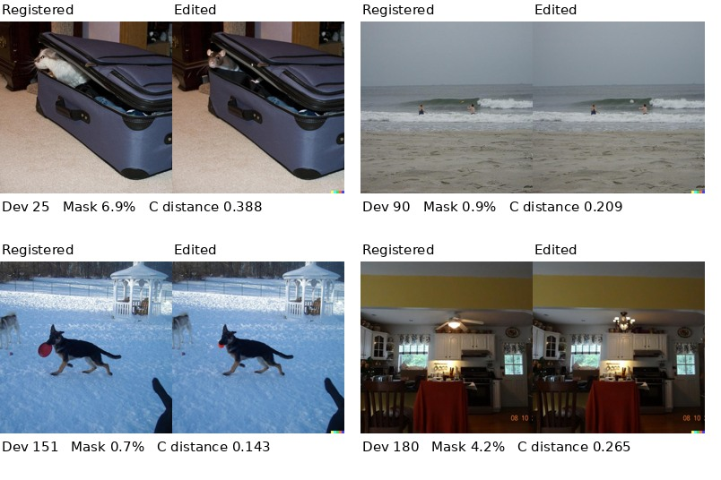

# 第三阶段实验报告 · 局部语义能识别主体替换吗？

**局部 DINOv2 在独立确认的 16 组物体替换中识别了 12 组，RGB 局部统计识别了 0 组。剩下 4 组漏检的编辑区域都不到画幅的 7%。密钥投影没有带来可观察的识别收益。** 所有主方法在独立校准集的合法通过率均为 95%。再把它们在另一批 SD2.1 图像上的实际通过率精确对齐至 95%，局部 DINOv2 仍识别 11/16，密钥投影识别 10/16，RGB 局部统计仍识别 0/16。

## 配对、阈值和扩样依据

沿用第二阶段的 24 张校准图（12 个提示词）、40 张留出登记图及其 40 张供体（20 个提示词，每词两个种子）。五种合法编辑等权，包括 JPEG 质量 58、高斯模糊半径 8、噪声标准差 0.04、中心裁剪保留一半面积、缩放到原面积的 70%。每种方法独立取校准集 120 个合法分数的第 114 个为阈值，分数越小越容易通过。632 个可直接对照的 RGB 分数与第二阶段逐一吻合。[第二阶段报告](../rgb_moments_phase2_20261120/report.md) · [冻结方案](protocol.md) · [各方法阈值](thresholds.json)

Pilot 使用另一批 12 张归档生成图、原有 MagicBrush 的 4 对和颜色迁移的 4 对。预设扩样条件为 C 在 60 次合法编辑中通过至少 54 次，同时比 A 多识别至少 2 个主体替换。实测通过 **59/60**，主体替换误收由 **4/4 降为 0/4**，因此启动扩样。确认集保留了原有 MagicBrush 的另 4 对，并加入 12 个按作者编辑指令预选的不同场景，共 **16 对**。颜色迁移用余下 4 对确认。Pilot 和确认阶段的样本、逐图分数分别保存。这里的独立性针对本阶段阈值和扩样决策；第二阶段已评估过原有图像的 RGB 指标。[Pilot 决策](pilot_decision.json) · [新增图像、指令及校验值](additional_manifest.json)

语义模型使用 249 已有的 DINOv2-giant，ViT-g/14，1536 维。两阶段均在空闲 GPU 4 上推理，未训练模型或重新生成图像。输入为完整画幅缩放至 224 × 224，沿用模型输入通道归一化。B 至 E 同时登记完整视图和预先指定的 50% 面积中心视图，查询只编码完整画幅，取与两个登记视图较接近的距离。这个先验适用于本实验的中心裁剪，任意位置的裁剪仍待测试。[DINOv2 作者实现](https://github.com/facebookresearch/dinov2) · [本地模型哈希](model.sha256) · [评分代码](score.py)

## 五种方法的独立测试

| 方法 | SD2.1 合法通过 /200 | 主体替换误收 /16（95% 区间） | 颜色迁移误收 /4 | 同提示词异种子误收 /40 | 供体误收 /40 |
|---|---:|---:|---:|---:|---:|
| A　RGB 4×4 局部均值和方差 | 194（97%） | 16（100%，79.4–100%） | 2 | 6 | 13 |
| B　DINOv2 全局 CLS 余弦距离 | 185（92.5%） | 9（56.3%，24.4–84.8%） | 1 | 16 | 12 |
| **C　DINOv2 局部对应区域** | **186（93%）** | **4（25%，4.9–58.4%）** | **0** | **0** | **0** |
| D　RGB 局部与 DINOv2 局部联合 | 187（93.5%） | 5（31.3%，7.8–64.7%） | 0 | 0 | 0 |
| E　密钥控制的 64 维局部投影 | 186（93%） | 6（37.5%，11.3–70.4%） | 0 | 0 | 0 |

C 将图像的 16×16 个 patch token 汇成 8×8 个区域，比较相同位置的余弦距离，取差异最大的四格求平均。D 取经各自阈值归一化后的 A、C 分数最大值，再用相同校准集定阈值。供体是第一阶段为登记图提供 RGB 目标的另一张图。颜色迁移以作者配对的颜色参照图登记，再核对保留另一张图内容的迁移结果。[颜色迁移样本来源](https://github.com/luanfujun/deep-photo-styletransfer/tree/4801fa2dca2e2b52847c377f451246a39eae154a/examples)

在相同 16 对主体替换上，C 拒绝了 A 放行的 12 对，反向为 0 对，双侧精确 McNemar 检验 p=0.00049。C 比 B 多识别 5 对，具体为 6 对仅 C 识别、1 对仅 B 识别，p=0.125。局部方案相对 RGB 的收益清楚，相对全局 DINOv2 的差异仍需更多独立场景。第二阶段原有 8 对单独复算，A、B、C、D、E 分别误收 **8、2、2、2、2 对**；其中 4 对参加了 Pilot。全新的 12 对上分别误收 **12、8、2、3、4 对**。[逐个主体的分数与判定](subject_scores.csv) · [配对统计](paired.json)

区间沿用第二阶段的双侧 Chernoff 界，以提示词或不同公开场景为独立单位，条件于冻结阈值。40 次同词异种子的双向比较共用 20 个提示词，C 的 0/40 对应 0–16.8%；供体也是 0/40、0–16.8%。颜色迁移确认集只有 4 对，0/4 对应 0–60.2%。合并 Pilot 与确认后，原有全部 8 对迁移样本中，A 误收 6/8，B 误收 1/8，C、D、E 都为 0/8。这是对已有公开源图和参照图的迁移检验。[各条件完整计数、分母和区间](comparison.csv)

### 实际合法通过率也取相同值时

主结果采用预先冻结的阈值。为检验 93% 与 97% 的留出通过率差异能解释多少收益，补做一次敏感性分析：各方法仅使用 200 次 SD2.1 留出合法分数设阈值，均精确放行 **190/200**，然后核对完全独立的 16 对 MagicBrush 图。A 至 E 依次误收 **16、9、5、5、6 对**。C 相对 A 的误收率降低 **68.75 个百分点**。此附加阈值使用了 SD2.1 留出合法样本，主表仍采用先前冻结的阈值。[精确对齐 95% 的对照表](matched95.csv)

## 合法编辑的代价

| 合法编辑（每类 40 张） | A | B | C | D | E |
|---|---:|---:|---:|---:|---:|
| JPEG | 40 | 40 | 40 | 40 | 40 |
| 强模糊 | 40 | 25 | **26** | 32 | 26 |
| 噪声 | 40 | 40 | 40 | 40 | 40 |
| 中心裁剪 | 34 | 40 | **40** | 35 | 40 |
| 缩放 | 40 | 40 | 40 | 40 | 40 |

C 在 SD2.1 留出集上的 **14 次合法误拒都来自强模糊**。D 多放行 6 张模糊图，同时少放行 5 张裁剪图，并多误收 1 对主体替换。为区分检测到主体变化与对公开图像普遍拒绝，另对 16 张 MagicBrush 原始登记图施加相同五种合法编辑。A 和 C 均通过 **77/80**，而对同一批原图的替换结果分别只拒绝 0/16 和 12/16。在 4 张颜色参照图自身的 20 次合法编辑中，C 通过 17/20。

## 收益来自哪些特征

每项消融使用同一预训练模型、同一校准集和独立阈值。以正确密钥比较不同内容，所有列的分母与主表一致。

| 语义表示或评分方式 | 合法通过 /200 | 替换误收 /16 | 同词误收 /40 | 供体误收 /40 |
|---|---:|---:|---:|---:|
| B，全局 CLS | 185 | 9 | 16 | 12 |
| 区域 token 汇成单个均值向量 | 187 | 16 | 25 | 19 |
| 保留位置，64 格距离全部平均 | 187 | 16 | 0 | 0 |
| 取消位置约束，双向最近邻取最大差异四格 | 185 | 6 | 0 | 1 |
| **C，保留位置并取最大差异四格** | **186** | **4** | **0** | **0** |
| C 仅登记整图 | 194 | 12 | 4 | 6 |

**最大的差异来自怎样汇总局部变化。** 即使保留区域位置，平均全部 64 格也误收了 16/16；关注变化最大的四格后降至 4/16。仅取消格子间的位置约束，误收从 4/16 回升至 6/16，因此这批样本中空间位置的额外贡献小于局部差异汇总的贡献。两种匹配改变了对应方式，该差异不宜解释为精确的独立因果效应。

单视图 C 为容纳裁剪将校准阈值放宽至 0.6970，加入中心登记视图后阈值为 0.4465。相应地，留出裁剪从 35/40 升到 40/40，强模糊从 39/40 降到 26/40。主方法的主体识别收益同时依赖局部特征、评分方式和已知编辑条件；仅换语义编码器不能复现全部改善。

## 密钥投影有没有真实收益

E 对每条登记记录用 HMAC 派生可重复的 1536→64 维高斯投影，同一登记与查询用同一矩阵，然后沿用 C 的局部距离。对照包括同分布、同维度的公开投影，另外四把独立实验钥，以及保留全部维数的带符号坐标置换。这里使用公开可复算的实验钥检验机制，未测量部署密钥的保密性。

| 在同一批图像上的检验 | 观察 |
|---|---|
| 原始 C 与主钥 E | 主体替换误收 4/16 与 6/16。E 多放行 2 对，没有额外识别 C 放行的替换。主体分数的 Spearman 相关为 0.932 |
| 同维公开投影与主钥 E | 均误收 6/16。两种投影各自独有的误收均为 2 对；公开投影与 E 的合法通过数也同为 186/200 |
| 五把实验钥分别校准 | 替换误收依次为 6、5、5、5、5 对，合法通过为 186、182、186、181、185 次。各把钥的校准通过率均为 95% |
| 完整维数正交变换 | 全部 784 个图像比较中，C 的距离最多变化 0.00000102，判定变化 0 次 |
| 登记与查询使用不同钥 | 40 张原图通过 0/40，200 次合法编辑通过 0/200。用正确主钥时分别为 40/40 和 186/200 |

实验支持两项不同结论。第一，错钥拒绝说明核验依赖一致的投影坐标系。第二，针对不同内容的正确钥核验，公开投影与密钥投影表现相近；本轮未观察到额外的抗替换收益。64 维表示有实际的压缩价值：按两个登记视图、64 格、每值 float32 计算，局部描述从 768 KiB 降至 32 KiB，未计索引和密钥元数据。要把压缩以外的收益称为安全增益，还需明确攻击者能访问什么，以及真实密钥与发行记录如何管理。

## 四个漏检样本

下面是 C 在独立确认中误收的全部四对，左为登记图，右为编辑图。编号 25 是行李箱中的猫换成鼠；90 和 151 都是把飞盘换成球；180 是把吊扇换成吊灯。四对的作者编辑掩膜占画幅 **6.9%、0.9%、0.7%、4.2%**，中位数 2.6%。正确识别的 12 对占比中位数为 18.4%，其中也有只占 5.1% 的成功样本。编辑区面积与漏检有关，但本轮样本不能给出可靠的面积界限。掩膜按发布 RGBA 文件的透明区域计算，仅用于事后诊断。[掩膜数据与哈希](mask_sizes.csv) · [MagicBrush 数据来源](https://huggingface.co/datasets/osunlp/MagicBrush)

## 研究判断与复核

**局部语义显著缓解了 RGB 对主体替换的盲点，但小目标和强模糊仍是两项明确的失败条件。** 后续最有价值的检验，是在独立场景中按编辑区域面积分层，比较提高局部特征分辨率后的小目标识别收益，并同时守住强模糊的合法通过率。当前保留 C 为主对照，E 作为压缩与错钥一致性对照。此次测量覆盖固定公开编辑与离线图像配对，尚未验证端到端密钥水印的安全性。

完整运行保存在 249 的 `/data0/liyanlei/watermark_research/runs/local_semantics_phase3_20261120`，新增原图、编辑图和掩膜分别位于 `additional/` 与 `masks/`。冻结前后共 784 个图像比较、14,112 条方法分数。复核顺序是用第一阶段已有环境 `envs/semantic_forgery_py310/bin/python -B` 在独立实验目录运行 `score.py pilot`，达标后准备新增固定样本并运行 `score.py test`，以 `summarize.py` 从分数重建表格。运行时设置 `OPENBLAS_NUM_THREADS=1`、`OMP_NUM_THREADS=1` 和 `HF_HUB_OFFLINE=1`。[Pilot 与校准原始分数](pilot_scores.csv.gz) · [留出原始分数](test_scores.csv.gz) · [统计实现](summarize.py)
