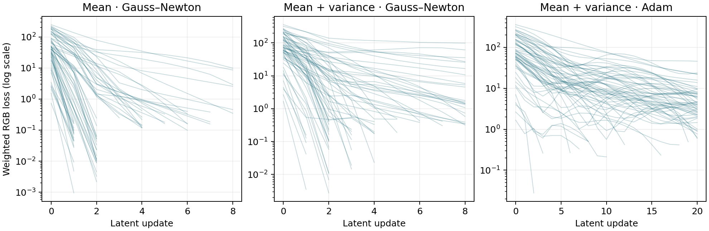
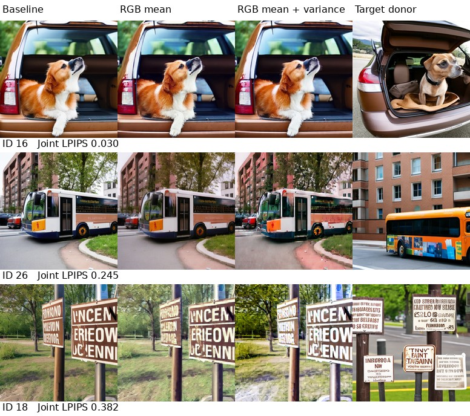

# SD2.1 生成图的 RGB 均值与方差可以控制到什么程度？

在 32 个独立测试提示词、每词两个新种子的配对实验中，末端潜变量引导让 **60/64 张图的三个通道均值同时达标**。同时要求三个均值和三个方差时，阻尼 Gauss–Newton 让 **54/64 张达标（84.4%，按提示词重采样的 95% 区间为 73.4%–93.8%）**，原始 SD2.1 为 1/64。代价是单图从 2.24 秒增至 4.46 秒，相对同种子原图的平均 LPIPS 为 0.245。这个结果支持继续研究统计量的生成控制。全局方差经强模糊后、全局均值经裁剪后的表现，则限制了它们单独承担水印验证的价值。

## 配对设计与判据

使用 249 已有的 SD2.1-base 权重，冻结生成模型，采用 512 × 512、50 步 DDIM、CFG 7.5 和半精度推理。Pilot 按哈希选取 6 个提示词，COCO 和 SDP 各 3 个。独立测试从另一批历史资产选取不同的 32 个提示词，两来源各 16 个。每个提示词分配两个新种子。每个新种子有一张预先指定的供体图，由同一提示词、另一历史种子经原始 SD2.1 生成。取供体的六个统计量作为目标。这样能检验一个提示词下实际出现过的色彩范围，同一提示词的两个新种子也可以有不同目标。任意指定的 RGB 数值以及多个种子共用一个目标的情形仍待验证。[目标与测试提示词](test_sources.json) · [实验协议](protocol.json)

同一样本的各方法直接共用 50 步去噪得到的潜变量。基准分支直接解码。引导分支在最终解码前调节 4 个潜通道增益和一个双线性上采样的 4 × 4 × 4 偏置场，共 68 个可调量。对 VAE 解码后、截到 [0,1] 的图像求梯度。最小化三个均值与目标之差的平方和乘以 2500，再加上三个总体方差与目标之差的平方和乘以方差权重。仅均值组的方差权重为 0，最终联合组为 10000。保留 loss 最小的迭代，量化为 8 位 PNG 后重新测量全部指标。优化阶段接收的供体信息只有六个数值。[生成实现](generate.py) · [冻结测试配置](test_config.json)

MAE 为逐通道绝对误差的平均。均值达标要求 **每个**通道误差 ≤ 0.02（约 5.1 个 8 位灰阶），六项达标还要求 **每个**通道的方差误差 ≤ 0.01（归一化强度的平方）。全部测试样本计入分母。置信区间用 COCO 和 SDP 分层、以提示词为单位进行 5000 次配对 bootstrap，同一提示词的两个种子始终一起抽样。[评价实现](quality.py) · [指标及配对差的区间](uncertainty.json)

## Pilot 怎样决定独立测试配置

两轮 Pilot 使用相同的 12 个样本，两轮基准 PNG 逐一哈希一致。第一轮联合控制中，方差权重从 2500 增至 10000，Adam 10 步的六项达标数从 2 增至 5，Gauss–Newton 4 步从 7 增至 9。第二轮沿用较高方差权重，Gauss–Newton 允许最多 8 次更新，单次参数最大变化由 0.25 放宽到 0.35，达到 10/12，平均 4.11 秒。Adam 允许最多 20 次更新，达到 8/12，平均 4.63 秒。仅均值的 Gauss–Newton 8 步达到 11/12 个均值目标。由此选定联合 Gauss–Newton 为主方法，保留仅均值组和联合 Adam 作为对照。独立测试沿用第二轮配置和同一组容差。[第一轮逐图结果](pilot_quality.json) · [第二轮逐图结果](refine_quality.json)

## 独立测试的目标误差与效率

| 方法 | 均值 MAE | 方差 MAE | 三均值达标 | 六项达标 | 秒/图 |
|---|---:|---:|---:|---:|---:|
| 原始 SD2.1 | 0.07726 | 0.02591 | 3/64 | 1/64 | 2.24 |
| 仅均值 · Gauss–Newton | **0.00455** | 0.02563 | **60/64** | 6/64 | 3.10 |
| 均值与方差 · Gauss–Newton | 0.00772 | **0.00443** | 57/64 | **54/64** | 4.46 |
| 均值与方差 · Adam | 0.01079 | 0.00702 | 43/64 | 28/64 | 4.70 |

联合 Gauss–Newton 相对联合 Adam 的六项达标率提高 **40.6 个百分点**，配对 95% 区间为 +28.1 至 +53.1 个百分点。按整批生成时间除以达标图数，每张六项达标图耗时 **5.29 秒对 10.73 秒**。单次生成平均快 0.23 秒，配对区间为 −0.51 至 +0.04 秒。效率证据主要来自达标数。计时为 GPU 同步墙钟时间，各分支均计入相同的完整去噪时间及各自的反馈、解码时间，排除加载和磁盘写入。[逐图误差与计时](test_quality.json)

联合 Gauss–Newton 在 COCO 上达标 31/32，在 SDP 上达标 23/32。回看其 10 张失败图，基准图到供体的方差 MAE 中位数为 0.0404，54 张成功图为 0.0182。相应的均值 MAE 中位数为 0.0914 和 0.0631。这提示需要在更大样本上按初始目标距离分层评估。图中每条线对应一个测试样本，横轴为实际更新次数，纵轴为各目标自己的加权 loss，提前终止保留在真实步数处。[逐步记录与图像哈希](records.json.gz)

## 画面变化、文本一致性与多样性

| 方法 | 同种子图像 LPIPS ↓ | 同种子图像 CLIP 余弦 ↑ | 文图 CLIP 余弦 ↑ | 同词异种子图像 LPIPS |
|---|---:|---:|---:|---:|
| 原始 SD2.1 | 0 | 1.0000 | 0.2688 | 0.7217 |
| 仅均值 · Gauss–Newton | 0.1914 | 0.9397 | 0.2644 | 0.7285 |
| 均值与方差 · Gauss–Newton | 0.2449 | 0.9260 | 0.2648 | 0.7354 |
| 均值与方差 · Adam | 0.2046 | 0.9467 | 0.2664 | 0.7259 |

同种子两列衡量与配对基准图的接近程度。联合 Gauss–Newton 比仅均值多出 0.0535 LPIPS，配对 95% 区间为 +0.0318 至 +0.0740。联合组相对基准的文图 CLIP 变化为 −0.0040，区间为 −0.0089 至 +0.0009。同提示词两种子间 LPIPS 变化为 +0.0136，区间为 −0.0051 至 +0.0327。每个种子有各自的供体目标，因此这项多样性结果只覆盖这种分配方式；主观自然度尚缺盲评。[质量与多样性原始测量](test_quality.json)

下图按联合组相对基准的 LPIPS，选取 COCO 子集中最小、中间顺位、最大的三个样本。从左到右为基准、仅均值、联合 Gauss–Newton、目标供体。第一行的狗与车几乎保持原貌，中间一行的公交车和路面明显偏红，最后一行的路牌高光和地面纹理都有可见变化。即使主体仍符合提示词，六项控制也可能带来明显的视觉代价。

| 样本 FID ↓ | 全部生成图对真实 COCO（64 对 256） | 仅 COCO 提示词对真实 COCO（32 对 256） | 全部生成图对配对基准分布（64 对 64） |
|---|---:|---:|---:|
| 原始 SD2.1 | 252.38 | 278.99 | 0.00 |
| 仅均值 · Gauss–Newton | 252.92 | 278.41 | 69.15 |
| 均值与方差 · Gauss–Newton | 254.05 | 279.96 | 83.06 |
| 均值与方差 · Adam | 251.11 | 277.30 | 61.23 |

所有方法共用从 COCO test2017 按哈希选出的 256 张真实图，使用标准 Inception pool3 的 2048 维特征。联合 Gauss–Newton 与基准的混合提示词 FID 差为 +1.67。有限样本和 SDP 与真实 COCO 的域差异会影响绝对 FID，这个差值只作描述，无法据此判定总体画质相当。配对 LPIPS 与图例更直接地显示生成图发生的变化。[FID 实现与权重](https://github.com/mseitzer/pytorch-fid) · [本次测量](fid.json) · [参考图清单](real_reference.json)

## 合法编辑后的保留与同提示词碰撞

每种编辑独立施加于原始生成图。JPEG、模糊和噪声使用 WAVES 作者实现，相对强度均为 0.4，分别对应 JPEG 质量 58、高斯模糊半径 8、归一化强度噪声标准差 0.04。中心裁剪保留原面积的 50%，缩放到原面积的 70%，均用 Stable Signature 作者实现。各条件沿用原阈值。[WAVES，ICML 2024](https://proceedings.mlr.press/v235/an24a.html) · [Stable Signature，ICCV 2023](https://openaccess.thecvf.com/content/ICCV2023/html/Fernandez_The_Stable_Signature_Rooting_Watermarks_in_Latent_Diffusion_Models_ICCV_2023_paper.html)

| 联合 Gauss–Newton | 均值绝对漂移 | 方差绝对漂移 | 自己的均值通过 /64 | 自己的六项通过 /64 | 原先达标且仍六项通过 /54 | 同词另一目标六项误收 /64 |
|---|---:|---:|---:|---:|---:|---:|
| 原图 | 0 | 0 | 57 | 54 | 54 | 0 |
| JPEG | 0.00050 | 0.00067 | 57 | 52 | 52 | 0 |
| 强模糊 | 0.00028 | 0.02091 | 57 | 10 | 10 | 0 |
| 噪声 | 0.00189 | 0.00123 | 56 | 53 | 53 | 0 |
| 中心裁剪 | 0.03729 | 0.00742 | 8 | 7 | 6 | 1 |
| 缩放 | 0.00191 | 0.00151 | 56 | 52 | 52 | 0 |

模糊后均值通过数保持 57，方差平均漂移却达到容差的两倍以上，原先达标的 54 张只保住 10 张。裁剪则改变参与统计的像素集合，均值漂移达到 0.03729，原先达标的 54 张只保住 6 张。仅均值组的三均值通过数在强模糊前后均为 60/64，裁剪后为 12/64。选择均值能缓解模糊的影响，裁剪仍是主要障碍。[四个方法的完整编辑结果](test_stability.json) · [1536 条逐图逐条件记录](test_edits.csv.gz)

每个提示词有两个目标和两张各自独立引导的图。32 对供体目标中，2 对的三均值已落在彼此容差内，0 对的六项同时接近。联合组的干净生成图去核对同词另一种子的目标，单看均值误收 4/64，联合误收 0/64，裁剪后的联合误收为 1/64。直接比较两张干净输出图的实测统计时，三均值碰撞 2/32 对，六项碰撞 0/32 对。基准图在六项判据下同样有 0/64 次错目标通过，但自己目标的通过数仅为 1/64。解读误收须同时看自己的合法通过率。这里每个提示词只有两个种子，且未经密钥编码，样本量和协议都不足以估计部署所需的低误收率。

## 是否进入第二阶段

**值得进入一个小规模的局部统计可行性实验。** 保留仅均值和联合 Gauss–Newton 两条全局对照。优先验证一个假设：如果统计只取自编辑后仍能对应到原图的区域，裁剪后剩余内容能否保留足够的目标信息？先测区域对应与局部均值的保留率，再检验方差能否提供超出其模糊代价的区分力。这样可以区分失败来自区域丢失、区域匹配错误，还是统计量本身漂移。

进入密钥绑定前，应用独立校准提示词设定合法编辑通过率，再在更多同提示词种子上比较相同通过率下的误收，同时记录未编辑达标率和配对画质损失。本阶段证明了特定自然目标可由潜变量引导写入，尚无密钥载荷、端到端水印验证或对 SemBind 的同协议比较。

完整运行在 249 的 `/data0/liyanlei/watermark_research/runs/rgb_moments_phase1_20261120`。实际生成使用 GPU 4、7。两轮 Pilot 与独立测试共保存并核对 388 张全分辨率 PNG、88 份样本记录和 1536 条测试编辑记录。Git 目录包含紧凑逐步数据、来源、配置、图表、代码及校验摘要，全分辨率图像和 FID 特征保存在服务器。[复核入口](reproduce.md) · [文件与模型校验摘要](audit.json)
