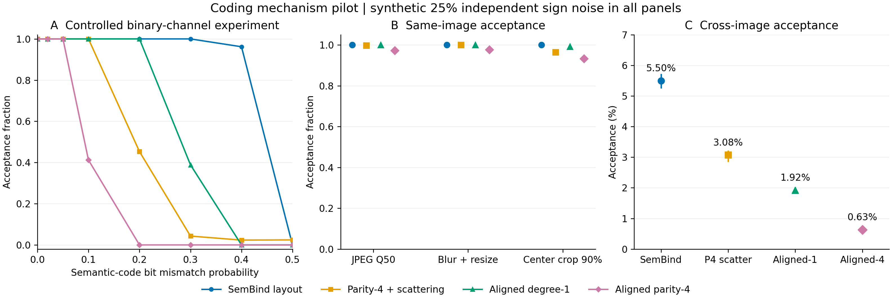

# 解码感知内容绑定：机制验证与研究评估

日期：2026-11-09（Asia/Shanghai）。基线仓库版本：`613f0c6278ed2fe4661d009956283595d154f043`。

## 研究结论

**值得继续验证的主线是：将来源认证所需的内容差异，与水印纠错应消除的传输误差分开编码。** 已实现码字对齐的稀疏奇偶绑定原型，完成代数测试、真实语义特征提取和配对信道实验。端到端小样本结果见下文。现有证据不支持“已超过 SemBind 等先进防御”的结论。

这个问题的核心是认证目标：两幅图都描绘滑雪，并不意味着它们具有相同来源。语义不变性有助于抵抗失真，也可能容许同类不同实例之间的水印迁移。合理的论文应明确哪些变换属于允许的内容等价类，并测量该边界，不能将所有特征接近都称作漏洞。

## 1. 仓库与资产审视

| 核查对象 | 可追溯的观察 | 研究含义 |
|---|---|---|
| 普通 GS 的既有 `analysis_s30.json` | 实际 `n=30`；30 步伪造 30/30 通过，平均 BA=0.822786，平均 PSNR=24.0397 dB；非对角身份检查 870/870 通过 | 属于共享身份开发实验。入口摘要中的“48/50、0.8588、29.01 dB”没有在该指定结果文件中得到支持 |
| 既有 SemBind `summary.json` | 已完成 30 对，2 对通过，平均 BA=0.536198，最大 0.984375 | 通过率为 2/30。脚本未逐对记录合法参考图的检测有效性，不能当成完整安全—鲁棒性主表 |
| SemBind 实际模型调用 | `sembind_pairs.py` 使用 `design['proxy']` 创建生成与反演 provider | 该批实际采用 SD2.1；不能根据普通 GS 目标为 SDXL 而将该批写成 SDXL |
| 官方 masker 的 20 图结果 | 跨图平均距离 501.705/1024，最小 29；失真平均距离 20.55/1024 | 整体接近随机，存在近邻尾部；不支持整体哈希坍缩的判断 |
| 最小距离的图片内容 | 29 位差异的一对都描绘滑雪；100 图中最小 12 位差异的一对都描绘滑板 | 是同类不同实例的诊断证据；不等于证明无关语义碰撞，视觉检查也不替代盲标注 |
| 自适应攻击证据 | SemBind 最终出版版 E.1/Table 17 已有代理 masker 的端到端评估 | 尚未完成论文标准自适应基线复现，不能声称具有对应防御效果 |
| GS 工作点 | 保持严格 `BA > 181/256`，即至少正确 182 位 | 理想独立公平位下尾概率约 `5.6348e-12`；这不是项目实测 FPR，也不是多用户检索 FPR |

仓库已有的 Geometry 数值实现、PGID 小样本和 SEAL 源码审计值得复用，但其攻击预算、模型和最终判定契约不同。AUC、单图 BA、仿真实验、真实攻击接受率应分别记录。

249 上 0–5、7 号 GPU 在本次检查时均有其他任务，6 号明确排除。服务器只用于读取已有资产、低优先级 CPU 特征核验和 CPU 权重转换；新 GPU 实验使用本机 RTX 4070 Laptop 8GB，绑定 UUID。未终止他人进程。

## 2. 相关工作与创新边界

| 工作 | 已核对的相关机制 | 对本研究的约束 |
|---|---|---|
| [SemBind，ICML 2026](https://proceedings.mlr.press/v306/zhang26hj.html) | 语义掩码与潜变量绑定，最终版包含代理 masker 端到端评估 | 需要比较相同工作点，并补足合法图、完整预算与新密钥 |
| [CoverLock，2026 预印本](https://arxiv.org/html/2609.32241v2) | 式 8–9 已将内容码 XOR 到消息，再交给水印编码器；使用 DINOv2 patch 特征 | “先包装消息再纠错”本身已有先例；码字对齐不能单独宣称首创 |
| [SEAL，ICCV 2025](https://arxiv.org/html/2503.12172v3) | 多位 SimHash、密钥化块采样与块匹配计数 | 分块、密钥化、内容哈希已有；需强调实际解码器的错误结构与可验证边界 |
| [Gaussian Shading++](https://arxiv.org/abs/2504.15026) / [Gaussian Shannon](https://arxiv.org/abs/2603.26167) | 软判决、纠错和通信信道建模 | “使用软解码或 ECC”不构成充分创新 |
| [Sign Clamping，2026 预印本](https://arxiv.org/html/2610.40204v1) | 幅值加权、BCH/Chase、CLIP/RS 模糊承诺 | 简单增加纠错与内容承诺已有直接重叠 |
| [CSGuard，2026 预印本](https://arxiv.org/html/2605.01479) | 用秘密矩阵约束生成与反演过程 | 密钥化轨迹约束已存在，单遍或秘密投影需单独证明贡献 |
| [Geometry，ICML 2026](https://proceedings.mlr.press/v306/lee26bm.html) | 分析代理—目标反演的结构几何失真 | 真实误差不应仅用独立翻转近似；最终实验需回到实际反演 |
| [CSI，WWW 2026](https://arxiv.org/html/2602.21593v1) | 保持语义连贯的内容注入攻击 | 同类、关系改变和局部编辑应列入测试；检测反馈预算须单列 |
| [PP-Mark](https://arxiv.org/html/2610.41170v1) | 将统计检测与嵌入过程证明组合 | 有附带证明的协议与仅凭图像的验证不宜直接并表 |
| [IRIS](https://arxiv.org/abs/2608.03539) | v2 已撤回，早期材料提出晚期视觉语义绑定 | 可记录概念重叠，不能作为有效性已确认的最新基线 |

还核对了 SWIFT、密钥随机化、正确密码学使用与动力学水印的原始来源。检索包括 OpenAlex 和论文／出版社页面，附 16 条已做字段校验的引用。搜索没有发现相同实现，不等于证明全球首创。

## 3. 一个统一机制：使语义差异保留在码字层

设 GS 消息有 256 位，每位重复 64 次。`m` 是消息，`c(x)` 是语义码，`E` 是重复编码。

SemBind 的实现先将 1024 位语义码平铺、全局置换，再作用到 16384 个潜变量符号。假设语义不匹配率为 `d`，独立传输符号错误率为 `e`，在理想散布近似下，单坐标综合错误率为：

`q = e + d - 2ed`。

只要 `q < 1/2`，增大重复次数会使多数投票更容易恢复原消息。这有助于正常鲁棒性，也可能把伪造图的语义差异纠正掉。该式的独立性只用于分析，不是对真实扩散误差的断言。

原型先构造 256 位的内容码 `c_K(x)`，使同一消息位的 64 个副本共享一个语义符号：

`z_sem = sign(E(c_K(x_aux))) * z_GS`。

于是，在没有恰好平票时，重复译码对 XOR 的等变性给出：

`Decode(E(m XOR c_ref) XOR noise) XOR c_query`

`= m XOR Decode(noise) XOR c_ref XOR c_query`。

传输噪声由重复纠错处理，内容差异保留在消息层。64 次重复的平票规则沿用原实现：恰好 32 个 1 时解为 0；测试覆盖了该边界。

候选使用由密钥确定的 1024 位分组，每组 4 位取奇偶，输出 256 位。每个源位恰好使用一次。独立语义翻转近似下，其差异概率为：

`d_4 = [1 - (1 - 2d)^4] / 2`。

这提供了一个可解释的敏感度参数：放大内容差异，也放大失真带来的变化。它是稀疏线性码，不是密码学抗碰撞哈希。底层特征完全相同、同类实例混淆、公共骨干自适应对齐都没有被这一代数构造自动解决。

## 4. 已完成的机制实验

### 4.1 数据、协议与可复现性

- 从服务器复用官方 DINOv2-giant 和 masker；本机 float32 提取 100 张自然图片的原图、JPEG Q50、半径 1 模糊加 0.8 缩放、90% 中心裁剪，以及 30 对已有参考图／伪造图，共 460 条记录。
- 服务器 CPU 与本机 GPU 的前 120 条语义码逐位一致，最大 Hamming 差为 0。
- 自然图片按文件名固定分为前 20 张开发、后 80 张本次 pilot 留出。全部来自历史研究资产，不是可用于最终论文确认的全新测试集。
- 工作点固定为严格 `BA > 181/256`。四个对照共享消息、模拟噪声和配对；使用 5 个诊断密钥。它们是公开可复现的开发密钥，不能冒充秘密部署密钥。
- 所有信道噪声仍为模拟；未使用这些数字代替实际 Imprint/Reprompt 结果。

### 4.2 真实语义码 + 模拟信道

下表为预声明主工作点：25% 独立符号翻转。正例每项 80 图 × 5 个密钥；跨图为同一批 80 图构成的 3160 个无序配对 × 5 个密钥。图片复用使配对相关，因此不按 15800 个独立样本计算置信区间。

| 方法 | 跨图通过率 ↓ | JPEG Q50 正例通过率 ↑ | 模糊缩放正例通过率 ↑ | 中心裁剪正例通过率 ↑ |
|---|---:|---:|---:|---:|
| SemBind 排列 | 5.50% | 100.00% | 100.00% | 100.00% |
| 奇偶 4 + 全局打散 | 3.08% | 99.75% | 100.00% | 96.50% |
| 码字对齐，1 位映射 | 1.92% | 100.00% | 100.00% | 99.25% |
| 码字对齐，奇偶 4 | 0.63% | 97.25% | 97.75% | 93.25% |

两个干预分别改善跨图拒绝；较强的内容敏感性损失了裁剪鲁棒性。候选不能宣称 Pareto 支配。整体三种正例的平均下降约 3.92 个百分点，但裁剪一项下降 6.75 个百分点，必须作为主要限制保留。

在完全合成的机制实验中，语义位差异 20%、信道错误 25% 时，SemBind 排列 1024/1024 通过，码字对齐奇偶 4 为 0/1024；语义位差异 2% 时，两者均为 1024/1024。这仅证明受控模型内的机制，不是现实伪造防御率。

图中误差线为 5 个诊断密钥结果的最小值—最大值，不是置信区间。所有面板均使用合成信道；图像内容真实与攻击过程真实是两件不同的事。

## 5. SD2.1 生成—验证闭环

同一 SD2.1 快照、512×512、50 步 DDIM 生成／反演、生成 CFG 7.5、空提示 CFG 1 反演；扩散模型 fp16，语义提取 float32。每个方法用相同的提示词、辅助图、消息、密钥材料和初始潜变量幅值；绑定模式改变参考图。每个参考只输出一个固定提示词的攻击候选，无分数择优。这里是本项目的 DDIM 适配，**不是官方精确反演复现**。

| 方法 | 原图通过 ↑ | JPEG Q50 通过 ↑ | 跨类别 Reprompt 通过 ↓ | 同类不同实例 Reprompt 通过 ↓ |
|---|---:|---:|---:|---:|
| SemBind-DDIM 适配 | 5/5 | 5/5 | 0/5 | 5/5 |
| 码字对齐，奇偶 4 | 5/5 | 4/5 | 0/5 | 2/5 |
| 码字对齐，奇偶 2（探索性敏感度实验） | 5/5 | 5/5 | 未测试 | 3/5 |

奇偶 2 是在观察到奇偶 4 的 JPEG 误拒后进行的开发性敏感度实验，新生成其对应水印图，未调整原 GS 阈值。它不属于预注册确认结论。每列仅 5 个提示词，不能据此估计小概率失败、声称显著优越或宣称 SOTA。数据包保留每图 BA、语义距离、候选哈希和所有图像。

降低奇偶度后，这 5 张图的 JPEG 通过数从 4 提升至 5，但同类候选接受数从 2 增至 3。这支持敏感度—鲁棒性之间存在取舍；没有出现同时解决两者的证据。后续方法应围绕允许失真与来源变化的可分性设计，不能仅继续调奇偶度追逐小样本分数。

这些计数只表示验证器接受；同类提示词是否充分改变实例、是否保持预期内容，需要独立盲标。本文附图用于检查，不能代替人工内容标签。测试尚无完整 Imprint 151 步、论文标准自适应基线、其他模型、FID／CLIP／LPIPS 或严格密钥进程隔离。开发密钥可由公开脚本复现，不是秘密部署安全评估。

逐图观察：猫、公交车和列车的主体或场景发生明显变化；水果与帆船候选保留较多布局，且“切片”“搁浅”等提示并未完全实现。因此应分别报告验证器接受和攻击内容达成，不能把本表直接解释为经过语义标注的攻击成功率。

## 6. 创新判断与后续实验门槛

可以继续发展的论文叙事是：**鲁棒水印中，认证错误和通信错误并非同一类错误；底层纠错器可能消除防伪所需的内容证据。** 贡献必须包括实际译码器的机制分析、由该分析推导的码结构，以及在相同合法检出率／内容保真度下的自适应攻击评估。

当前原型适合作为强消融与研究起点。单独使用消息 XOR、稀疏奇偶或更换特征，不足以确认达到顶会创新门槛。与 CoverLock 的关系应正面讨论；其现成思想不能改名后作为首创。

当前工作暂停。恢复后使用已发表论文的标准基线与官方实现，验证以下条件：

1. **正常图稳定性门槛。** 独立提示词与密钥上，先测辅助图→最终图的码漂移、合法图检出和 JPEG／裁剪误拒。未达标则不进行大规模安全宣称。
2. **论文标准 Reprompt 基线。** 遵循官方实现、提示词协议和预算；固定候选并记录哈希，再由评估端检测，内容是否达成须盲标。
3. **完整 Imprint 与论文标准自适应基线。** 使用已发表方法和官方代码，遵循其知识边界及参数；记录强度、失真与查询预算，不自行设计攻击方法。
4. **完整基线。** SemBind 的官方精确反演与本项目 DDIM 适配分开；补 CoverLock 风格绑定、SEAL、PGID、CSGuard 等适用基线；未知判定规则保持未知。
5. **新确认集。** 历史 confirmation100 已被用于审视和开发，正式论文需要未参与方法选择的独立图像／提示词／密钥；同一图多密钥属于重复测量。报告固定 FPR 的正常检出率、伪造接受率、图像质量和 NFE，避免用小样本证明极低 FPR。

没有证据时不保证最终胜过全部方法。目前最有价值的结果是可复现的机制、明确的性能取舍和能够淘汰错误路线的评测条件。

## 7. 文件与运行记录

- 实现：`scripts/defense/codeword_binding.py`；四个针对码结构和解码边界的测试。
- 实验：`extract_semantic_codes.py`、`codeword_channel_pilot.py`、`codeword_diffusion_pilot.py`、`codeword_hard_reprompt_pilot.py`、`codeword_degree2_pilot.py`。
- 预声明协议：`protocols/codeword_binding_pilot_20261109.json` 与 `protocols/codeword_hard_reprompt_20261109.json`。
- 数据包保留逐配对分数、图像哈希、特征、论文元数据与运行 manifest；模型权重不放入代码包。
- 文献发现与引用核验使用 citation-management，作图使用 scientific-visualization；其方法资源在引用文件中以 [Scientific Agent Skills](https://arxiv.org/abs/2609.00065) 记录。它们不是水印方法贡献。
