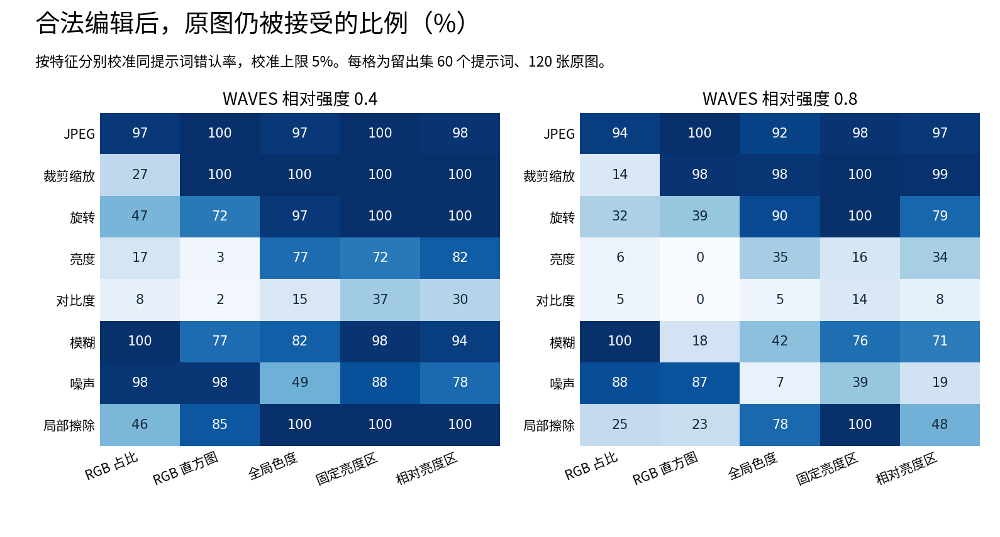

# 颜色统计能否认回同一张生成图？

**亮度分区后的色度分布值得保留为候选指纹。** 从 120 张原图里检索编辑前的来源，全局色度直方图首位命中 82.71%，固定亮度分区 87.45%，相对亮度分区 86.93%。分区对检索有收益。验证身份困难得多：阈值按 95% 合法通过率校准后，两种分区特征在留出集上分别误收 44.38% 和 45.21% 的同提示词另一张图。当前证据支持继续研究颜色信息的区分力，尚不足以把它作为独立的来源凭证。

## 来源和判定

在 249 上读取已有 SD2.1 普通生成图。100 个不同提示词各有两个独立种子，COCO 和 SDP 各 50 个提示词。两图来自同一模型和生成入口，核对了提示词、种子、200 张原图的文件摘要和像素唯一性。两套图均未嵌入本项目水印。每组的两张图都作过查询和登记参考。

每个数据集固定 20 组校准、30 组留出。对每张图使用 WAVES 原码的 JPEG、裁剪缩放、旋转、亮度、对比度、模糊、噪声和局部擦除，相对强度各取 0.4、0.8。相同来源对中的两张图使用相同编辑种子。留出集有 60 个提示词、120 张原图、1,920 个编辑查询。各编辑等权，干净图自比较不计入编辑通过率。原图库是一张图一个参考。[WAVES，ICML 2024](https://proceedings.mlr.press/v235/an24a.html) · [预设协议](../../protocols/color_identity_20261119.json) · [源图清单](sources.json)

每个编辑查询对照自己的原图和同提示词另一种子的原图，分别得到正确距离和错误距离。所有特征使用 Hellinger 距离。每种特征只在校准集定一个通用门限，使编辑查询对错误同提示词参考的接受率至多 5%。留出集按该阈值计算实际合法通过和误收。另按校准集合法通过率至少 95% 定第二套门限。检索指标无需阈值。

| 特征 | 维数 | 合法通过 | 同提示词误收 | 同提示词二选一 | 120 图首位命中 | 高通过率门限下的合法通过 / 同提示词误收 |
|---|---:|---:|---:|---:|---:|---:|
| RGB 总强度占比 | 3 | 50.16% | 0.31% | 95.62% | 66.72% | 95.68% / 42.81% |
| 全局 RGB 直方图 | 96 | 56.41% | 5.36% | 90.05% | 64.06% | 94.38% / 83.39% |
| 全局色度直方图 | 144 | 66.41% | 2.14% | 96.30% | 82.71% | 94.27% / 46.67% |
| 固定亮度分区色度 | 432 | 77.34% | 5.89% | 96.98% | 87.45% | 94.06% / 44.38% |
| 相对亮度分区色度 | 432 | 71.15% | 3.91% | 97.71% | 86.93% | 94.74% / 45.21% |

全局 RGB 直方图对每个通道取 32 个等宽箱。全局色度使用每个像素的 R/(R+G+B)、G/(R+G+B) 构造 12×12 联合直方图，纯黑像素指定为中性色度。两种分区保留相同的色度箱。固定分区以 85 和 170 为八位亮度边界；相对分区按每张图的像素亮度排序分成等量三组，边界同亮度像素按占比拆分。所有方法均保留作者编辑产生的黑色填充区域。

## 对后续研究有影响的差异

- **先分清检索和验真。** 相对分区能在两张同提示词图里选对 1,876/1,920 次；在指定来源的阈值验证中，正确参考通过 1,366/1,920，错误参考通过 75/1,920。参照图只有这两张时，距离稍小就能选对；验证器面对一项独立来源声明时，还需要绝对距离足够小。
- **分区的检索增益可以配对重现。** 相对全局色度，两种分区的 120 图首位命中分别提高 4.74 和 4.22 个百分点。按提示词分层配对 bootstrap，95% 区间分别为 [+3.33, +6.25]、[+3.02, +5.42] 个百分点。区间以本图库和冻结阈值为条件；维数随分区从 144 增至 432，尚不能断言等存储预算下仍有同样增益。
- **JPEG 和裁剪有利，强对比度是共同短板。** 强度 0.8 时，固定/相对分区在 JPEG 下通过 118/120、116/120，裁剪缩放下为 120/120、119/120。对比度因子 1.8 时只剩 17/120、10/120。强亮度下相对分区通过 41/120，固定分区 19/120；强局部擦除则为 58/120、120/120。相对分区在全局变亮时仍可能丢失区分力，原因需另行验证。
- **误收率随来源和编辑改变。** 固定/相对分区的留出误收分别为 5.89%（95% 区间 2.34%–10.26%）、3.91%（1.30%–7.24%）。查询改为未编辑的另一种子时，同一门限误收 12/120、8/120；两方向共享 60 对图。相对分区对编辑查询的误收为 COCO 5.94%、SDP 1.88%。本轮数据只支持小样本筛选，不能保证部署误收率。

优先保留固定和相对亮度分区作后续机制比较，全局色度作消融对照。决定是否进入生成引导阶段的关键，是能否在未参与选择的新提示词上改善强光度编辑的通过率，同时守住同提示词误收与画质。这里所有结果都是纯图像指纹测量，使用 249 CPU 完成，未调用生成模型、训练、攻击程序或水印检测器。

[逐查询分数（压缩 CSV）](scores.csv.gz) · [逐条件、分数据集结果和区间](summary.json) · [冻结阈值](thresholds.json) · [运行回执与输入哈希](complete.json) · [测量代码](../../scripts/defense/color_identity_probe.py) · [独立汇总核对和作图](../../scripts/defense/report_color_identity.py)
