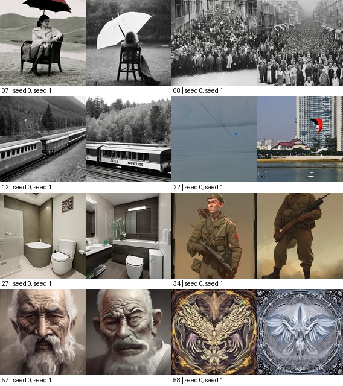

# 同提示词误收与强模糊拒绝的逐例诊断

在独立确认集的 114 次同提示词误收中，**108 次由全局色度相似主导，6 次由明暗布局相似主导**。误收集中在 8 对图。强模糊下被拒的 45 张原图中，颜色单独检索只找回 14 张，布局单独检索找回 42 张。色度更容易失去辨别原图的能力，粗布局仍保留了多数原图的相对身份信息。绝对通过门限同时受两项影响。

## 8 对原图为什么误收

每行是同一个提示词、两个种子。每组有 32 次编辑查询机会（2 张图、8 类编辑、2 档强度）。颜色和布局各自的「下尾比例」是校准错误配对中有多少比例的距离小于等于当前距离，沿用原验证器的加一平滑。越小表示这一项越相似。表内两列百分比均是该组**实际误收查询**的中位数。

| 编号与提示词概要 | 误收 / 32 | 干净两图已互相通过 | 色度下尾 | 布局下尾 | 原图和逐条分数给出的解释 |
|---|---:|:---:|---:|---:|---|
| 07　撑伞坐在椅上的女子 | 4 | 否 | 0.078% | 71.39% | 两图分别是黑伞和白伞，人物朝向不同。量化后两图中性色箱占 93.4% 和 100%。4 次均出现在第一张作查询时。 |
| 08　街上的人群 | 28 | 是 | 0.078% | 10.54% | 两张黑白图的 96 箱色度指纹都将 100% 质量分给同一中性色箱。人群在画面里的位置仍有变化。 |
| 12　火车与车厢 | 28 | 是 | 0.078% | 50.35% | 车体位置和背景不同，中性色箱占比却都超过 99.4%。两方向各误收 14 次。 |
| 22　水面与建筑间的风筝 | 1 | 否 | 0.156% | 32.86% | 一张水景偏灰，一张有醒目的红风筝和高楼。仅第二张在强模糊后误收。此例由颜色主导，乘积越过门限仍需要布局项参与。 |
| 27　带镜子的浴室 | 3 | 否 | 0.078% | 84.39% | 两张图以浅色和灰褐色为主，镜面、台面和洁具位置不同。三个误收都出现在第一张作查询时。 |
| 34　士兵肖像插画 | 20 | 是 | 0.078% | 63.82% | 两张图都有大面积卡其色和橄榄色，但人物在画面中的大小和裁切不同。相似色板也能出现在彩色图中。 |
| 57　油画风格老人像 | 24 | 是 | 0.078% | 49.73% | 两张肖像都以肤色、白须、灰褐色为主。即使画面题材也相似，冻结描述子给出异常接近的是色度项。 |
| 58　展翼圣鸟装饰画 | 6 | 否 | 77.83% | 0.078% | 一张偏金褐，一张偏银灰，中央主体和两侧对称展开的构图相近。6 次均由布局主导。 |

### 验证器为何会放行

冻结规则将两个下尾比例相乘，乘积不超过 **0.000859253** 即通过。两项平均分担这一门限时，各为 **2.93%**。以此为描述标准，114 次中仅颜色异常接近 108 次，仅布局异常接近 6 次，两项同时异常接近 0 次。把描述标准收紧到 1% 或放宽到 5%，逐组分类均相同。原判定始终使用原乘积门限。

更直接的证据来自校准分辨率。1,280 个校准错误配对能给出的最低下尾比例为 **1/1281 ≈ 0.00078064**。这一数值已经低于整个乘积的门限，所以任一项落到底部，即使另一项取最大值 1，验证器也会通过。**107 次颜色触底、6 次布局触底，合计解释 113/114 次误收**。剩余 1 次是第 22 组。第 08、12、34、57 组的干净原图已互相通过，这四组贡献了 100/114 次编辑误收。底部表示超出本批校准样本的分辨能力，不能据此估计总体中这类配对的真实稀有程度。

## 强模糊主要丢了什么

对 120 张原图重放 WAVES 作者实现中的强模糊（512×512 图像、Pillow GaussianBlur 半径 16），以同一图的半径 8 版本作配对参照。45 张冻结门限拒绝的图来自 31 个提示词。下表中的首位命中均从全部 120 张登记原图中检索。

| 强模糊后的诊断 | 被拒的 45 张 | 通过的 75 张 |
|---|---:|---:|
| 单用 96 箱全局色度找回原图 | 14/45 | 34/75 |
| 单用 4×4 格、每格 3 档相对亮度找回原图 | 42/45 | 75/75 |
| 颜色与布局联合找回原图 | 33/45 | 75/75 |
| 色度直方图重新分配的质量，中位数 | 20.17% | 8.15% |
| 明暗布局直方图重新分配的质量，中位数 | 14.34% | 10.16% |
| 对真原图的色度下尾比例，中位数 | 11.79% | 0.16% |
| 对真原图的布局下尾比例，中位数 | 5.07% | 1.09% |

重新分配的质量是该项强模糊前后归一化直方图的总变差距离。45 张中，**33 张联合检索已经找对，绝对证据仍未达到通过门限**。另外 12 张联合检索没有找回原图，其中颜色单独检索找回 0 张，布局单独仍找回 9 张。45 张中有 29 张的两项下尾比例都超过 2.93%。这些数据表明布局保留了较好的排序能力，同时也发生了足以影响阈值判定的漂移。

为区分两项对拒绝的贡献，逐图把强模糊的一项分数换回同图半径 8 时的值，另一项和门限固定。这是对既有分数的诊断。

| 45 张被拒图在两档模糊之间的表现 | 张数 |
|---|---:|
| 任意一项换回半径 8 的值即可通过 | 24 |
| 只有换回色度可以通过 | 3 |
| 只有换回布局可以通过 | 4 |
| 两项都换回才通过 | 4 |
| 半径 8 时已经被拒，单项换回也未通过 | 10 |

因此，35 张由通过转为拒绝的图里，24 张在任意一项恢复后都能通过。能确定的是强模糊损伤了颜色的身份区分力，同时两项漂移共同影响最终通过率。把 45 次拒绝都归给颜色会高估它的单独作用。

## 对绑定特征的判断

**优先保留相对明暗的空间布局作为绑定候选，全局色度用于补充辨别。** 布局在强模糊拒绝集仍能找回 42/45，在先前的强对比度确认中能找回 120/120。第 58 组同时给出了布局的边界，同类对称构图可以共享粗布局。全局色度对近灰度图和相同色板的不同实例尤其容易碰撞。现有数据支持保留两种信息。后续验证应单独统计一项达到经验分辨率下限、另一项明显不相似时的放行情况。调整绑定或判定规则后的真实误收与合法通过，需要新的留出样本验证。

## 复核材料

本次在 249 的 CPU 重算了 120 张原图的登记字节以及 584 个查询的像素摘要、两项距离和单项图库排名。重算覆盖 8 对图的全部查询、全部原图、两档模糊的全部查询。所有结果与冻结记录吻合。源图、45 张原图与强模糊图的配对缩略图保存在服务器的 `/data0/liyanlei/watermark_research/runs/color_joint_diagnosis_20261119`。本次仅诊断原确认集，分组结论对应这 8 对图及本次编辑条件。

[逐条误收与归因](false_accepts.csv) · [120 张图的两档模糊分数、换回结果和排名](blur_images.csv) · [分组汇总与输入输出摘要](summary.json) · [249 复核代码](../../scripts/defense/diagnose_color_joint.py) · [原始确认与冻结门限](../color_joint_20261119/report.md)
