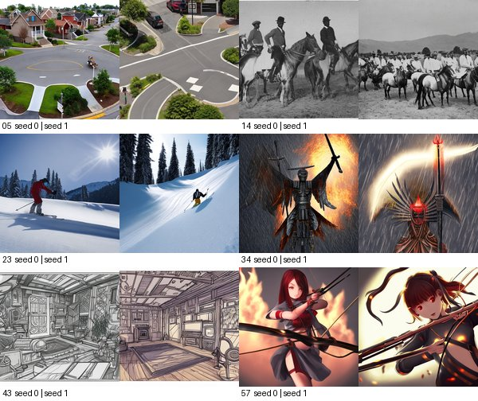
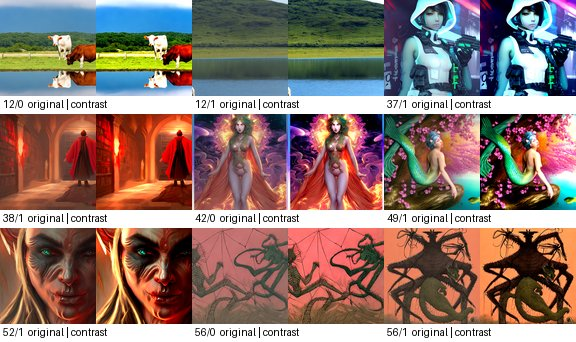

# 新提示词的 49 次同提示词误收与 9 张强对比度拒绝图

原乘积规则在 60 个新提示词中有 6 组出现同提示词不同种子的误收。两对近灰图贡献 **42/49 次（85.7%）**。黑白骑马照的全局色度指纹完全相同。近灰室内线稿的色度和粗布局都有相似之处。强对比度下，单项否决额外拒掉的 **9 张真图全部能靠布局从 120 张图库中唯一找回**。保留原乘积规则，优先保留相对明暗布局作为绑定候选，全局色度用于补充辨别。

## 49 次分别来自哪些提示词

每个提示词有两张原图，每张经过 16 种编辑，得到 32 次错种子验证机会。下表按原冻结乘积门限拆解误收。若一个分项的下尾比例不超过门限的平方根 2.93%，把该项记为异常接近。下尾比例越小，意味着在校准错误配对中越少见到这么小的距离。对齐整体 95% 合法通过和使用原冻结门限得到的是同一批 49 次误收。

| 提示词编号与概要 | 误收 / 32 | 仅颜色 / 仅布局 / 两者均异常接近 | 对照两张原图的解释 |
|---|---:|---:|---|
| 14　多人骑马 | 28 | 28 / 0 / 0 | 两张都是黑白照片，骑手大小和队列位置不同，但两个 96 箱色度直方图的质量都 100% 落在同一中性色箱。干净图已互相通过，两个方向各误收 14 次。 |
| 43　带注释的室内概念线稿 | 14 | 5 / 7 / 2 | 两图中性色箱质量为 99.98% 和 91.03%，都以房间内部为主体。它们是全批唯一一对干净图布局距离落入错误配对最低 5% 的图。干净图尚未互相通过，不同编辑会使不同分项变得更相似。 |
| 05　郊区住宅环形路口 | 2 | 2 / 0 / 0 | 都有大片灰路面和绿植，图中道路朝向不同。模糊和加噪各误收 1 次。 |
| 23　雪坡滑雪者 | 2 | 2 / 0 / 0 | 雪地和蓝灰阴影配色接近。干净两图布局下尾比例为 99.69%，差异很大。裁剪缩放和局部擦除各误收 1 次。 |
| 34　持燃烧武器的面具武士 | 1 | 1 / 0 / 0 | 两图都有暗背景和暖色亮部，人物和武器位置不同。仅局部擦除后误收。 |
| 57　动漫女弓箭手 | 2 | 2 / 0 / 0 | 两图都有暖色背景与深色人物。仅第一张作查询时，在两档亮度编辑下误收。 |

按上述分界，49 次可拆为仅颜色 40、仅布局 7、两者都近 2。**28 次骑马照误收中，色度项每次都落到经验分布的分辨率下限，单凭这一项就足以放行。** 第 43 组的细分类更依赖描述分界。若两项均以 5% 为界，全批计数变为仅颜色 38、两者都近 11。分界仅用于解释，原始判定、提示词及其误收次数均固定。[逐查询距离下尾比例与编辑记录](false_accepts.csv)

## 全部 60 组里的分母

以下按**未编辑的两张原图**定义各组，分类可重叠。近灰指两图各自至少 90% 的量化色度质量落在中性色箱。色板接近指干净两图的色度距离下尾比例不超过 5%。为描述粗布局的左右对称程度，将每张图的 4×4 亮度分组直方图左右翻转，并计算与自身的 Hellinger 距离。取两张中较大的距离，将全批最低四分之一记为较对称。这项描述只衡量左右明暗分布。

| 干净种子对的特征 | 满足条件的提示词 | 其中发生误收的提示词 | 误收 / 该组机会 |
|---|---:|---:|---:|
| 两张均近灰 | 2 | 2 | 42/64 |
| 色板接近（含上述近灰组） | 7 | 4 | 45/224 |
| 两图的布局距离下尾比例 ≤5% | 1 | 1 | 14/32 |
| 两图的粗布局均较左右对称 | 15 | 3 | 44/480 |

两对近灰图同时落入较对称组。移出这两对后，其余 13 对较对称的图只贡献 2 次误收，均来自路口；另 45 对贡献 5 次。此次证据最明确的是近灰色度碰撞。对称性和近灰在两大误收组重叠，这批数据不能确立对称性是独立原因。近灰也只有两个独立提示词，42 次编辑误收不等于 42 次独立提示词复现。[全部 60 对的提示词、色度占比和对称性测量](prompts.csv)

## 被否决的 9 张，布局是否还认得出

只取 1.8 倍对比度下原乘积规则通过、单项否决新增拒绝的真图。两个工作点选出的 9 张完全相同，涉及 7 个提示词。使用现有 48 箱布局直方图检索同一批 120 张干净参考。下表距离均为 Hellinger 距离，越小越近。

| 提示词 / 种子索引 | 布局名次 | 对原图距离 | 到最近其他原图的距离 | 仅颜色名次 |
|---|---:|---:|---:|---:|
| 12 / 0 | 1 | 0.0054 | 0.2724 | 9 |
| 12 / 1 | 1 | 0.0017 | 0.2277 | 3 |
| 37 / 1 | 1 | 0.0169 | 0.2250 | 14 |
| 38 / 1 | 1 | 0.1073 | 0.2971 | 3 |
| 42 / 0 | 1 | 0.0067 | 0.1995 | 8 |
| 49 / 1 | 1 | 0.0189 | 0.2265 | 7 |
| 52 / 1 | 1 | 0.0495 | 0.2683 | 9 |
| 56 / 0 | 1 | 0.0009 | 0.2228 | 23 |
| 56 / 1 | 1 | 0.0220 | 0.2025 | 28 |

9 张布局首位均无并列。最近其他原图与正确原图的距离差最小仍有 **0.1805**。9 张的布局下尾比例都达到校准分辨率下限 1/1281，均由色度项超过否决界限触发拒绝。同批全部 120 张强对比度查询的布局也都唯一找回原图。这支持把布局作为耐受强对比度变化的绑定候选。第 43 组说明不同原图也可能具有相近布局，仅凭图库排名还不足以证明来源。近灰对的全局色度分数则应理解为辨别力有限的证据。

复核在 249 CPU 上完成。验证了 120 张原图的文件摘要，重新生成的每图 288 字节指纹与原登记文件逐字节相同。对 6 个误收提示词的全部查询及整批强对比度查询去重后，共重放 312 次。查询像素摘要、分项距离与首位并列分数均与原记录一致。[全部强对比度查询的名次与距离](contrast.csv) · [汇总与校验摘要](summary.json) · [复核代码](../../scripts/defense/diagnose_veto_cohort.py) · [原工作点比较](../color_veto_20261119/report.md)
