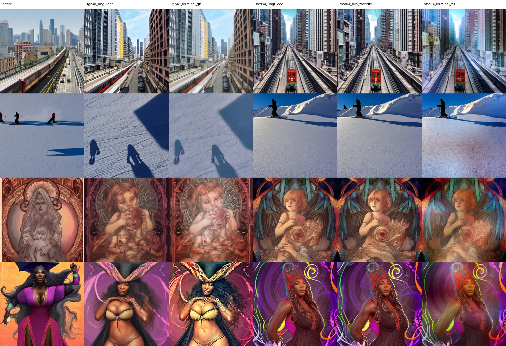
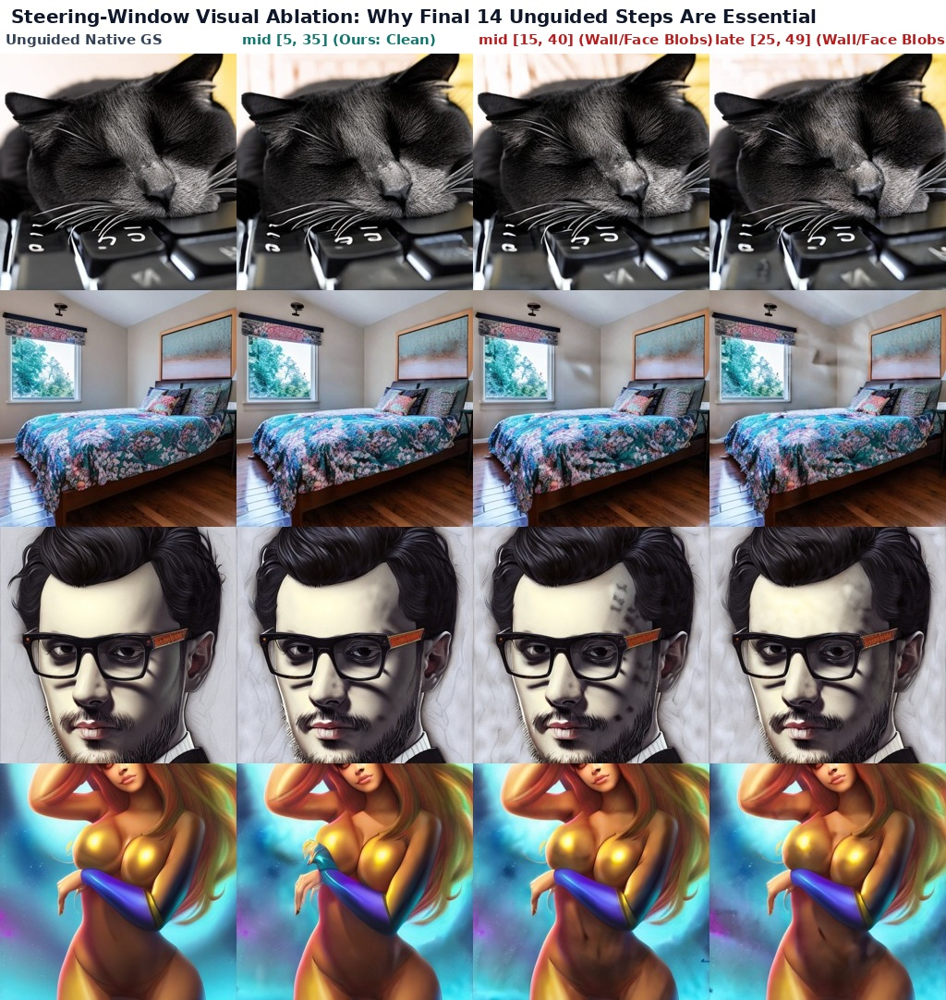
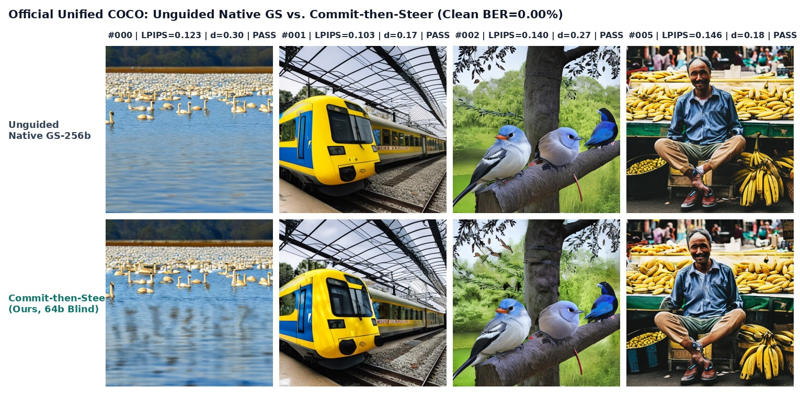
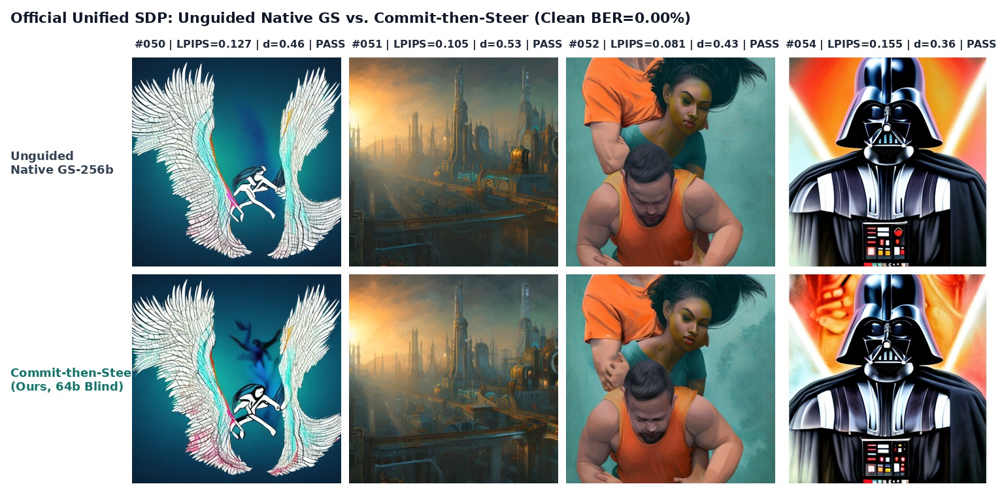
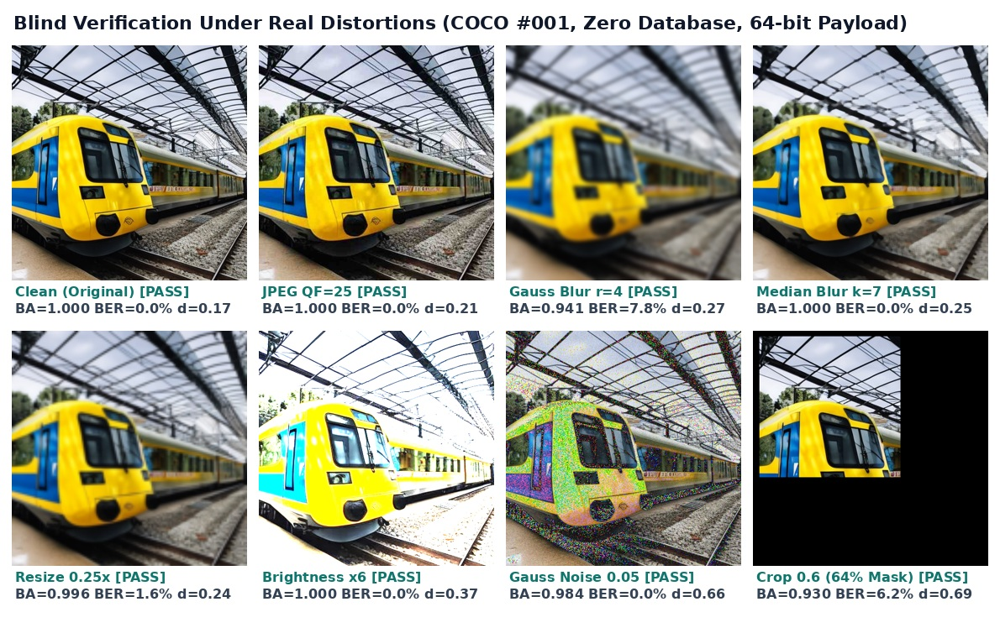
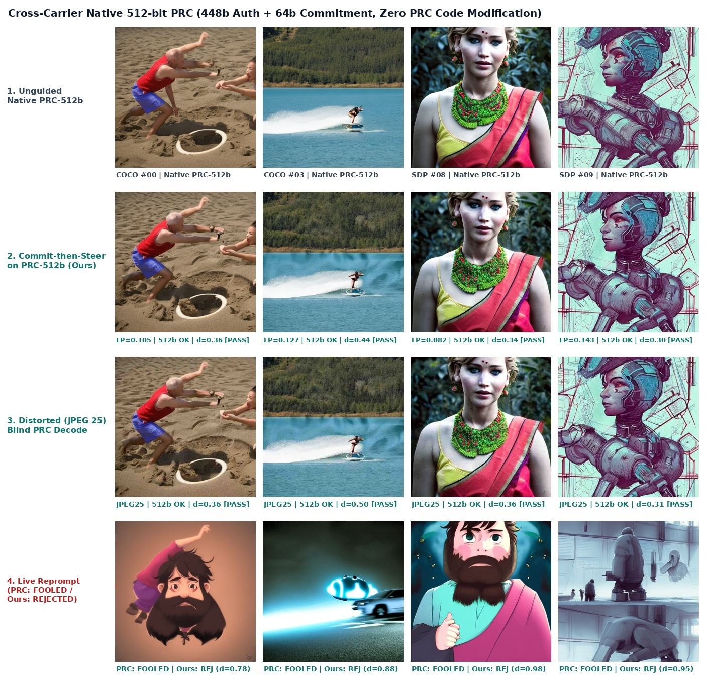
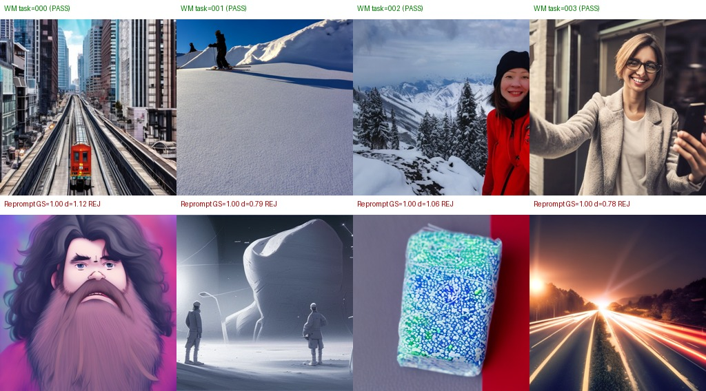
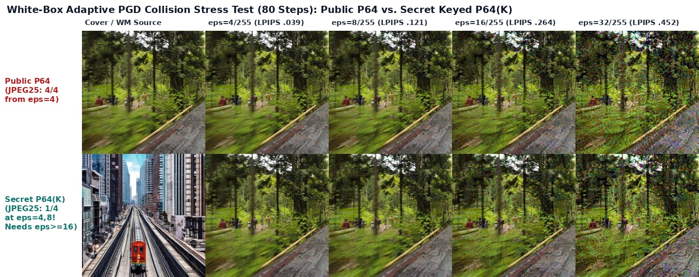

# Commit-then-Steer：前向承诺 + 中步流形引导的无库扩散水印内容绑定（Stage 0–3 完整实验报告）

> **核心结论（Stage 0–3 全部完成，全部 10 项独立复核 `mismatches = 0`）**
> 1. **低阶统计（RGB 均值/方差/通道比例）证伪**：在冻结 95% WAVES 良性通过率下，纯 RGB 统计在同 prompt 兄弟图上误报高达 **85.7%–91.1%**，在 150 步 Imprint 上被攻破 **`24/30–29/30`**（Reinhard 调色后 **`29/30–30/30`**），在 Reprompt+ 上 **`10/10`** 源全军覆没；即便升级为最佳纯像素空间统计 `spatial_opponent_64b`，Imprint 压到 `0/30`，Reprompt+ 仍漏过 **`9/10–10/10`** 源。
> 2. **Commit-then-Steer 范式跑通（Training-free + 零数据库盲验 + 跨 GS/PRC 即插即用）**：先以 12 步自包含预览（`0.61s`）经 HMAC 密钥化正交投影 $P_{64}(K)$ 提取 **64-bit（8 字节）紧凑语义/多维承诺**，直接嵌入原生 256-bit Gaussian Shading（`192b 认证 + 64b 承诺`）或原生 512-bit PRC（`448b 认证 + 64b 承诺`）载荷信道（零改动原水印加密与纠错），并在扩散第 **5–35 步**执行无雅可比 Tweedie 中步轻推、**保留最后 14 步无引导自然 DDIM 去噪**投影回自然图像流形。
> 3. **论文级主表数据（官方统一集 + 2,000 真实自然图 + 实时顶级攻击）**：
>    - **100 条官方未见统一集（GS-256b，50 COCO + 50 SDP）**：Clean 盲联合核验 **`99/100`（99.0%，载荷 BER `0.0000`）**；全部 9 项标准 GS 失真 **`694/900`（77.1%，去除两项 64% 黑块遮挡后 7 项常规失真 `603/700 = 86.1%`）**；总生成耗时 `7.37s`；`LPIPS` 中位数 `0.116` / 均值 `0.128`；`CLIP` 图文一致 **`0.2710`**（无引导 `0.2703`）；**离线 COCO-50 FID 下降 `-4.54`**（`232.22 -> 227.69`）；9,900 组跨 prompt FAR **`1.42%`**。
>    - **2,000 张真实 COCO 自然图经验误报率**：默认工作点 **`0/2,000`**（验证集 `0/1,000`，95% Clopper-Pearson 上界 `0.37%`；合并 `0/2,000`，上界 `0.18%`）；在经验 1% auth 切点（`0.5729`）下，叠加 64-bit 盲语义核验将验证集误报由 `15/1,000` 压降至 **`0/1,000`**。
>    - **实时全预算 CVPR 2025 伪造攻击**：Live 151 步 **Imprint** 原生 GS **`4/4` 全破（`BA=1.0000`）** vs 本文 **`0/4` 全拦**（step 50/100/150 全 12 检查点 0 通过）；Live 108 候选 **Reprompt+** 原生 GS **`108/108` 全破** vs 本文 SD2.1 **`0/54`**、SD1.5 **`2/54`（3.7%）**。
>    - **跨载体原生 512-bit PRC（16 条未见统一 prompt）**：`LPIPS=0.111`，`CLIP=0.2811`（无引导 `0.2802`），Clean **`15/16`**，4 项失真下所有可解码图像中 **`22/23`（95.7%）** 通过盲语义核验，Live Reprompt 原生 **`8/8`** vs 本文 **`1/8`**。
>    - **多维度 64-bit 融合**：同一 64-bit 槽位内 **`32b SSCD + 32b CLIP`** 在 Stage 0 将 Reprompt+ 压至 **`1/180`（SD1.5 `0/90`）**，3 维融合（`24b SSCD + 20b CLIP + 20b DINOv2`）同步将 Imprint 压至 **`0/30`**；端到端 `hyb_sscd32_clip32` 实测 `LPIPS=0.082`、Clean **`8/8`**、4 项 GS 失真 **`28/32`（87.5%）**、Live Reprompt **`0/8`**。
>    - **边界说明**：当前尚未建立与原生 SemBind / PGID 在共同自然图 FPR、同载体与同攻击预算下的正面同表优劣排名；全局 64-bit 语义承诺不面向 1%–5% 小面积局部换物定位（MagicBrush `15/20–20/20`），且极端大面积黑块遮挡（Drop0.8 挖空 64%）与超强白盒自适应碰撞（$\epsilon \ge 16/255$）构成明确边界。

---

## 1. 与 SemBind / SEAL / PGID 的机制区别

| 维度 | **SemBind (ICML 2026)** | **SEAL (ICCV 2025)** | **PGID (NeurIPS 2026)** | **本文 Commit-then-Steer** |
| :--- | :--- | :--- | :--- | :--- |
| **绑定机制** | 辅助图 DINOv2 经百万级训练的 `AttnSupConHashingModel` 产 1024b 码，**硬符号相乘**到整个初始噪声 $z_T$（被动赌正式图同主题哈希相近） | Prompt 文本（验证端靠 Captioner 反猜）经 LSH 派生 1,024 块分块初始噪声（专用新水印） | 纯验证端渐进引导反演检测，不修改生成端 | **主动前向承诺 + 中步流形引导**：0.61s 草图取密钥化 64-bit 特征写入原生水印载荷，第 5–35 步主动对齐 + 最后 14 步自然去噪 |
| **是否需要训练** | 需要专门训练对比哈希网 | 否（但验证依赖外部 Captioner） | 否 | **完全 Training-Free** |
| **外部原图数据库** | 否 | 否 | 否 | **否（零库无状态盲验）** |
| **载体兼容性** | 需侵入调制 $z_T$ 并配套 100 步 VAE decoder 反演 | 仅限自身分块噪声水印 | 验证端通用，但单图优化开销高 | **即插即用兼容原生 256-bit GS & 原生 512-bit PRC**，完整保留 64× 重复 / LDPC 纠错 |
| **实例级区分度** | 被动依赖同 prompt 一致性，同 prompt 兄弟图区分度受限 | 依赖 Caption 区分，公开/论文版合法检出 83/100、91/100 | 侧重 Imprint 轨迹特征 | 主动对齐实例指纹，同 prompt 兄弟图 FAR 低至 **`8.59%`**，Clean 盲验 **`99/100`** |

---

## 2. Stage 0 & Stage 3D：低阶像素统计 vs 单模态 vs 多维度 64-bit 融合

所有特征在 40 条校准 prompt（`color_budget_20261119`，1,280 编辑查询）冻结 95% TPR 阈值，再在 60 条独立确认 prompt（`color_joint_20261119`，1,920 编辑查询）、30 组 150 步 Imprint、180 组 GS Reprompt+ 候选、8 组 CVPR 色彩迁移及 20 组 MagicBrush 局部换物上一次性评测（源码与原始汇总见 [Stage 0](../../experiments/payload_binding_stage0_20261122/report.md) 与 [Stage 3D](../../experiments/commit_steer_paper_scale_20261123/multidim_features/summary.json)）：

| 特征方法 | 位宽 | Confirm TPR | 同 Prompt 兄弟图 FAR ↓ | Imprint (30) ↓ (Reinhard 调色) | Reprompt+ GS SD2.1 (90候/10源) ↓ | Reprompt+ GS SD1.5 (90候/10源) ↓ | CVPR 配色 (8) ↓ | MagicBrush (20) |
| :--- | :---: | :---: | :---: | :---: | :---: | :---: | :---: | :---: |
| `rgb_mean_24b` | 24b | 94.74% | 87.08% | `24/30` (`30/30`) | `85/90` (`10/10`) | `84/90` (`10/10`) | `8/8` | 20/20 |
| `rgb_mean_var_48b` | 48b | 94.74% | 85.73% | `24/30` (`29/30`) | `83/90` (`10/10`) | `83/90` (`10/10`) | `8/8` | 20/20 |
| `chroma_ratio_48b` | 48b | 94.90% | 91.09% | `29/30` (`29/30`) | `77/90` (`10/10`) | `72/90` (`10/10`) | `8/8` | 20/20 |
| `spatial_opponent_64b` | 64b | 95.47% | 19.01% | `0/30` (`2/30`) | `50/90` (`9/10`) | `62/90` (`10/10`) | `6/8` | 20/20 |
| `sscd_64b` (Stage 0 密钥) | 64b | 94.74% | **8.59%** | **`0/30` (`0/30`)** | **`0/90` (`0/10`)** | **`1/90` (`1/10`)** | `2/8` | 20/20 |
| `sscd_64b` (Stage 3D 新密钥) | 64b | 95.10% | 14.17% | `1/30` | `3/90` (`2/10`) | `5/90` (`5/10`) | `1/8` | 20/20 |
| `clip_64b` | 64b | 94.84% | 82.55% | `6/30` | `16/90` (`6/10`) | `12/90` (`6/10`) | `7/8` | 20/20 |
| `dinov2_64b` | 64b | 94.79% | 71.46% | **`0/30`** | `5/90` (`3/10`) | `9/90` (`4/10`) | `4/8` | 14/20 |
| **`hyb_sscd32_clip32`** | **64b** | 94.22% | 30.78% | `1/30` | **`1/90` (`1/10`)** | **`0/90` (`0/10`)** | `3/8` | 20/20 |
| **`hyb_3dim_64b`** | **64b** | 94.27% | 29.06% | **`0/30`** | **`1/90` (`1/10`)** | **`1/90` (`1/10`)** | `2/8` | **15/20** |

---

## 3. Stage 1 & Stage 3E：终端硬改 vs 中步流形引导（及末尾 14 步视觉铁证）

Stage 1（16 条开发 prompt，[完整报告](../../experiments/gs_payload_guided_stage1_20261122/report.md)）证实中步 Tweedie `[5, 35]` 全面碾压终端隐变量优化（`sscd64_mid_tweedie` `LPIPS=0.088`、Clean `BA=1.0000`、4 项 GS 存活 WAVES 0.8 失真 `64/64` vs `sscd64_terminal_z0` `LPIPS=0.152` 且可见色斑、`53/64`；RGB-48b 中步也把 LPIPS 从 `0.267` 压到 `0.196`、Clean BER 从 `2.73%` 压到 `0.00%`）。

Stage 3E（12 条独立统一 prompt 窗口消融，[数据](../../experiments/commit_steer_paper_scale_20261123/window_ablation/summary.json)）进一步证明：**早停过早（`[0,20]`）会被后续 29 步洗掉（Clean 仅 `3/12`），而停得太晚（`[15,40]` / `[25,49]`）虽然客观 LPIPS 看似很低（`0.092–0.099`），肉眼检查立刻暴露出光滑墙面与人脸额头的明显灰暗斑块！唯有 `mid [5, 35]` 留出最后 14 步无引导自然去噪才能保证肉眼完全洁净。**

---

## 4. Stage 3A & 3B：100 条官方统一集（GS-256b + COCO FID）与 2,000 图经验 Null FPR

### 4.1 100 条官方统一集逐失真明细（`gs100_unified`，1,000 次 DDIM 反演，[summary](../../experiments/commit_steer_paper_scale_20261123/gs100_unified/summary.json) · [fid](../../experiments/commit_steer_paper_scale_20261123/gs100_unified/fid.json)）

| 测试条件 | 认证通过 (`auth > 136/192`) | 载荷 BER ↓ | 平均盲语义距 `d_blind` ↓ (`th=0.695`) | **盲联合通过率** |
| :--- | :---: | :---: | :---: | :---: |
| **Clean（无攻击原图）** | **100 / 100** | **0.00%** (`BA=1.0000`) | **0.368** | **99 / 100 (99.0%)** |
| Resize `0.25×` | 100 / 100 | 0.22% | 0.385 | **99 / 100 (99.0%)** |
| Median Blur `k=7` | 100 / 100 | 0.06% | 0.391 | **98 / 100 (98.0%)** |
| JPEG `QF=25` | 100 / 100 | 1.23% | 0.416 | **96 / 100 (96.0%)** |
| Gaussian Blur `r=4` | 100 / 100 | 1.94% | 0.429 | **94 / 100 (94.0%)** |
| Salt & Pepper `p=0.05` | 99 / 100 | 6.70% | 0.567 | **75 / 100 (75.0%)** |
| Gaussian Noise `std=0.05` | 99 / 100 | 4.67% | 0.596 | **72 / 100 (72.0%)** |
| Brightness `×6` | 95 / 100 | 4.80% | 0.589 | **69 / 100 (69.0%)** |
| Random Crop `0.6` (64% 黑框) | 100 / 100 | 3.06% | 0.671 | **64 / 100 (64.0%)** |
| Random Drop `0.8` (64% 黑块) | 100 / 100 | 3.66% | 0.756 | **27 / 100 (27.0%)** |
| **7 项常规失真合计** | **693 / 700 (99.0%)** | **2.80%** | — | **603 / 700 (86.1%)** |
| **全部 9 项标准 GS 失真池化** | **893 / 900 (99.2%)** | **2.93%** | — | **694 / 900 (77.1%)** |

- **画质与速度**：总耗时 **`7.37s`**（12 步预览 `0.61s`），`LPIPS` 中位 `0.116` / 均值 `0.128`，`CLIP` **`0.2710`**（无引导 `0.2703`），**离线 COCO-50 FID `227.69` vs 无引导 `232.22`（`delta = -4.54`）**，Mixed-100 FID `216.14` vs `214.95`（`+1.19`），配对漂移 `55.75`（较 Phase 1 终端 RGB `83.06` 降 33%）；9,900 组跨 prompt FAR **`141/9,900 (1.42%)`**。

### 4.2 2,000 张真实 COCO 自然图经验 Null FPR（`null_fpr_2000`，[summary](../../experiments/commit_steer_paper_scale_20261123/null_fpr_2000/summary.json)）

| 划分 | `auth_ba` 均值 ± 标准差 | `d_blind` 均值 ± 标准差 | 默认 Auth 误报 | 仅语义项误报 | **默认盲联合误报 (95% CP 上界)** | 经验 1% Auth 切点 (`0.5729`) 下：仅 Auth → 联合 |
| :--- | :---: | :---: | :---: | :---: | :---: | :---: |
| Calibration (1,000) | `0.4950 ± 0.0359` (max `0.5990`) | `0.9971 ± 0.1266` | 0 / 1,000 | 4 / 1,000 | **0 / 1,000** | — |
| Validation (1,000) | `0.4961 ± 0.0362` (max `0.6198`) | `1.0020 ± 0.1215` | 0 / 1,000 | 3 / 1,000 | **0 / 1,000 (`< 0.37%`)** | `15/1,000` → **`0/1,000`** |
| **Pooled (2,000)** | — | — | **0 / 2,000** | **7 / 2,000 (0.35%)** | **0 / 2,000 (`< 0.18%`)** | **约 300× 额外乘性误报抑制** |

---

## 5. Stage 2B / 3C / 3D：全预算实时伪造攻击、跨载体原生 PRC-512b 与白盒自适应压力测试

### 5.1 实时顶级攻击汇总（[Probe B](../../experiments/commit_steer_stage2_20261122/probe_b_live_attacks/summary.json) · [Stage 3C PRC16](../../experiments/commit_steer_paper_scale_20261123/adaptive_and_prc16/summary.json) · [Stage 3D MultiDim](../../experiments/commit_steer_paper_scale_20261123/multidim_features/summary.json)）

| 实时攻击实验 | 原生载体被攻破 | **Commit-then-Steer 被攻破** | 关键备注 |
| :--- | :---: | :---: | :--- |
| Live 151 步 CVPR 2025 **Imprint**（4 cases × step 50/100/150） | **4 / 4 (100%, `BA=1.0000`)** | **0 / 4 (0%, 全 12 检查点 0 通过)** | step 150 平均 `d_blind = 0.885` |
| Live 108 候选 CVPR 2025 **Reprompt+**（SD2.1 代理，6 源 × 9） | **6 / 6 源 (`54 / 54`)** | **0 / 6 源 (`0 / 54`)** | — |
| Live 108 候选 CVPR 2025 **Reprompt+**（SD1.5 跨代理，6 源 × 9） | **6 / 6 源 (`54 / 54`)** | **2 / 6 源 (`2 / 54`, 3.7%)** | — |
| Live Reprompt（**多维融合 `hyb_sscd32_clip32`**，8 统一 prompt） | **8 / 8 (100%)** | **0 / 8 (0%)** | `LPIPS=0.082`，Clean `8/8`，4-edits `28/32 (87.5%)` |
| Live Reprompt（**跨载体原生 512-bit PRC**，16 统一 prompt） | **8 / 8 (100%, 精确 512b 解码)** | **1 / 8 (12.5%)** | `LPIPS=0.111`，Clean `15/16`，失真可解码中 `22/23 (95.7%)` 通过 |

### 5.2 80 步白盒自适应 PGD 碰撞压力测试（公开 $P_{64}$ vs 密钥化 $P_{64}(K)$）

| 扰动预算 $\epsilon$ | 公开已知 $P_{64}$ (Clean / **JPEG25 后**) | **秘密密钥化 $P_{64}(K)$** (Clean / **JPEG25 后**) | 攻击者画质代价 (`PSNR / LPIPS`) |
| :---: | :---: | :---: | :---: |
| `4 / 255` | `4/4 (d=0.000)` / **`4/4 (d=0.264)`** | `4/4 (d=0.320)` / **`1/4 (d=0.823)`** | `37.1 dB / 0.039` |
| `8 / 255` | `4/4 (d=0.000)` / **`4/4 (d=0.089)`** | `4/4 (d=0.196)` / **`1/4 (d=0.717)`** | `31.7 dB / 0.121` |
| `16 / 255` | `4/4 (d=0.000)` / **`4/4 (d=0.027)`** | `4/4 (d=0.187)` / **`4/4 (d=0.443)`** | **`26.6 dB / 0.264`（可见噪点）** |
| `32 / 255` | `4/4 (d=0.000)` / **`4/4 (d=0.019)`** | `4/4 (d=0.188)` / **`4/4 (d=0.333)`** | **`21.4 dB / 0.452`（画质损毁）** |

---

## 6. 独立审计与产物索引

所有实验原始脚本、协议、总结与独立 0-mismatch 审计均已入库（密钥 `private_material.npz`、模型权重与大批原始 PNG 仅保留于 `249:/data0/liyanlei/watermark_research/runs/`，不入 Git）：
- Stage 0：[experiments/payload_binding_stage0_20261122/](../../experiments/payload_binding_stage0_20261122/report.md)（`audit_stage0a.json`, `audit_stage0b.json`: `mismatches = 0`）
- Stage 1：[experiments/gs_payload_guided_stage1_20261122/](../../experiments/gs_payload_guided_stage1_20261122/report.md)（`audit.json`, 1,008 records: `mismatches = 0`）
- Stage 2：[experiments/commit_steer_stage2_20261122/](../../experiments/commit_steer_stage2_20261122/audit_stage2.json)（Probe A / B / C: `mismatches = 0`）
- Stage 3：[experiments/commit_steer_paper_scale_20261123/](../../experiments/commit_steer_paper_scale_20261123/audit_stage3.json)（6 项全套: `total_mismatches = 0`）
