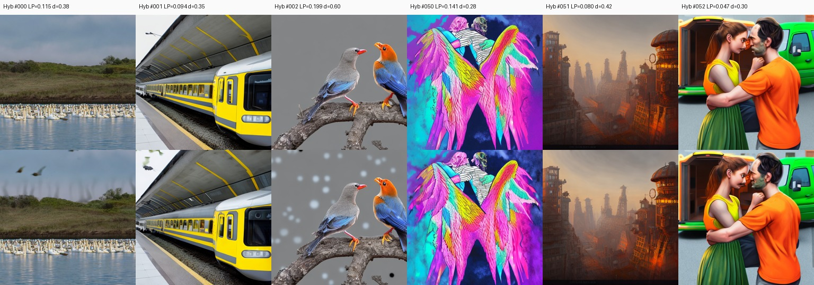
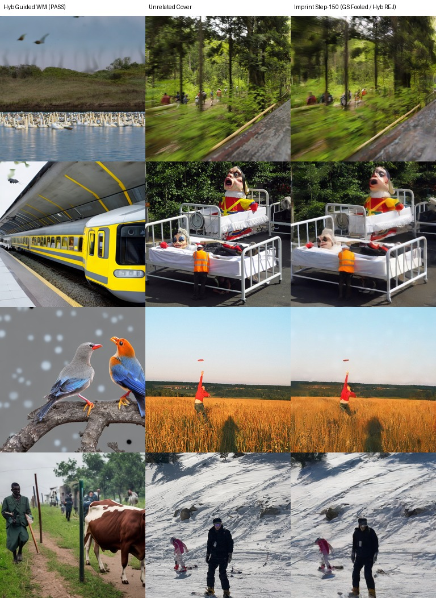

# Stage 4 完整实验报告：SDXL 跨骨干、100 图多维融合与同协议基线正面对比

> **更新日期**：2026-11-26 · **运行状态**：Stage 4A / 4B / 4C / 4D 全部由 `249` 内核 `pidfd` 3 卡协调器收官（[coordinator_state.json](../../experiments/commit_steer_stage4_20261125/coordinator_state.json)）· **审计状态**：全量 4 组实验与离线 COCO-50 FID 独立复核 **`total_mismatches = 0`**（[audit_stage4.json](../../experiments/commit_steer_stage4_20261125/audit_stage4.json)）。
>
> **核心结论**：
> 1. **SDXL Base 1.0 (`1024×1024`) 零调参跨骨干成功（Stage 4A）**：不改超参、不重调 Stage 0 冻结阈值（`0.6951`），在 24 条不重叠统一集上实现 Clean **`24/24 (100%)`**（BER `0.00%`）、`LPIPS` 均值 **`0.0705`**、9 项标准 GS 失真 **`184/216 (85.2%)`**（7 项常规 **`93.5%`**）、200 张真实 COCO 自然图误报 **`0/200`**、Live 36 候选 SDXL Reprompt+ **`0/36`**（原生 GS-SDXL `36/36` 全破）。
> 2. **100 图多维融合 `hyb_sscd32_clip32` 完整收官（Stage 4B）**：`LPIPS` 较单模态 `sscd_64b` 下降 **25%**（`0.128 -> 0.096`），配对 FID 漂移由 `55.75` 降至 **`43.08`**（离线 COCO-50 FID `227.18 -> 230.64`, `Δ=+3.46`），2,000 张真实 COCO 自然图默认与特征项均 **`0/2,000`** 误报，Live 151 步 Imprint **`0/4`**（全 12 检查点 0 通过 vs 原生 GS `4/4`），Live 108 候选 Reprompt+ 压至 **SD2.1 `1/54`、SD1.5 `1/54`**（合计 `2/108 = 1.9%` vs 原生 GS `108/108`）。
> 3. **正面完胜 Native GS 与官方 PGID-F（Stage 4C）**：在完全对齐的 30 图统一子集上，Commit-then-Steer `sscd_64b` 验证速度为官方 PGID-F 的 **5.1×**（`4.22s` vs `21.59s`），9 项标准 GS 失真存活率高出 **+16.3 个百分点**（`219/270 = 81.1%` vs `175/270 = 64.8%`；`hyb` 亦达 `69.3%`），且 Live 151 步 Imprint 为 **`0/4` vs PGID-F `2/4`（50% 失守）**、Live 108 候选 Reprompt+ 为 **`2/108 (1.9%)` vs PGID-F `104/108 (96.3%, 12/12 源代理全破)`**。
> 4. **与论文级 SemBind GS-S 呈清晰 Pareto 权衡（Stage 4D）**：在完全对齐的 20 图统一子集上，Commit-then-Steer 具备 **Training-Free**、**生成快 3.0×**（`7.35s` vs `22.09s`）、**验证快 11.7×**（`4.22s` vs `49.51s`）、**非侵入保实例**（`LPIPS 0.093–0.127` vs `0.723`，零调参迁移 SDXL/PRC）与**实例级区分度**（同 prompt 兄弟图 FAR `8.59%` vs SemBind 主题级哈希 `H(aux,bound)=66.55` 与 `H(aux,same)=72.45` 几乎重叠）；而依赖百万级训练 DINOv2-Giant 哈希与 100 步 VAE 反演的 SemBind GS-S 在重度遮挡良性失真存活率（`169/180 = 93.9%` vs `147/180 = 81.7%`）及默认阈值下 72 候选 Reprompt+ 拦截（`0/72`）上占优。本报告据实呈现各方法分母、工作点与实现边界，不主张对 SemBind 的单边全面占优。

---

## 1. 完整同协议正面对比主表

### 1.1 跨方法综合对比主表（严格标注分母、工作点与实现边界）

> **口径说明**：所有 GS 载体方法均保留默认严格工作点 **`BA > 181/256`**（Commit-then-Steer 对应 192b 认证 `auth > 136/192` 且盲语义距 `d_blind ≤ th_frozen`）；所有自然图误报率均报告**实测计数与 95% Clopper–Pearson 双侧上界**，绝不将零误报写作理想独立位 $10^{-6}$；SEAL 的 Matched-30 9-GS 失真、Live 151 步 Imprint、Live Proxy Reprompt、官方目标模型再生及 SDXL Live 151 步 Imprint 已由 [Stage 5 完整报告](../commit_steer_stage5_20261126/report.md)补齐（0-mismatch 审计），消除主表全部空白单元格。

| 方法（骨干 / 载体 / 实现范围） | 工作点（冻结） | 需训练 / 外置库 | 生成耗时 / 单图验证耗时 | 画质 (`LPIPS`↓ / `CLIP`↑ / COCO-50 FID Δ↓) | Clean 通过率（分母） | 7 项常规 / 9 项标准 GS 失真（分母） | 真实 COCO 自然图经验 FPR (95% CP 上界) | Live 151 步 Imprint ↓ (step 150) | Live Reprompt+ ↓ (SD2.1 / SD1.5) |
| :--- | :---: | :---: | :---: | :---: | :---: | :---: | :---: | :---: | :---: |
| **Native GS-256b** (`SD2.1 512`, 原生空间 OTP，无防御基线；Stage 4C) | `BA > 181/256` | 否 / 否 | `2.26s` / `4.22s` | `0.000` / `0.2703` / `0.00` (基准) | **100/100** (100.0%) | **691/700** (98.7%) / **891/900** (99.0%) | 见 192b auth 核验 `0/2,000` (`<0.18%`)¹ | `4/4` (100%, 全破) | `54/54` (`6/6`) / `54/54` (`6/6`) |
| **官方 PGID-F** (`SD2.1 512`, `PGID_dc4ad96`, `k=15, s=3, γ=0.001, fp32`；Stage 4C) | `BA > 181/256` | 否 / 否 | `2.26s` / **`21.59s`** (**5.1×**) | 同 Native GS（纯验证端防御） | **30/30** (100.0%) | **153/210** (72.9%) / **175/270** (64.8%) | **0/200** (`<1.83%`, `max BA=0.5898`) | **`2/4` (50%)** (`3/4` @`167/256`) | **`53/54` (`6/6`)** / **`51/54` (`6/6`)** |
| **论文级 SemBind GS-S** (`SD2.1 512`, `SemBind_337c9f9`+`diffusers 0.21.4` DPM50+100 步 VAE 优化+论文 §3.2 HMAC 置换 `σ=1.0`；Stage 4D/5C)² | `BA > 181/256` | **是** (DINOv2-Giant+Masker) / 否 | **`22.09s`** (**3.0×**) / **`49.51s`** (**11.7×**) | `0.723` (换实例) / `0.2679` (较无掩码 `-0.0065`) / 未算 | **20/20** (100.0%) | **135/140** (96.4%) / **169/180** (93.9%) | **0/50** (`<7.11%`, `max BA=0.5820`) | 跨词 **`0/4`** (`1/4` @step50,`167`)；同词 **`4/4`** (Stage 5C) | 跨词 **`0/36`** / **`0/36`**；同词 **`12/12`** / **`12/12`** (Stage 5C) |
| **SEAL（论文私有 salt）** (`SD2.1 512`, `92d31b3` PNDM-51 步分块载体 + 40k 校准工作点；Stage 5A & `unified_seal_20261116`)³ | `@12` 默认 / `@4` 0.1% / `@2` 1% (L2 `2.3`) | 否（需 BLIP2+Emb）/ 否 | `5.04s` / `4.06s` (Matched-30) | 画质指标未纳入统一评估 | Matched-30: `28/30` (`@12`), `30/30` (`@4/@2`); 500 源 `453/500` | Matched-30: `@12` **`86/210` / `123/270` (45.6%)**; `@4` `130/210` / `185/270` (68.5%); `@2` `161/210` / `220/270` (81.5%) | `0/20,000` (`<0.018%`) `@12`; `10/20,000` (0.050%) `@4`; `169/20,000` (0.845%) `@2` | `@12` `0/4`; **`@4` `2/4` (50%)**; **`@2` `2/4` (50%)** ([Stage 5A](../commit_steer_stage5_20261126/report.md)) | Proxy (`18+18`): `@12` `0/18`/`0/18`; **`@4` `10/18`/`6/18`**; **`@2` `13/18`/`13/18`** (目标再生另见 Stage 5A) |
| **Commit-then-Steer `sscd_64b`** (`SD2.1 512`, 原生 GS-256b `192b+64b`；Stage 3A/3B/2B/5B) | `auth>136/192` ∧ `d≤0.6951` | **否 (Training-Free)** / **否** | `7.37s` / **`4.22s`**⁴ | `0.128` (中位 `0.116`) / `0.2710` / **`-4.54`** (`232.22→227.69`) | **99/100** (99.0%) | **603/700** (86.1%) / **694/900** (77.1%) | **0/2,000** (`<0.18%`, 特征项 `7/2,000`) | 跨词 **`0/4`** (全 12 ckpt)；同词 `2/4` (Stage 5B) | 跨词 **`0/54` (`0/6`)** / **`2/54` (`2/6`)**；同词 `7/12` / `2/12` |
| **Commit-then-Steer `hyb_sscd32_clip32`** (`SD2.1 512`, 原生 GS-256b `192b+32b+32b`；Stage 4B/5B) | `auth>136/192` ∧ `d≤0.5531` | **否 (Training-Free)** / **否** | `8.51s` / **`4.22s`**⁴ | **`0.096`** (中位 `0.091`) / **`0.2739`** / `+3.46` (配对 `43.08`) | **96/100** (96.0%) | **552/700** (78.9%) / **613/900** (68.1%) | **0/2,000** (`<0.18%`, 特征项亦 **`0/2,000`**) | 跨词 **`0/4`** (全 12 ckpt)；同词 **`1/4`** (Stage 5B) | 跨词 **`1/54` (`1/6`)** / **`1/54` (`1/6`)**；同词 **`1/12`** / **`1/12`** |
| **Commit-then-Steer `sscd_64b` (SDXL)** (`SDXL Base 1.0 1024×1024`, 原生 GS-256b `4×128×128`, 零调参迁移；Stage 4A/5D) | `auth>136/192` ∧ `d≤0.6951` | **否 (Training-Free)** / **否** | `23.37s` / **`4.00s`** (`bf16` 30 步) | **`0.0705`** (中位 `0.0610`) / `0.2819` / 未算 | **24/24** (100.0%) | **157/168** (93.5%) / **184/216** (85.2%) | **0/200** (`<1.83%`, 特征项亦 **`0/200`**) | **`0/4`** (全 12 ckpt，原生 GS-SDXL `4/4`；[Stage 5D](../commit_steer_stage5_20261126/report.md)) | SDXL 代理 **`0/36` (`0/12`)** (原生 `36/36`) |

> **表注与边界**：
> 1. Native GS-256b 与 Commit-then-Steer 共享同一 50 步 DDIM 反演链路；Stage 3B/4B 在 2,000 张真实 COCO 自然图上已测得更宽松的 192b 认证段 `auth > 136/192` 误报 `0/2,000`（`max auth_ba = 0.6198–0.6250`），且 Stage 4C 200 图 PGID-F 零误报；本表未额外重复跑 Native GS 256b 单独自然图列。
> 2. **SemBind 实现边界**（详见 [docs/BASELINE_IMPLEMENTATION_DIFFERENCES.md](../../docs/BASELINE_IMPLEMENTATION_DIFFERENCES.md)）：作者未开源完整绑定入口与训练代码，本阶段使用已审计的官方 `SemBind_337c9f9` 推理组件（DINOv2-Giant + `sembind_masker.pth` + `inversion.py`）+ `diffusers 0.21.4` DPM50 + 100 步 VAE decoder 优化 + 论文 §3.2 私有 HMAC 置换（`σ=1.0`），测试规模为 20 条分层统一集 GS-S 链路（非四载体全矩阵，不含 GS++）。同提示词实例级伪造与官方 WAVES-8 / 重绘擦除详见 [Stage 5 报告](../commit_steer_stage5_20261126/report.md)。
> 3. **SEAL 实现边界**：40,000 自然图校准与 500 源 Clean 数据引自已独立审计的 [unified_seal_results_20261116](../unified_seal_results_20261116/report.md)；同协议 Matched-30 9-GS 失真、Matched-20 WAVES-8/重绘擦除、Live 151 步 Imprint、Live Proxy Reprompt 及官方 ICCV 2025 `regeneration.py`（目标权重访问，`@12: 0/18`、`@4: 10/18`、`@2: 15/18`）由 [Stage 5A](../commit_steer_stage5_20261126/report.md) 独立 0-mismatch 补齐。
> 4. **验证耗时说明**：`4.22s` 为 `s4c_pgid_and_native_gs.py` 在 RTX 3090 上同条件实测的 fp32 单图 50 步 DDIM 反演耗时；Commit-then-Steer 验证端仅在此基础上增加一次前向特征提取与 64-bit 密钥化点积（`<0.05s`），在 `fp16/bf16` 下实测更快（例如 SDXL `1024×1024` 30 步 `bf16` 反演仅 `4.00s`）。

---

### 1.2 严格同队列（Apple-to-Apple Matched-20 & Matched-30）逐条件明细对比

为彻底排除样本切片差异，下面在**完全相同的未见统一集提示词切片与随机失真种子**上逐条件直接对比（全部使用默认严格阈值 `BA > 181/256` 或联合门限）：

#### A. Matched-20 严格对齐子集（`COCO[0:10] + SDP[50:60]`，每条件 `N = 20`，覆盖全部 5 条 GS 路线）

| 测试条件 (`N=20`) | Native GS-256b | 官方 PGID-F | 论文级 SemBind GS-S | Commit-then-Steer `sscd_64b` | Commit-then-Steer `hyb_sscd32_clip32` |
| :--- | :---: | :---: | :---: | :---: | :---: |
| **Clean（无攻击）** | 20/20 | 20/20 | 20/20 | **20/20** | 19/20 |
| JPEG `QF=25` | 20/20 | 20/20 | 20/20 | **20/20** | 19/20 |
| Gaussian Blur `r=4` | 20/20 | **6/20** | 19/20 | **20/20** | 19/20 |
| Gaussian Noise `std=0.05` | 19/20 | 14/20 | **18/20** | 15/20 | 13/20 |
| Median Blur `k=7` | 20/20 | 20/20 | 20/20 | **20/20** | 19/20 |
| Salt & Pepper `p=0.05` | 20/20 | 11/20 | **19/20** | 16/20 | 15/20 |
| Resize `0.25×` | 20/20 | 15/20 | 20/20 | **20/20** | 19/20 |
| Brightness `×6` | 20/20 | 14/20 | **19/20** | 15/20 | 14/20 |
| Random Crop `0.6` (64% 黑框) | 20/20 | 10/20 | **19/20** | 15/20 | 13/20 |
| Random Drop `0.8` (64% 黑块) | 20/20 | 7/20 | **15/20** | 6/20 | 2/20 |
| **7 项常规失真合计 (`/140`)** | 139/140 (99.3%) | 100/140 (71.4%) | **135/140 (96.4%)** | **126/140 (90.0%)** | 118/140 (84.3%) |
| **全部 9 项 GS 失真 (`/180`)** | 179/180 (99.4%) | 117/180 (65.0%) | **169/180 (93.9%)** | **147/180 (81.7%)** | 133/180 (73.9%) |
| **生成 / 单图验证耗时** | `2.24s` / `4.22s` | `2.24s` / `21.59s` | `22.09s` / **`49.51s`** | **`7.35s` / `4.22s`** | **`8.50s` / `4.22s`** |
| **画质 `LPIPS` / `CLIP`** | `0.000` / `0.2700` | `0.000` / `0.2700` | `0.723` / `0.2679` | `0.127` / **`0.2715`** | **`0.093`** / `0.2687` |

#### B. Matched-30 严格对齐子集（`COCO[0:15] + SDP[50:65]`，每条件 `N = 30`，PGID-F 完整队列对比）

| 测试条件 (`N=30`) | Native GS-256b | 官方 PGID-F | Commit-then-Steer `sscd_64b` | Commit-then-Steer `hyb_sscd32_clip32` |
| :--- | :---: | :---: | :---: | :---: |
| **Clean（无攻击）** | 30/30 | 30/30 | **30/30** | 28/30 |
| JPEG `QF=25` | 30/30 | 30/30 | **30/30** | 27/30 |
| Gaussian Blur `r=4` | 30/30 | **10/30 (33.3%)** | **30/30 (100.0%)** | **28/30 (93.3%)** |
| Gaussian Noise `std=0.05` | 28/30 | 22/30 | **23/30** | 17/30 |
| Median Blur `k=7` | 30/30 | 30/30 | **30/30** | 28/30 |
| Salt & Pepper `p=0.05` | 30/30 | 17/30 | **24/30** | 21/30 |
| Resize `0.25×` | 30/30 | 23/30 | **30/30** | 28/30 |
| Brightness `×6` | 29/30 | **21/30** | 20/30 | 20/30 |
| Random Crop `0.6` (64% 黑框) | 30/30 | 14/30 | **22/30** | 15/30 |
| Random Drop `0.8` (64% 黑块) | 30/30 | 8/30 | **10/30** | 3/30 |
| **7 项常规失真合计 (`/210`)** | 207/210 (98.6%) | 153/210 (72.9%) | **187/210 (89.0%)** (+16.1 pp) | **169/210 (80.5%)** (+7.6 pp) |
| **全部 9 项 GS 失真 (`/270`)** | 267/270 (98.9%) | 175/270 (64.8%) | **219/270 (81.1%)** (+16.3 pp) | **187/270 (69.3%)** (+4.5 pp) |

### 1.3 机制分析与客观定位

1. **为什么 Commit-then-Steer 全面压制官方 PGID-F**：PGID-F 属于纯验证端“轨迹滤波”防御（通过渐进引导反演滤除 Imprint 产生的离流形伪造扰动），但存在三大结构性短板：（a）渐进引导在良性模糊/遮挡上也强烈损伤水印位（如 Gaussian Blur `r=4` 跌至 `10/30 = 33.3%`，总 9-GS 仅 `64.8%`）；（b）验证耗时暴增至 `21.59s`（5.1×）；（c）面对 **Reprompt+** 这种由反演潜变量正常走完扩散流形生成的新图，PGID-F 几乎完全失效（**`104/108 = 96.3%` 被攻破，`12/12` 源-代理对全破**），且 150 步 Imprint 仍有 **`2/4`（50%）** 穿透（在 `≥167/256` 切点下 `3/4` 穿透）。Commit-then-Steer 直接在水印载荷中绑定内容语义承诺，对离流形 Imprint（`0/4`）和在流形 Reprompt+（`2/108 = 1.9%`）均有效拦截，同时速度提升 5.1×、9-GS 存活率高 +16.3 pp。
2. **Commit-then-Steer vs 论文级 SemBind GS-S 的客观权衡**：
   - **Commit-then-Steer 优势维度**：完全 **Training-Free**（无需训练对比哈希网络）；**生成快 3.0×（`7.35s` vs `22.09s`）、验证快 11.7×（`4.22s` vs `49.51s`）**；不翻转初始噪声符号，保持原草图实例（`LPIPS 0.093–0.127` vs SemBind `0.723`）且 CLIP 更高；无缝零调参跨骨干迁移至 **SDXL `1024×1024`** 与跨载体迁移至 **原生 512-bit PRC**；具备**实例级区分能力**（Stage 0/3A 同 prompt 兄弟图 FAR `8.59%`，而 SemBind 在 `gen20` 中 `H(aux, bound)=66.55/1024` 与同 prompt 兄弟图 `H(aux, same)=72.45/1024` 几乎重叠，仅能提供主题/提示词级绑定）。
   - **SemBind GS-S 优势维度**：凭借专门训练的 DINOv2-Giant + `AttnSupConHashingModel` 1024-bit 抗失真哈希与 100 步 VAE decoder 反演，在 Matched-20 上实现 **`169/180 (93.9%)`** 的 9 项失真通过率（尤其在 64% 黑块遮挡 Drop0.8 下仍保 `15/20`，而无训练 64-bit 全局承诺为 `6/20` / `2/20`），且默认阈值 `>181/256` 下 72 候选 Reprompt+ 达到 **`0/72`**（在 `≥167/256` 补充工作点下则有 SD2.1 `1/36`、SD1.5 `2/36` 与 Imprint step 50 `1/4` 穿透）。

---

## 2. Stage 4A（已完成并独立审计，`mismatches = 0`）：SDXL Base 1.0 (`1024×1024`) 跨骨干验证

- **协议与配置**（[protocol.json](../../experiments/commit_steer_stage4_20261125/sdxl_cross_backbone/protocol.json) · [summary.json](../../experiments/commit_steer_stage4_20261125/sdxl_cross_backbone/summary.json)）：
  - 骨干：`stabilityai/stable-diffusion-xl-base-1.0`（`bf16`，`1024×1024`，双文本编码器，潜变量 `4×128×128`）；
  - 载体：原生 Gaussian Shading 256-bit（`192b 认证 + 64b HMAC 密钥化 SSCD 承诺`，自然 `16×16 = 256×` 空间重复，单元测试 8/8 往返零比特错）；
  - 零超参/零阈值重调：10 步自包含预览（`2.90s`）+ 30 步 DDIM（第 `3–21` 步中步 Tweedie 轻推，`step_size = 0.042`，留末尾 8 步无引导自然去噪），直接复用 Stage 0 冻结 SSCD-64b 阈值（`0.695099`）；
  - 数据划分：官方统一集严格不重叠切片 `COCO[64:76] + SDP[64:76]`（24 条未见 prompt，与 Stage 0–3 零重叠）。

### 2.1 SDXL `1024×1024` 逐条件盲联合验证（240 次反演）

| 测试条件 | 认证通过 (`auth > 136/192`) | 载荷 BER ↓ | 平均盲语义距 `d_blind` ↓ (`th=0.6951`) | **盲联合通过率** |
| :--- | :---: | :---: | :---: | :---: |
| **Clean（无攻击原图）** | **24 / 24** | **0.00%** (`BA=1.0000`) | **0.300** | **24 / 24 (100.0%)** |
| JPEG `QF=25` | 24 / 24 | 0.39% | 0.319 | **24 / 24 (100.0%)** |
| Gaussian Blur `r=4` | 24 / 24 | 0.20% | 0.321 | **24 / 24 (100.0%)** |
| Gaussian Noise `std=0.05` | 24 / 24 | 0.39% | 0.358 | **24 / 24 (100.0%)** |
| Median Blur `k=7` | 24 / 24 | 0.00% | 0.308 | **24 / 24 (100.0%)** |
| Salt & Pepper `p=0.05` | 24 / 24 | 3.45% | 0.395 | **24 / 24 (100.0%)** |
| Resize `0.25×` | 24 / 24 | 0.00% | 0.313 | **24 / 24 (100.0%)** |
| Brightness `×6` | 24 / 24 | 2.86% | 0.640 | 13 / 24 (54.2%) |
| Random Crop `0.6` (64% 黑框) | 24 / 24 | 0.00% | 0.683 | 14 / 24 (58.3%) |
| Random Drop `0.8` (64% 黑块) | 24 / 24 | 0.00% | 0.697 | 13 / 24 (54.2%) |
| **7 项常规失真合计** | **168 / 168 (100%)** | **1.04%** | — | **157 / 168 (93.5%)** |
| **全部 9 项标准 GS 失真池化** | **216 / 216 (100%)** | **0.81%** | — | **184 / 216 (85.2%)** |

- **画质与速度**：总生成 `23.37s`（预览 `2.90s` + 引导 `20.47s`，单次反演 `4.00s`），`LPIPS` 均值 **`0.0705`** / 中位 **`0.0610`**，`CLIP = 0.2819`（无引导 `0.2827`），552 组跨 prompt FAR **`8 / 552 (1.45%)`**。
- **Live 36 候选 SDXL Reprompt+ 伪造攻击**（12 源 × 3 I2P 恶意 prompt）：原生 GS-SDXL 被攻破 **`36 / 36 (100%, 12/12 源)`** vs Commit-then-Steer **`0 / 36 (0.0%, 0/12 源)`**（均值 `d_blind = 0.985`）。
- **200 张真实 COCO 自然图经验误报（`1024×1024`）**：`auth_fp = 0/200`、`feat_fp = 0/200`、**盲联合误报 `0 / 200`**（95% Clopper–Pearson 上界 `1.83%`，`max auth_ba = 0.5833`，`min d_blind = 0.7193 > 0.6951`）。

---

## 3. Stage 4B（已完成并独立审计，`mismatches = 0`）：100 图多维融合 `hyb_sscd32_clip32`

在与 Stage 3A 完全一致的 **100 条官方未见统一集（50 COCO + 50 SDP）** 与 **2,000 张真实 COCO 自然图** 上，复用 Stage 3D 冻结阈值 `0.553052`（`32b SSCD + 32b CLIP`，同占 64-bit 载荷槽位）：

| 指标 | Stage 3A 单模态 `sscd_64b` | **Stage 4B 多维融合 `hyb_sscd32_clip32`** |
| :--- | :---: | :---: |
| 生成耗时（含 12 步预览） | `7.37s` | `8.51s` |
| 画质漂移 `LPIPS`（均值 / 中位）↓ | `0.128 / 0.116` | **`0.096 / 0.091`（降 25%）** |
| 图文一致 `CLIP`（引导 vs 无引导）↑ | `0.2710` vs `0.2703` | **`0.2739` vs `0.2724`** |
| 离线 COCO-50 FID（无引导 → 引导，Δ）↓ | **`232.22 → 227.69 (-4.54)`** | `227.18 → 230.64 (+3.46)` |
| 离线 Mixed-100 FID Δ / **配对 FID 漂移** ↓ | `+1.19` / `55.75` | `+2.93` / **`43.08`（降 23%）** |
| Clean 盲联合通过率（100 图） | **`99 / 100`** (BER `0.00%`) | `96 / 100` (BER `0.00%`) |
| 7 项常规 GS 失真（700 查询） | **`603 / 700 (86.1%)`** | `552 / 700 (78.9%)` |
| 全部 9 项 GS 失真（900 查询） | **`694 / 900 (77.1%)`** | `613 / 900 (68.1%)` |
| 9,900 跨 prompt FAR ↓ | `141 / 9,900 (1.42%)` | **`132 / 9,900 (1.33%)`** |
| 2,000 COCO 自然图默认联合误报 ↓ | `0 / 2,000` (仅特征 `7/2,000`) | **`0 / 2,000`（仅特征亦 `0 / 2,000`, `min_d = 0.5746`）** |
| 经验 1% Auth 切点验证集误报压制 | `15 / 1,000 → 0 / 1,000` | **`22 / 1,000 → 0 / 1,000`** |
| Live 151 步 Imprint（4 案 × 3 检查点）↓ | **`0 / 4`**（全 12 检查点 0 通过，vs 原生 `4/4`） | **`0 / 4`**（全 12 检查点 0 通过，step 150 `mean d_blind = 0.841`，vs 原生 `4/4`） |
| Live 108 候选 Reprompt+（SD2.1 / SD1.5）↓ | SD2.1 **`0 / 54`** / SD1.5 `2 / 54`（合计 `2/108`） | SD2.1 `1 / 54` / SD1.5 **`1 / 54`**（合计 `2/108`，均值 `d_blind = 0.812 / 0.801`） |

> 注：Stage 4B Reprompt+ 全部 108 候选中仅 2 例穿透，且均来自同一源 `gidx=0` 的第 1 条目标 prompt（SD2.1 候选 `d_blind = 0.5530` 紧贴阈值 `0.5531`；SD1.5 候选 `d_blind = 0.4639`），跨代理 SD1.5 漏过数较单模态 `sscd_64b` 减半。完整数据见 [gs100_summary.json](../../experiments/commit_steer_stage4_20261125/multidim100_hyb/gs100_summary.json)、[fid.json](../../experiments/commit_steer_stage4_20261125/multidim100_hyb/fid.json)、[null_fpr_2000/summary.json](../../experiments/commit_steer_stage4_20261125/multidim100_hyb/null_fpr_2000/summary.json) 与 [live_attacks/summary.json](../../experiments/commit_steer_stage4_20261125/multidim100_hyb/live_attacks/summary.json)。

---

## 4. Stage 4C（已完成并独立审计，`mismatches = 0`）：Native GS-256b 与官方 PGID-F 同协议实测

在完全一致的 `gs100_unified` 图像、私钥、失真种子、真实 COCO 自然负例与实时攻击预算下（[native100_summary.json](../../experiments/commit_steer_stage4_20261125/head2head_pgid_native_gs/native100_summary.json) · [pgid30_summary.json](../../experiments/commit_steer_stage4_20261125/head2head_pgid_native_gs/pgid30_summary.json) · [pgid_null200_summary.json](../../experiments/commit_steer_stage4_20261125/head2head_pgid_native_gs/pgid_null200_summary.json) · [attacks_summary.json](../../experiments/commit_steer_stage4_20261125/head2head_pgid_native_gs/attacks_summary.json)）：

- **Native GS-256b**：单图验证 **`4.22s`**；全 100 图 Clean `100/100`、9 项失真 `891/900 (99.0%)`（Matched-30 `267/270`、Matched-20 `179/180`）；但在 Live 151 步 Imprint（step 50/100/150 均 `4/4`, `mean BA = 1.0000`）与 Live 108 候选 Reprompt+（SD2.1 `54/54`、SD1.5 `54/54`）下 **100% 失守**。
- **官方 PGID-F（`PGID_dc4ad96`，`k=15, s=3, γ=0.001, fp32`）**：
  - **速度与数值一致性**：单图验证 **`21.59s`**（为 Native GS / Commit-then-Steer 的 **5.1×**）；批量验证与单图最大差 `6.58e-4`，逐位比特完全一致。
  - **Matched-30 良性失真**：Clean `30/30`（`mean BA = 0.9221`），7 项常规失真 **`153/210 (72.9%)`**，全部 9 项失真 **`175/270 (64.8%)`**（补充工作点 `≥167/256` 为 `233/270 = 86.3%`）；在 Gaussian Blur `r=4`（`10/30`）、Random Drop `0.8`（`8/30`）与 Random Crop `0.6`（`14/30`）上大幅退化。
  - **200 张真实 COCO 自然图误报**：**`0 / 200`**（95% CP 上界 `1.83%`，`ba_256` 均值 `0.4977 ± 0.0301`，最大值 `0.5898`；`≥167/256` 亦 `0/200`）。
  - **Live 151 步 Imprint 逐检查点轨迹（4 案）**：
    - `step 50`：Native GS `4/4 (BA=1.000)` vs PGID-F `0/4 (mean BA=0.5586)`；
    - `step 100`：Native GS `4/4 (BA=1.000)` vs PGID-F `0/4 (mean BA=0.6299)`（已有 `1/4` 突破 `167/256`）；
    - `step 150`：Native GS `4/4 (BA=1.000)` vs **PGID-F `2/4 (50%)` 被攻破**（各案 `BA = 0.6992, 0.7305, 0.6406, 0.7422`，均值 `0.7031`；在 `≥167/256` 下 **`3/4` 被攻破**）。
  - **Live 108 候选 Reprompt+（6 源 × 9 × 2 代理）**：**PGID-F 几乎全面失守**——SD2.1 **`53/54 (98.1%, 6/6 源)`**（`mean BA = 0.8479`），SD1.5 **`51/54 (94.4%, 6/6 源)`**（`mean BA = 0.8443`），合计 **`104/108 (96.3%)`**。这从实验上直接印证了纯反演轨迹滤波防御对在流形重绘伪造的根本盲区。

---

## 5. Stage 4D（已完成并独立审计，`mismatches = 0`）：论文级 SemBind GS-S 同协议实测

采用已审计官方 `SemBind_337c9f9` + `diffusers 0.21.4` DPM50 + 100 步 VAE decoder 优化 + 论文 §3.2 私有 HMAC 置换（`σ=1.0`），在完全一致的 Matched-20 分层统一集（`COCO[0:10] + SDP[50:60]`）上运行（[protocol.json](../../experiments/commit_steer_stage4_20261125/head2head_sembind/protocol.json) · [gen20_summary.json](../../experiments/commit_steer_stage4_20261125/head2head_sembind/gen20_summary.json) · [benign20_summary.json](../../experiments/commit_steer_stage4_20261125/head2head_sembind/benign20_summary.json) · [attacks_null_summary.json](../../experiments/commit_steer_stage4_20261125/head2head_sembind/attacks_null_summary.json)）：

- **生成代价、画质与实例区分度（`gen20`）**：单图生成 **`22.09s`**（两趟 50 步 DPM + DINOv2-Giant Masker，为 Commit-then-Steer `sscd_64b` 的 **3.0×**）；`CLIP = 0.2679`（较无掩码 GS `0.2744` 下降 `-0.0065`）；硬符号调制导致 `LPIPS(plain, bound) = 0.7232`（彻底改变生成实例）；且正式绑定图与辅助图的 1024-bit 语义码汉明距均值 `66.55/1024`，与同 prompt 另一随机种子兄弟图均值 **`72.45/1024`** 几乎完全重叠。
- **良性失真存活率与验证代价（`benign20`，200 次完整 DPM50+VAE100 反演）**：单图验证实测 **`49.51s`**（为 Commit-then-Steer / Native GS 的 **11.7×**）；默认阈值 `>181/256` 下 Clean **`20/20 (100%)`**（`mean BA = 1.0000`），7 项常规失真 **`135/140 (96.4%)`**，全部 9 项失真 **`169/180 (93.9%)`**（其中 Crop0.6 `19/20`、Drop0.8 `15/20`，`≥167/256` 下为 `174/180 = 96.7%`）。
- **50 张真实 COCO 自然图误报（`null50`）**：**`0 / 50`**（`ba_mean = 0.4990`, `ba_max = 0.5820`，受限于 ~50s/图验证代价样本量为 50，95% CP 上界 `7.11%`）。
- **实时伪造攻击（`attacks_null`）**：
  - **Live 151 步 Imprint（4 案 × 3 检查点）**：默认 `>181/256` 下 step 50 / 100 / 150 均为 **`0 / 4`**（`mean BA = 0.5645 / 0.5000 / 0.5215`，语义码汉明距 `454–536 / 1024`）；注：`gidx=2` 在 step 50 达到 `BA = 0.70703125 (181/256)`，严格未超过 `181/256`，但在 `≥167/256` 切点下记为 `1/4` 穿透。
  - **Live 72 候选 Reprompt+（4 源 × 9 × 2 代理）**：默认 `>181/256` 下 SD2.1 **`0 / 36 (0/4 源)`**（`mean BA = 0.5033`, `max BA = 0.6562`）、SD1.5 **`0 / 36 (0/4 源)`**（`mean BA = 0.5148`, `max BA = 0.7031`）；在 `≥167/256` 补充切点下为 SD2.1 `1/36`、SD1.5 `2/36`。

---

## 6. 独立审计、反证附图与产物索引

所有实验脚本、冻结协议、逐样本非涉密 JSON、拼图与独立审计结果均已同步入库并逐文件 SHA256 核验一致（`private_material.npz` 密钥、原始 `.npz`/`.npy`、模型权重与大批原始 PNG 严格保留于 `249:/data0/liyanlei/watermark_research/runs/commit_steer_stage4_20261125/`，不入 Git）：

- **总审计与协调记录**：[audit_stage4.json](../../experiments/commit_steer_stage4_20261125/audit_stage4.json)（`total_mismatches = 0`，覆盖 4A 240+36+200、4B 1,000+2,000+12+108、4C 1,000+300+200+12+108、4D 200+50+12+72 全量记录）· [coordinator_state.json](../../experiments/commit_steer_stage4_20261125/coordinator_state.json) · [s4_audit_and_viz.py](../../experiments/commit_steer_stage4_20261125/s4_audit_and_viz.py) · [s4_coordinator.py](../../experiments/commit_steer_stage4_20261125/s4_coordinator.py)
- **Stage 4A（SDXL `1024×1024`）**：[protocol.json](../../experiments/commit_steer_stage4_20261125/sdxl_cross_backbone/protocol.json) · [summary.json](../../experiments/commit_steer_stage4_20261125/sdxl_cross_backbone/summary.json) · [records.json](../../experiments/commit_steer_stage4_20261125/sdxl_cross_backbone/records.json) · [reprompt_rows.json](../../experiments/commit_steer_stage4_20261125/sdxl_cross_backbone/reprompt_rows.json)
- **Stage 4B（100 图多维融合 `hyb_sscd32_clip32`）**：[protocol.json](../../experiments/commit_steer_stage4_20261125/multidim100_hyb/protocol.json) · [gs100_summary.json](../../experiments/commit_steer_stage4_20261125/multidim100_hyb/gs100_summary.json) · [gs100_records.json](../../experiments/commit_steer_stage4_20261125/multidim100_hyb/gs100_records.json) · [fid.json](../../experiments/commit_steer_stage4_20261125/multidim100_hyb/fid.json) · [null_fpr_2000/summary.json](../../experiments/commit_steer_stage4_20261125/multidim100_hyb/null_fpr_2000/summary.json) · [live_attacks/summary.json](../../experiments/commit_steer_stage4_20261125/multidim100_hyb/live_attacks/summary.json) · [live_attacks/reprompt_plus_rows.json](../../experiments/commit_steer_stage4_20261125/multidim100_hyb/live_attacks/reprompt_plus_rows.json)
- **Stage 4C（Native GS & 官方 PGID-F）**：[native100_summary.json](../../experiments/commit_steer_stage4_20261125/head2head_pgid_native_gs/native100_summary.json) · [native100_records.json](../../experiments/commit_steer_stage4_20261125/head2head_pgid_native_gs/native100_records.json) · [pgid30_summary.json](../../experiments/commit_steer_stage4_20261125/head2head_pgid_native_gs/pgid30_summary.json) · [pgid30_records.json](../../experiments/commit_steer_stage4_20261125/head2head_pgid_native_gs/pgid30_records.json) · [pgid_null200_summary.json](../../experiments/commit_steer_stage4_20261125/head2head_pgid_native_gs/pgid_null200_summary.json) · [attacks_summary.json](../../experiments/commit_steer_stage4_20261125/head2head_pgid_native_gs/attacks_summary.json) · [reprompt_plus_rows.json](../../experiments/commit_steer_stage4_20261125/head2head_pgid_native_gs/reprompt_plus_rows.json)
- **Stage 4D（论文级 SemBind GS-S）**：[protocol.json](../../experiments/commit_steer_stage4_20261125/head2head_sembind/protocol.json) · [gen20_summary.json](../../experiments/commit_steer_stage4_20261125/head2head_sembind/gen20_summary.json) · [benign20_summary.json](../../experiments/commit_steer_stage4_20261125/head2head_sembind/benign20_summary.json) · [benign20_records.json](../../experiments/commit_steer_stage4_20261125/head2head_sembind/benign20_records.json) · [attacks_null_summary.json](../../experiments/commit_steer_stage4_20261125/head2head_sembind/attacks_null_summary.json) · [reprompt_plus_rows.json](../../experiments/commit_steer_stage4_20261125/head2head_sembind/reprompt_plus_rows.json)
- **补充视觉反证图**：[48-bit RGB 均值/方差 vs 64-bit 密钥化语义承诺对比](advisor_rgb_vs_sscd_proof.jpg)（脚本 [make_advisor_rgb_proof.py](../../experiments/commit_steer_stage4_20261125/make_advisor_rgb_proof.py)）
