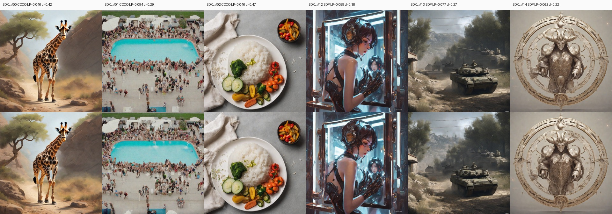

# Stage 4 实验报告：SDXL 跨骨干、100 图多维融合与同协议基线正面对比（阶段性审计归档）

> **更新日期**：2026-11-26 00:38 CST · **审计状态**：已完成部分全部独立复核 `total_mismatches = 0`（[audit_stage4.json](../../experiments/commit_steer_stage4_20261125/audit_stage4.json)）；Stage 4B 实时攻击、Stage 4C 官方 PGID-F 及 Stage 4D 论文级 SemBind 仍在 `249`（GPU 0/1/2）满载运行，全部收尾后将更新完整同表排名与离线 FID。

---

## 1. Stage 4A（已完成并独立审计，`mismatches = 0`）：SDXL Base 1.0 (`1024×1024`) 跨骨干验证

- **协议与配置**（[protocol.json](../../experiments/commit_steer_stage4_20261125/sdxl_cross_backbone/protocol.json) · [summary.json](../../experiments/commit_steer_stage4_20261125/sdxl_cross_backbone/summary.json)）：
  - 骨干：`stabilityai/stable-diffusion-xl-base-1.0`（`bf16`，`1024×1024`，双文本编码器，潜变量 `4×128×128`）；
  - 载体：原生 Gaussian Shading 256-bit（`192b 认证 + 64b HMAC 密钥化 SSCD 承诺`，自然 `16×16 = 256×` 空间重复，单元测试 8/8 往返零比特错）；
  - 零超参/零阈值重调：10 步自包含预览（`2.90s`）+ 30 步 DDIM（第 `3–21` 步中步 Tweedie 轻推，`step_size = 0.042`，留末尾 8 步无引导自然去噪），直接复用 Stage 0 冻结 SSCD-64b 阈值（`0.695099`）；
  - 数据划分：官方统一集严格不重叠切片 `COCO[64:76] + SDP[64:76]`（24 条未见 prompt，与 Stage 0–3 零重叠）。

### 1.1 SDXL `1024×1024` 逐条件盲联合验证（240 次反演）

| 测试条件 | 认证通过 (`auth > 136/192`) | 载荷 BER ↓ | 平均盲语义距 `d_blind` ↓ (`th=0.6951`) | **盲联合通过率** |
| :--- | :---: | :---: | :---: | :---: |
| **Clean（无攻击原图）** | **24 / 24** | **0.00%** (`BA=1.0000`) | **0.300** | **24 / 24 (100.0%)** |
| JPEG `QF=25` | 24 / 24 | 0.39% | 0.319 | **24 / 24 (100.0%)** |
| Gaussian Blur `r=4` | 24 / 24 | 0.20% | 0.321 | **24 / 24 (100.0%)** |
| Gaussian Noise `std=0.05` | 24 / 24 | 0.39% | 0.358 | **24 / 24 (100.0%)** |
| Median Blur `k=7` | 24 / 24 | 0.00% | 0.308 | **24 / 24 (100.0%)** |
| Salt & Pepper `p=0.05` | 24 / 24 | 3.45% | 0.395 | **24 / 24 (100.0%)** |
| Resize `0.25×` | 24 / 24 | 0.00% | 0.313 | **24 / 24 (100.0%)** |
| Brightness `×6` | 24 / 24 | 2.86% | 0.640 | 13 / 24 (54.2%) |
| Random Crop `0.6` (64% 黑框) | 24 / 24 | 0.00% | 0.683 | 14 / 24 (58.3%) |
| Random Drop `0.8` (64% 黑块) | 24 / 24 | 0.00% | 0.697 | 13 / 24 (54.2%) |
| **7 项常规失真合计** | **168 / 168 (100%)** | **1.04%** | — | **157 / 168 (93.5%)** |
| **全部 9 项标准 GS 失真池化** | **216 / 216 (100%)** | **0.81%** | — | **184 / 216 (85.2%)** |

- **画质与速度**：总生成 `23.37s`（预览 `2.90s` + 引导 `20.47s`，单次反演 `4.00s`），`LPIPS` 均值 **`0.0705`** / 中位 **`0.0610`**，`CLIP = 0.2819`（无引导 `0.2827`），552 组跨 prompt FAR **`8 / 552 (1.45%)`**。
- **Live 36 候选 SDXL Reprompt+ 伪造攻击**（12 源 × 3 I2P 恶意 prompt）：原生 GS-SDXL 被攻破 **`36 / 36 (100%, 12/12 源)`** vs Commit-then-Steer **`0 / 36 (0.0%, 0/12 源)`**（均值 `d_blind = 0.985`）。
- **200 张真实 COCO 自然图经验误报（`1024×1024`）**：`auth_fp = 0/200`、`feat_fp = 0/200`、**盲联合误报 `0 / 200`**（95% Clopper-Pearson 上界 `1.83%`，`max auth_ba = 0.5833`，`min d_blind = 0.7193 > 0.6951`）。

---

## 2. Stage 4B（100 图与 2,000 自然图已审计完成，`mismatches = 0`；实时攻击运行中）：多维融合 `hyb_sscd32_clip32`

在与 Stage 3A 完全一致的 **100 条官方未见统一集（50 COCO + 50 SDP）** 与 **2,000 张真实 COCO 自然图** 上，复用 Stage 3D 冻结阈值 `0.553052`（`32b SSCD + 32b CLIP`，同占 64-bit 载荷槽位）：

| 指标 | Stage 3A 单模态 `sscd_64b` | **Stage 4B 多维融合 `hyb_sscd32_clip32`** |
| :--- | :---: | :---: |
| 生成耗时（含 12 步预览） | `7.37s` | `8.51s` |
| 画质漂移 `LPIPS`（均值 / 中位）↓ | `0.128 / 0.116` | **`0.096 / 0.091`（降 25%）** |
| 图文一致 `CLIP`（引导 vs 无引导）↑ | `0.2710` vs `0.2703` | **`0.2739` vs `0.2724`** |
| Clean 盲联合通过率（100 图） | `99 / 100` (BER `0.00%`) | `96 / 100` (BER `0.00%`) |
| 7 项常规 GS 失真（700 查询） | `603 / 700 (86.1%)` | `552 / 700 (78.9%)` |
| 全部 9 项 GS 失真（900 查询） | `694 / 900 (77.1%)` | `613 / 900 (68.1%)` |
| 9,900 跨 prompt FAR ↓ | `141 / 9,900 (1.42%)` | **`132 / 9,900 (1.33%)`** |
| 2,000 COCO 自然图默认联合误报 ↓ | `0 / 2,000` (仅特征 `7/2,000`) | **`0 / 2,000`（仅特征亦 `0 / 2,000`, `min_d = 0.5746`）** |
| 经验 1% Auth 切点验证集误报压制 | `15 / 1,000 -> 0 / 1,000` | **`22 / 1,000 -> 0 / 1,000`** |
| Live 151 步 Imprint & 108 Reprompt+ | `0/4`；SD2.1 `0/54` / SD1.5 `2/54` | 运行中（前 8/8 Imprint 检查点已全拦 `0/8` vs 原生 GS `8/8`） |

数据文件：[gs100_summary.json](../../experiments/commit_steer_stage4_20261125/multidim100_hyb/gs100_summary.json) · [null_fpr_2000/summary.json](../../experiments/commit_steer_stage4_20261125/multidim100_hyb/null_fpr_2000/summary.json)。

---

## 3. Stage 4C & 4D（进行中）：同协议正面基线对比（Native GS / 官方 PGID-F / 论文级 SemBind GS-S）

- **Native GS-256b（100 图已完成，[native100_summary.json](../../experiments/commit_steer_stage4_20261125/head2head_pgid_native_gs/native100_summary.json)）**：单图验证 `4.22s`，Clean `100/100`，9 项失真 `891/900 (99.0%)`（匹配 30 图子集 `267/270`，匹配 20 图子集 `179/180`），但面对 Imprint 与 Reprompt+ 100% 失守。
- **官方 PGID-F（`PGID_dc4ad96`，`k=15, s=3, gamma=0.001`，GPU 1 运行中）**：单图验证实测 **`21.59s`**（为 Commit-then-Steer / Native GS 的 **5.1×**），批量验证与单图最大差 `6.58e-4` 逐位一致；匹配 30 图失真已跑至 `20/30`，随后自动完成 200 自然图误报与实时 Imprint / 108 候选 Reprompt+。
- **论文级 SemBind GS-S（`SemBind_337c9f9` + `diffusers 0.21.4` DPM50 + 100 步 VAE 优化，GPU 0 运行中）**：
  - 20 条分层统一集生成已完成（[gen20_summary.json](../../experiments/commit_steer_stage4_20261125/head2head_sembind/gen20_summary.json)）：单图生成 **`22.09s`**（约为 Commit-then-Steer 的 **3.0×**），`CLIP = 0.2679`（较无掩码 `0.2744` 下降 `-0.0065`），`LPIPS(plain, bound) = 0.723`（硬符号翻转改变图像实例），且同 prompt 兄弟图与辅助图语义汉明距均值 `72.45/1024` 与正式绑定图 `66.55/1024` 几乎重叠；
  - 200 次完整 DPM50+VAE100 失真验证（单图验证实测 ~`52s`）与实时 Imprint / Reprompt+ / 自然图误报正分片执行中。

全部任务由内核 `pidfd` 协调器 [s4_coordinator.py](../../experiments/commit_steer_stage4_20261125/s4_coordinator.py) 自动接续并将在收官后执行离线 COCO-50 FID 与完整 0-mismatch 审计。
