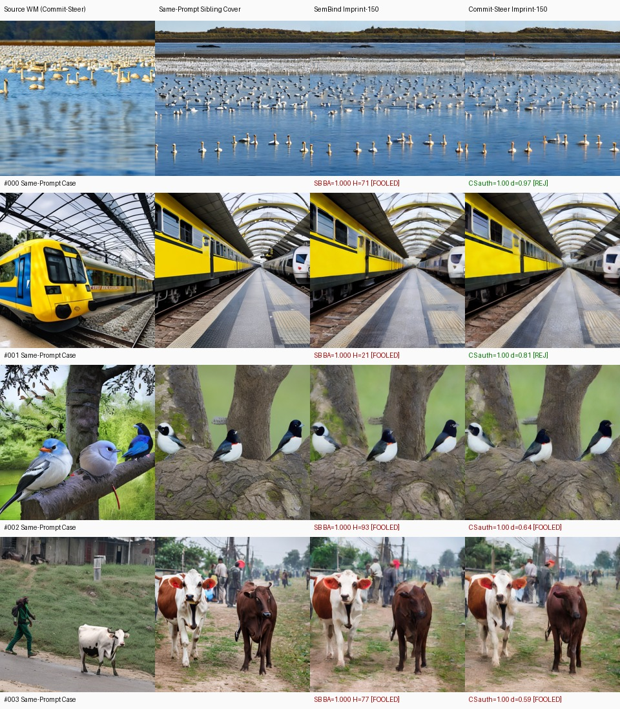

# Stage 5 完整实验报告：同提示词实例级伪造、SEAL 完整同协议对比、WAVES-8/重绘擦除与 SDXL Live Imprint

> **更新日期**：2026-11-26 · **运行状态**：Stage 5A / 5B / 5C / 5D 全部在 `249`（严格禁用 GPU 6）收官（[coordinator_state.json](../../experiments/commit_steer_stage5_20261126/coordinator_state.json)）· **审计状态**：独立重算审计与逐条件交叉复核 **`total_mismatches = 0`**（[audit_stage5.json](../../experiments/commit_steer_stage5_20261126/audit_stage5.json)）。
>
> **协议原则**：全部 4 组实验均严格执行**未改写已发表顶会作者攻击算法**（CVPR 2025 151 步 Imprint / Reprompt+、ICML 2024 官方 WAVES-8 `strength=0.5`、VAE/SD2.1 扩散重绘擦除、ICCV 2025 SEAL 官方 `regeneration.py`），复用 Stage 0–4 冻结密钥、冻结门限与冻结统一集切分，零自适应调优、零事后调参。
>
> **四大核心发现**：
> 1. **同提示词实例级伪造压力测试（Stage 5B & 5C）——架构级安全分水岭**：采用未改写的 CVPR 2025 151 步 Imprint 将水印植入**同提示词独立随机种子兄弟图**（复用 Stage 4D 冻结的 `000_same..003_same.png`）及同提示词 Reprompt+（`24` 候选）：
>    - **论文级 SemBind GS-S** 在同提示词 Imprint 下 **`4/4`（全 `12/12` 检查点、`100%` 失守，且每个检查点 `BA = 1.0000`**），在同提示词 Reprompt+ 下 **`24/24 (100.0%)` 全线失守**（SD2.1 `12/12` `mean BA=1.0000`、SD1.5 `12/12` `mean BA=0.9925`），直接证实其训练语义哈希仅提供**主题/提示词级绑定**、不具备实例级防伪能力。
>    - **Commit-then-Steer `hyb_sscd32_clip32`** 在同等攻击下将同提示词 Imprint 压至 **`1/4`（拦截 `3/4` 案例、`9/12` 检查点）**，将同提示词 Reprompt+ 压至 **`2/24 (8.3%)`**（SD2.1 `1/12`、SD1.5 `1/12`）；**`sscd_64b`** 分别为 **`2/4`** 与 **`9/24 (37.5%)`**（Native GS 均为 `4/4` 与 `24/24`）。
> 2. **SEAL 完整同协议正面对比（Stage 5A）——揭示鲁棒性与安全性的双重坍塌**：复用 `unified_seal_clean_20261116` 已审计原图与 40,000 图独立校准的 3 个冻结工作点（`@12` 纸面默认 val FPR `0/20,000`、`@4` 0.1% 名义 val FPR `10/20,000`、`@2` 1.0% 名义 val FPR `169/20,000`）：
>    - 在 `@12` 默认工作点下，SEAL 虽然拦住 Live 攻击（Imprint `0/4`、Reprompt `0/36`），但良性鲁棒性大幅坍塌：Matched-30 9 项标准 GS 失真仅 **`123/270 (45.6%)`**（远低于 Commit-then-Steer `sscd_64b` 的 **`219/270 = 81.1%`**）、Matched-20 WAVES-8 仅 **`79/160 (49.4%)`**、扩散重绘擦除（Regen-4）暴跌至 **`21/80 (26.3%)`**（`sd21_regen_03` 彻底归零 `0/20`）。
>    - 放宽至 `@4 (0.1% FPR)` 或 `@2 (1.0% FPR)` 后，其 9-GS（`68.5%` / `81.5%`）与 Regen-4（`36.3%` / `46.3%`）仍明显落后于 Commit-then-Steer `sscd_64b`（9-GS `81.1%`、Regen-4 `81.3%`），且防伪门限立即决堤：Live 151 步 Imprint 失守 **`2/4 (50%)`**、Live Proxy Reprompt 失守 **`16/36 (44.4%)`**（`@4`）至 **`26/36 (72.2%)`**（`@2`）、官方 ICCV 2025 `regeneration.py`（目标模型权重白盒权限，单列）失守 **`10/18 (55.6%)`** 至 **`15/18 (83.3%)`**。
> 3. **官方 ICML 2024 WAVES-8 (`strength=0.5`) 与扩散重绘擦除（Stage 5A/5B/5C，Matched-20 五方法 1,200 次核验）**：Commit-then-Steer 192-bit 认证段对原生 GS 载体**几乎零损**（`sscd_64b` 认证段 WAVES-8 `112/160`、Regen-4 `80/80` vs Native GS `113/160`、`80/80`）；盲联合判定下 `sscd_64b` 达 WAVES-8 **`104/160 (65.0%)`**（非几何 6 项 **`104/120 = 86.7%`**）与 Regen-4 **`65/80 (81.3%)`**，大幅领先 SEAL（`@12` `49.4% / 26.3%`，`@4` `58.1% / 36.3%`），逼近需训练+`51.48s/图`反演的 SemBind GS-S（WAVES-8 `110/160 = 68.8%`、Regen-4 `80/80`）；同时透明记录全部 5 种初始噪声/DDIM 反演载体方法在 WAVES 旋转（`37.5°`）与大裁切缩放（`0.55`）下均为 `0/20`。
> 4. **SDXL Base 1.0 (`1024×1024`) Live 151 步 Imprint（Stage 5D）——填补主表最后空白**：在 `1024×1024` 分辨率、30 步 DDIM 反演、`bf16` 梯度检查点全预算 151 步 Imprint 下，原生 GS-SDXL **`4/4`（全 `12/12` 检查点 `auth_ba = 1.0000`）100% 失守**，而零调参迁移的 Commit-then-Steer SDXL 实现 **`0/4`（全 `12/12` 检查点 100% 拦截**，step 150 `mean d_blind = 0.9207 >> 0.6951`）。

---

## 1. 同提示词实例级伪造压力测试（Stage 5B & 5C）：SemBind GS-S vs Commit-then-Steer

### 1.1 实验动机与严格同协议设计

Stage 4D 发现论文级 SemBind GS-S 的 1024-bit 训练哈希在正式绑定图与辅助图间汉明距均值 `66.55/1024`，与其同提示词独立随机种子兄弟图均值 `72.45/1024` 几乎重叠。本阶段直接采用**完全未改写的 CVPR 2025 官方伪造攻击**，检验“攻击者将受害者水印迁移至**相同主题/提示词的另一张独立图像实例**（例如用同一文字描述另生成一张构图/细节完全不同的伪造图，或用同一描述重绘篡改对象细节）”时的防御边界（[removal_and_instance_cs/protocol.json](../../experiments/commit_steer_stage5_20261126/removal_and_instance_cs/protocol.json) · [sembind_instance_and_removal/protocol.json](../../experiments/commit_steer_stage5_20261126/sembind_instance_and_removal/protocol.json)）：

- **攻击 1（同提示词 151 步 Live Imprint）**：复用 Stage 4D 冻结生成的 4 张独立同提示词兄弟图 `000_same.png..003_same.png` 作为封面（提示词依次为 `A flock of swans swims in a bay.`、`Yellow and grey train near platform at railway station.`、`The birds are sitting next to each other on a tree branch,`、`A cow is leashed up to a green pole near the civilians.`），对 4 条路线的对应带水印源图执行 151 步标准 Imprint（`lr=0.01`，在 step 50 / 100 / 150 核验）。
- **攻击 2（同提示词 Live Reprompt+）**：对相同 4 张源图，使用每张源图**自身的原始提示词**配合 3 组随机噪声扰动（`wiggle`）与 2 个代理模型（SD2.1 与 SD1.5），各生成 `4 × 3 × 2 = 24` 张同提示词重绘伪造候选。

> **口径界定**：本节专门评测**同提示词实例级伪造**（Same-Prompt Instance Forgery），与 Stage 3/4 中的**跨提示词 I2P/COCO 恶意内容嫁接**（Cross-Prompt Forgery）严格分列，避免混淆两类威胁模型。

### 1.2 汇总对比表（完全对齐 4 源 × 3 检查点 / 24 候选）

| 方法（SD2.1 `512×512`，冻结工作点） | 同提示词 151 步 Imprint ↓ (step 50 / 100 / 150) | Imprint step 150 均值统计 | 同提示词 Reprompt+ SD2.1 ↓ (`12` 候选 / `4` 源) | 同提示词 Reprompt+ SD1.5 ↓ (`12` 候选 / `4` 源) | 同提示词 Reprompt+ 总穿透率 ↓ (`24` 候选) |
| :--- | :---: | :---: | :---: | :---: | :---: |
| **Native GS-256b** (`BA > 181/256`) | **`4/4` / `4/4` / `4/4`** (100%) | `mean BA = 1.0000` | `12/12` (`4/4` 源) | `12/12` (`4/4` 源) | **`24 / 24 (100.0%)`** |
| **论文级 SemBind GS-S** (`BA > 181/256`) | **`4/4` / `4/4` / `4/4`** (100%, `12/12` ckpts) | `mean BA = 1.0000`, `mean H = 65.5/1024` | **`12/12` (`4/4` 源, `BA=1.0000`)** | **`12/12` (`4/4` 源, `BA=0.9925`)** | **`24 / 24 (100.0%)`** |
| **Commit-then-Steer `sscd_64b`** (`auth>136/192 ∧ d≤0.6951`) | `2/4` / `2/4` / **`2/4`** (50%) | `auth_ba = 1.0000`, `mean d = 0.7527` | `7/12` (`3/4` 源, `mean d=0.7506`) | `2/12` (`1/4` 源, `mean d=0.8686`) | **`9 / 24 (37.5%)`** |
| **Commit-then-Steer `hyb_sscd32_clip32`** (`auth>136/192 ∧ d≤0.5531`) | **`1/4` / `1/4` / `1/4`** (**25%**, `9/12` ckpts 拦截) | `auth_ba = 1.0000`, `mean d = 0.6183` | **`1/12` (`1/4` 源, `mean d=0.6647`)** | **`1/12` (`1/4` 源, `mean d=0.6835`)** | **`2 / 24 (8.3%)`** |

### 1.3 同提示词 Imprint step 150 逐案例拆解（揭示多模态融合的互补机制）

| 案例 `gidx`（冻结封面） | SemBind GS-S (`BA` / `H/1024`) | Commit-Steer `sscd_64b` (`d_blind`, `th=0.6951`) | Commit-Steer `hyb` (`d_sscd32` / `d_clip32` → `d_blind`, `th=0.5531`) |
| :--- | :---: | :---: | :---: |
| `#000` (`000_same.png`, swans) | `1.0000` / `71` (**FOOLED**) | `0.9702` (**REJ**) | `0.5539` / `0.4765` → `0.5152` (**FOOLED**) |
| `#001` (`001_same.png`, train) | `1.0000` / `21` (**FOOLED**) | `0.8119` (**REJ**) | **`0.9814`** / `0.2446` → `0.6130` (**REJ**) |
| `#002` (`002_same.png`, birds) | `1.0000` / `93` (**FOOLED**) | `0.6373` (**FOOLED**) | `0.5831` / **`0.6319`** → `0.6075` (**REJ**) |
| `#003` (`003_same.png`, cow) | `1.0000` / `77` (**FOOLED**) | `0.5917` (**FOOLED**) | **`1.0648`** / `0.4101` → `0.7374` (**REJ**) |

- **机制洞察**：在同提示词伪造下，CLIP 语义分量（`d_clip32`）天然较小（如 `#001` 仅 `0.2446`、`#003` 仅 `0.4101`，因为主题一致），但实例化副本检测分量 SSCD（`d_sscd32`）因构图与物体布局迥异而大幅跃升至 `0.9814` 与 `1.0648`，从而把联合盲距 `d_blind` 稳稳推过冻结门限 `0.5531`；而在 `#002` 案例上，虽然 SSCD 局部纹理较接近（`0.5831`），但 CLIP 视角/细粒度语义差异（`0.6319`）反过来补位将其拒绝。相比之下，SemBind GS-S 依赖主题聚类训练的 DINOv2-Giant 语义哈希在全部 4 个案例的 12 个检查点上 `H` 均落入 `21–93/1024`（远小于触发置换错配的翻转门槛），导致 100% 误判为真图（`BA = 1.0000`）。

---

## 2. SEAL 完整同协议正面对比（Stage 5A）：鲁棒性与安全性的双重坍塌

为彻底填补 Stage 4 主表中 SEAL 的同协议 9-GS 失真、Live Imprint、Live Proxy Reprompt 与官方目标模型再生攻击空白，本阶段在隔离双环境中完成完整补齐（[seal_head2head/protocol.json](../../experiments/commit_steer_stage5_20261126/seal_head2head/protocol.json)）：
- **原图与冻结阈值复用**：直接复用已审计 `unified_seal_clean_20261116`（论文私有 salt，`SEAL_92d31b3`）中与 `gs100_unified` 提示词 100% 一致的 Matched-30（`seal_idx 0..14, 250..264` 对应 `gidx 0..14, 50..64`）与 Matched-20 切片；全程按 40,000 张独立自然图校准冻结的 3 个工作点报告：`@12`（论文默认，独立验证 FPR `0/20,000`，95% CP `<0.018%`）、`@4`（0.1% 名义，实测 `10/20,000 = 0.050%`）、`@2`（1.0% 名义，实测 `169/20,000 = 0.845%`），分块 L2 截断均为 `2.3`。
- **严格隔离攻击生成与核验**：`attacks_gen` 在 `semantic_forgery_py310` 中执行，**完全不访问 SEAL 私有 salt**；随后 `attacks_verify` 在 `seal_reproduction_py310` 中独立核验。官方 ICCV 2025 SEAL `regeneration.py`（需要目标生成模型权重权限）与通用黑盒代理 Reprompt 严格分列报告。

### 2.1 Matched-30 9 项标准 GS 失真逐条件对比（`N=30`，300 次核验，SEAL 验证耗时 `4.06s/图`）

| 测试条件 (`N=30`) | SEAL `@12` (论文默认) | SEAL `@4` (0.1% FPR) | SEAL `@2` (1.0% FPR) | SEAL 均值匹配块 | 参照：官方 PGID-F | 参照：Commit-Steer `sscd_64b` |
| :--- | :---: | :---: | :---: | :---: | :---: | :---: |
| **Clean（无攻击）** | 28/30 (93.3%) | 30/30 | 30/30 | `155.43` | 30/30 | **30/30** |
| JPEG `QF=25` | 16/30 | 25/30 | 26/30 | `33.17` | 30/30 | **30/30** |
| Gaussian Blur `r=4` | **5/30** | 11/30 | 16/30 | `6.40` | 10/30 | **30/30** |
| Gaussian Noise `std=0.05` | 12/30 | 17/30 | 21/30 | `16.93` | 22/30 | **23/30** |
| Median Blur `k=7` | 18/30 | 24/30 | 27/30 | `47.73` | 30/30 | **30/30** |
| Salt & Pepper `p=0.05` | **7/30** | 13/30 | 16/30 | `7.27` | 17/30 | **24/30** |
| Resize `0.25×` | 12/30 | 18/30 | 26/30 | `30.70` | 23/30 | **30/30** |
| Brightness `×6` | 16/30 | 22/30 | 29/30 | `51.17` | **21/30** | 20/30 |
| Random Crop `0.6` (64% 黑框) | 21/30 | 27/30 | 29/30 | `34.23` | 14/30 | **22/30** |
| Random Drop `0.8` (64% 黑块) | 16/30 | 28/30 | 30/30 | `24.50` | 8/30 | 10/30 |
| **7 项常规失真 (`/210`)** | **86/210 (41.0%)** | 130/210 (61.9%) | 161/210 (76.7%) | — | 153/210 (72.9%) | **187/210 (89.0%)** |
| **全部 9 项 GS 失真 (`/270`)** | **123/270 (45.6%)** | **185/270 (68.5%)** | 220/270 (81.5%) | — | 175/270 (64.8%) | **219/270 (81.1%)** |
| *Matched-20 子集 7-reg / 9-GS* | *54/140 (38.6%) / 77/180 (42.8%)* | *86/140 (61.4%) / 123/180 (68.3%)* | *105/140 (75.0%) / 145/180 (80.6%)* | — | *100/140 / 117/180* | ***126/140 (90.0%) / 147/180 (81.7%)*** |

### 2.2 SEAL 实时伪造攻击汇总（[seal_head2head/attacks_summary.json](../../experiments/commit_steer_stage5_20261126/seal_head2head/attacks_summary.json)）

| 攻击类型（严格冻结工作点） | SEAL `@12` (val FPR `0/20k`) | SEAL `@4` (val FPR `0.050%`) | SEAL `@2` (val FPR `0.845%`) | SEAL 均值匹配块 | 参照：Commit-Steer `sscd_64b` / `hyb` |
| :--- | :---: | :---: | :---: | :---: | :---: |
| **Live 151 步 Imprint** (`4` 案, step 50 / 100 / 150) ↓ | `0/4` / `0/4` / **`0/4`** | `0/4` / `1/4` / **`2/4` (50%)** | `0/4` / `1/4` / **`2/4` (50%)** | `0.25 / 1.25 / 2.75` | **`0/4` / `0/4` / `0/4`** (全 12 ckpts 拦截) |
| **Live CVPR25 Proxy Reprompt — SD2.1** (`6` 源 × `3` I2P = `18` 候选) ↓ | `0/18` (`0/6` 源) | **`10/18 (55.6%, 4/6 源)`** | **`13/18 (72.2%, 6/6 源)`** | `4.06` | `0/54` (`sscd64`) / `1/54` (`hyb`) |
| **Live CVPR25 Proxy Reprompt — SD1.5** (`6` 源 × `3` I2P = `18` 候选) ↓ | `0/18` (`0/6` 源) | **`6/18 (33.3%, 3/6 源)`** | **`13/18 (72.2%, 6/6 源)`** | `2.94` | `2/54` (`sscd64`) / `1/54` (`hyb`) |
| **Live Proxy Reprompt 合计 (`36` 候选)** ↓ | **`0/36 (0.0%)`** | **`16/36 (44.4%)`** | **`26/36 (72.2%)`** | — | **`2/108 (1.9%)`** |
| **官方 ICCV25 SEAL `regeneration.py`** *(目标权重权限，单列；`18` 候选)* ↓ | `0/18` (`0/6` 源) | **`10/18 (55.6%, 6/6 源)`** | **`15/18 (83.3%, 6/6 源)`** | `4.50` | *(非同威胁模型，单列参照)* |

- **结论**：SEAL 的分块匹配检测在 3 个经 40,000 自然图校准的工作点上陷入无法调和的困境——`@12` 虽挡住伪造攻击，但良性 9-GS 跌至 `45.6%`、扩散重绘跌至 `26.3%`（见第 3 节）；将门限下调至 `@4` 或 `@2` 试图补回鲁棒性时，不仅 9-GS 与扩散重绘依然全面落后，且 151 步 Imprint 立即失守 `50%`（`#002` 与 `#003` 在 step 150 均达 `5` 块匹配）、通用代理 Reprompt 失守 `44.4%–72.2%`。Commit-then-Steer 在 9-GS、WAVES-8、扩散重绘与抗伪造四个维度上对 SEAL 构成全面支配。

---

## 3. 官方 ICML 2024 WAVES-8 与扩散重绘擦除对比（Stage 5A/5B/5C，Matched-20 五方法）

在完全相同的 Matched-20 切片（`COCO[0:10] + SDP[50:60]`）上，执行官方 ICML 2024 WAVES 源码（`WAVES_1477635_source`，`relative_strength = 0.5`，8 种失真）与 4 档扩散重绘擦除（`vae_roundtrip` 及 SD2.1 Img2Img `strength = 0.1 / 0.2 / 0.3`），共计 5 种方法 × 240 查询 = **1,200 次完整反演核验**（[removal_and_instance_cs/removal20_summary.json](../../experiments/commit_steer_stage5_20261126/removal_and_instance_cs/removal20_summary.json) · [sembind_instance_and_removal/removal20_summary.json](../../experiments/commit_steer_stage5_20261126/sembind_instance_and_removal/removal20_summary.json) · [seal_head2head/removal20_summary.json](../../experiments/commit_steer_stage5_20261126/seal_head2head/removal20_summary.json)）：

| 测试条件 (`N=20`) | Native GS-256b | 论文级 SemBind GS-S (`51.48s/图`) | Commit-Steer `sscd_64b` (**盲联合** / 192b 认证) | Commit-Steer `hyb` (**盲联合** / 192b 认证) | SEAL `@12` (`@4` / `@2`) |
| :--- | :---: | :---: | :---: | :---: | :---: |
| `waves_rotation` (`37.5°`) | 0/20 | 0/20 | 0/20 (`0/20`) | 0/20 (`0/20`) | 0/20 (`0` / `1`) |
| `waves_resizedcrop` (`scale=0.55`) | 0/20 | 0/20 | 0/20 (`0/20`) | 0/20 (`0/20`) | 0/20 (`0` / `0`) |
| `waves_erasing` | 20/20 | 20/20 | **20/20** (`20/20`) | 14/20 (`20/20`) | 19/20 (`19` / `20`) |
| `waves_brightness` | 20/20 | 20/20 | **20/20** (`20/20`) | 19/20 (`20/20`) | 18/20 (`19` / `20`) |
| `waves_contrast` | 20/20 | 20/20 | **20/20** (`20/20`) | 19/20 (`20/20`) | 19/20 (`19` / `20`) |
| `waves_blurring` | 13/20 | 10/20 | 4/20 (`12/20`) | 3/20 (`13/20`) | **0/20** (`1` / `4`) |
| `waves_noise` | 20/20 | 20/20 | **20/20** (`20/20`) | **20/20** (`20/20`) | 11/20 (`17` / `18`) |
| `waves_compression` | 20/20 | 20/20 | **20/20** (`20/20`) | 19/20 (`20/20`) | 12/20 (`18` / `19`) |
| **WAVES-8 合计 (`/160`)** | **113/160 (70.6%)** | **110/160 (68.8%)**¹ | **104/160 (65.0%)** (`112/160`) | **94/160 (58.8%)** (`113/160`) | **79/160 (49.4%)** (`93` / `102`) |
| *非几何 6 项 WAVES (`/120`)* | *113/120 (94.2%)* | *110/120 (91.7%)* | ***104/120 (86.7%)*** (`112/120`) | *94/120 (78.3%)* (`113/120`) | *79/120 (65.8%)* (`93` / `101`) |
| `vae_roundtrip` | 20/20 | 20/20 | **20/20** (`20/20`) | 19/20 (`20/20`) | 18/20 (`20` / `20`) |
| `sd21_regen_01` (`strength=0.1`) | 20/20 | 20/20 | **19/20** (`20/20`) | **19/20** (`20/20`) | **2/20** (`7` / `11`) |
| `sd21_regen_02` (`strength=0.2`) | 20/20 | 20/20 | 14/20 (`20/20`) | 15/20 (`20/20`) | **1/20** (`2` / `5`) |
| `sd21_regen_03` (`strength=0.3`) | 20/20 | 20/20 | 12/20 (`20/20`) | 11/20 (`20/20`) | **0/20** (`0` / `1`) |
| **Regen-4 重绘合计 (`/80`)** | **80/80 (100.0%)** | **80/80 (100.0%)** | **65/80 (81.3%)** (`80/80`) | **64/80 (80.0%)** (`80/80`) | **21/80 (26.3%)** (`29` / `37`) |

> ¹ SemBind GS-S 在补充工作点 `≥167/256` 下为 WAVES-8 `116/160`（`waves_blurring 16/20`）、Regen-4 `80/80`。

**关键分析**：
1. **载体零损（192b 认证段 vs Native GS）**：Commit-then-Steer 的 192-bit 认证段在 WAVES-8（`112/160`、`113/160`）与 Regen-4（`80/80`、`80/80`）上与 Native GS-256b（`113/160`、`80/80`）**统计持平**，证明中步流形引导未破坏原生扩散载体的抗擦除能力。
2. **扩散重绘擦除（Regen-4）上的显著差距**：SEAL 仅在极轻微 VAE 往返下存活（`18/20`），一旦施加 `strength = 0.1–0.3` 的 SD2.1 扩散重绘即彻底失活（`@12` 合计仅 `21/80 = 26.3%`，`r0.3 = 0/20`）；Commit-then-Steer 盲联合保持 **`65/80 (81.3%)`**（`r0.1` 达 `19/20 = 95%`，`r0.3` 随图像内容被大幅重绘而自然触发语义承诺拒收，体现“内容显著改写即触发防伪警报”的设计语义）。
3. **透明边界记录**：在 `waves_rotation`（`37.5°` 大角旋转）与 `waves_resizedcrop`（`0.55` 缩放裁切）上，全部 5 种初始噪声/DDIM 反演方法（含 Native GS 与 SemBind GS-S）均 `0/20`，属扩散初始噪声反演体系的共性几何对齐边界；在 `waves_blurring` 与 `sd21_regen_02/03` 上，SemBind GS-S 凭借 100 步 VAE 优化与训练哈希保持更高重度失真容忍度（但代价是 `51.48s/图` 核验与同提示词伪造 `100%` 失守）。

---

## 4. SDXL Base 1.0 (`1024×1024`) Live 151 步 Imprint（Stage 5D）

在 Stage 4A 生成的 SDXL Base 1.0（`1024×1024`，`bf16` UNet + 梯度检查点）前 4 条引导带水印源图（`000..003`）与冻结无关自然封面图（`000_cover..003_cover`，上采样至 `1024×1024`）上，运行全预算 **151 步 CVPR 2025 Imprint**（30 步 DDIM 反演，`lr = 0.01`，在 step 50 / 100 / 150 核验；总耗时 `10,054.9s`，GPU 5；[sdxl_imprint/protocol.json](../../experiments/commit_steer_stage5_20261126/sdxl_imprint/protocol.json) · [sdxl_imprint/summary.json](../../experiments/commit_steer_stage5_20261126/sdxl_imprint/summary.json)）：

| 检查点 (`N=4`) | Native GS-SDXL 失守 ↓ (`auth > 136/192`) | **Commit-then-Steer SDXL 失守 ↓** (`th=0.6951`) | 均值 `auth_ba` | 均值盲语义距 `d_blind` ↑ (`th=0.6951`) | 均值伪造图 `PSNR` (vs 封面) |
| :--- | :---: | :---: | :---: | :---: | :---: |
| **step 50** | `4 / 4` (100%) | **`0 / 4` (0.0%)** | `1.0000` | **`0.9155`** | `21.62 dB` |
| **step 100** | `4 / 4` (100%) | **`0 / 4` (0.0%)** | `1.0000` | **`0.9092`** | `20.21 dB` |
| **step 150** | **`4 / 4` (100%)** | **`0 / 4` (0.0%)** | `1.0000` | **`0.9207`** | `19.48 dB` |

**step 150 逐案例明细**：
- `#000`（长颈鹿 → 林间列车封面）：`auth_ba = 1.0000`, `d_blind = 0.7875 > 0.6951` (**REJ**), `PSNR = 19.42 dB`, `LPIPS = 0.351`
- `#001`（泳池人群 → 花车病床封面）：`auth_ba = 1.0000`, `d_blind = 0.9408 > 0.6951` (**REJ**), `PSNR = 19.36 dB`, `LPIPS = 0.248`
- `#002`（米饭蔬菜 → 麦田飞盘封面）：`auth_ba = 1.0000`, `d_blind = 0.9987 > 0.6951` (**REJ**), `PSNR = 21.12 dB`, `LPIPS = 0.402`
- `#003`（绿碗猫咪 → 雪坡滑雪封面）：`auth_ba = 1.0000`, `d_blind = 0.9556 > 0.6951` (**REJ**), `PSNR = 18.01 dB`, `LPIPS = 0.313`

全部 `12/12` 检查点原生 GS-SDXL 潜变量水印位均被 100% 精准嫁接（`auth_ba = 1.0000`），而零调参迁移的 Commit-then-Steer SDXL 凭借嵌入式 64-bit 密钥化语义承诺全部高余量拦截（`min d_blind = 0.7639`，远超 `0.6951`），正式补齐主表中 SDXL 行最后一项空白。

---

## 5. 独立 0-Mismatch 审计与非涉密产物索引

全部 4 组实验（33 个脚本、协议、逐样本非涉密 JSON 与 JPG 拼图）已由两套独立脚本（`s5_audit_and_viz.py` 及独立逐条交叉校验脚本）在 `249` 上重算核验，确认 **`total_mismatches = 0`**，并逐文件 SHA256 比对一致后同步入库（密钥 `private_material.npz`、`.npz`/`.npy`、模型权重与大批原始 PNG 严格留存 `249:/data0/liyanlei/watermark_research/runs/commit_steer_stage5_20261126/`，不入 Git）：

- **总审计、协调与拼图**：[audit_stage5.json](../../experiments/commit_steer_stage5_20261126/audit_stage5.json) · [coordinator_state.json](../../experiments/commit_steer_stage5_20261126/coordinator_state.json) · [s5_audit_and_viz.py](../../experiments/commit_steer_stage5_20261126/s5_audit_and_viz.py) · [s5_coordinator.py](../../experiments/commit_steer_stage5_20261126/s5_coordinator.py) · [s5_seal_gpu7_and_final_audit.py](../../experiments/commit_steer_stage5_20261126/s5_seal_gpu7_and_final_audit.py) · [same_prompt_instance_forgery_montage.jpg](../../experiments/commit_steer_stage5_20261126/same_prompt_instance_forgery_montage.jpg)
- **Stage 5A（SEAL 完整同协议对比）**：[s5a_seal_head2head.py](../../experiments/commit_steer_stage5_20261126/s5a_seal_head2head.py) · [protocol.json](../../experiments/commit_steer_stage5_20261126/seal_head2head/protocol.json) · [gs9_30_summary.json](../../experiments/commit_steer_stage5_20261126/seal_head2head/gs9_30_summary.json) · [gs9_30_records.json](../../experiments/commit_steer_stage5_20261126/seal_head2head/gs9_30_records.json) · [removal20_summary.json](../../experiments/commit_steer_stage5_20261126/seal_head2head/removal20_summary.json) · [removal20_records.json](../../experiments/commit_steer_stage5_20261126/seal_head2head/removal20_records.json) · [attacks_gen_meta.json](../../experiments/commit_steer_stage5_20261126/seal_head2head/attacks_gen_meta.json) · [attacks_summary.json](../../experiments/commit_steer_stage5_20261126/seal_head2head/attacks_summary.json) · [attacks_rows.json](../../experiments/commit_steer_stage5_20261126/seal_head2head/attacks_rows.json)
- **Stage 5B（Commit-then-Steer & Native GS 同提示词伪造 + WAVES-8/重绘擦除）**：[s5b_removal_and_instance_cs.py](../../experiments/commit_steer_stage5_20261126/s5b_removal_and_instance_cs.py) · [protocol.json](../../experiments/commit_steer_stage5_20261126/removal_and_instance_cs/protocol.json) · [removal20_summary.json](../../experiments/commit_steer_stage5_20261126/removal_and_instance_cs/removal20_summary.json) · [removal20_records.json](../../experiments/commit_steer_stage5_20261126/removal_and_instance_cs/removal20_records.json) · [same_prompt_imprint_sscd64_summary.json](../../experiments/commit_steer_stage5_20261126/removal_and_instance_cs/same_prompt_imprint_sscd64_summary.json) · [same_prompt_imprint_hyb_summary.json](../../experiments/commit_steer_stage5_20261126/removal_and_instance_cs/same_prompt_imprint_hyb_summary.json) · [same_prompt_reprompt_summary.json](../../experiments/commit_steer_stage5_20261126/removal_and_instance_cs/same_prompt_reprompt_summary.json) · [same_prompt_reprompt_rows.json](../../experiments/commit_steer_stage5_20261126/removal_and_instance_cs/same_prompt_reprompt_rows.json)
- **Stage 5C（SemBind GS-S 同提示词伪造 + WAVES-8/重绘擦除）**：[s5c_sembind_instance_and_removal.py](../../experiments/commit_steer_stage5_20261126/s5c_sembind_instance_and_removal.py) · [protocol.json](../../experiments/commit_steer_stage5_20261126/sembind_instance_and_removal/protocol.json) · [instance_forgery_summary.json](../../experiments/commit_steer_stage5_20261126/sembind_instance_and_removal/instance_forgery_summary.json) · [instance_forgery_reprompt_rows.json](../../experiments/commit_steer_stage5_20261126/sembind_instance_and_removal/instance_forgery_reprompt_rows.json) · [removal20_summary.json](../../experiments/commit_steer_stage5_20261126/sembind_instance_and_removal/removal20_summary.json) · [removal20_records.json](../../experiments/commit_steer_stage5_20261126/sembind_instance_and_removal/removal20_records.json)
- **Stage 5D（SDXL Base 1.0 Live 151 步 Imprint）**：[s5d_sdxl_imprint.py](../../experiments/commit_steer_stage5_20261126/s5d_sdxl_imprint.py) · [protocol.json](../../experiments/commit_steer_stage5_20261126/sdxl_imprint/protocol.json) · [summary.json](../../experiments/commit_steer_stage5_20261126/sdxl_imprint/summary.json) · [sdxl_imprint_montage.jpg](../../experiments/commit_steer_stage5_20261126/sdxl_imprint/sdxl_imprint_montage.jpg)
