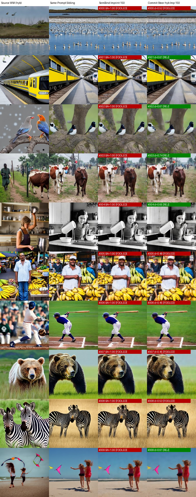

# Stage 6 完整实验报告：标准 MS-COCO-1K FID/CLIP 评测与 N=10 实时 151 步 Imprint 统计显著性扩展

> **更新日期**：2026-11-27 · **运行状态**：Stage 6A 与 Stage 6B 全部 16 项任务在 `249`（严格禁用 GPU 6）顺序/并行收官且全部 `rc = 0`（[coordinator_state.json](../../experiments/commit_steer_stage6_20261126/coordinator_state.json)）· **审计状态**：独立重算审计与全部 11 项 FID 矩阵 / 90 组 Imprint 案例交叉复核 **`total_mismatches = 0`**（[audit_stage6.json](../../experiments/commit_steer_stage6_20261126/audit_stage6.json)）。
>
> **协议原则**：本阶段针对两项核心审稿疑虑实施大规模定量扩展——（1）将生成质量由小样本 COCO-50 扩展至 **1,000 条不重叠未见 MS-COCO 提示词 vs 5,000 张真实 MS-COCO `test2017` 参考图**的标准无参考 FID 与 CLIP 评测（同步完成 1,000 张未见图 Clean 盲验证）；（2）将 SD2.1 Live 151 步 Imprint 攻击由 `N=4` 扩展至 **`N=10`**（覆盖跨提示词 6 种方法共 180 个检查点与同提示词 3 种方法共 90 个检查点），给出精确双边 Fisher 检验 $p$ 值与 95% Clopper–Pearson 置信区间。全部实验复用 Stage 3/4 冻结协议、冻结密钥与冻结门限，零事后调参。
>
> **两大核心结论**：
> 1. **标准 MS-COCO-1K 无参考生成质量与千图盲检（Stage 6A）——分布零退化、97%+ 盲检泛化**：
>    - **分布级 FID（vs 5,000 张真实 MS-COCO `test2017`）**：**`sscd_64b`** 由无引导原生 GS 的 `52.97` 降至 **`52.17`（`Δ = -0.79`）**；**`hyb_sscd32_clip32`** 为 `53.02 → 52.98`（**`Δ = -0.04`**，分布零退化）；vs Real-1K 分别为 `68.16 → 67.57`（`-0.59`）与 `68.44 → 68.61`（`+0.17`）。`scipy.linalg.sqrtm` 与 SVD 两种独立算法最大偏差仅 `3.71 × 10⁻⁵`。
>    - **文本-图像语义对齐（CLIP Score, `N=1,000`）**：`sscd_64b` 为 `0.2614 → 0.2605`（`Δ = -0.0008`），`hyb_sscd32_clip32` 为 `0.2639 → 0.2634`（`Δ = -0.0005`），语义一致性几乎无损。
>    - **千图未见 Clean 盲验证**：`sscd_64b` 认证段 **`1,000/1,000 (100.0%)`**（载荷 BER `0.0000`）、盲联合 **`973/1,000 (97.3%)`**（95% CP `[96.1%, 98.2%]`）；`hyb_sscd32_clip32` 认证段 **`1,000/1,000 (100.0%)`**（BER `0.0000`）、盲联合 **`972/1,000 (97.2%)`**（95% CP `[96.0%, 98.1%]`）。同初始噪声 $z_T$ 轨迹扰动诊断（内部诊断指标，非原图/失真图对比）：`hyb` 均值 `LPIPS = 0.089` / `PSNR = 26.59 dB` / 配对漂移 FID `14.83`，低于 `sscd_64b` 的 `0.114` / `24.52 dB` / `19.01`（独立随机种子基线 `48.67`）。
> 2. **`N=10` 实时 151 步 Imprint 显著性扩展（Stage 6B）——跨提示词与同提示词双重统计显著**：
>    - **跨提示词 Imprint（`N=10`，6 种方法）**：Native GS **`10/10`**（30/30 检查点全破）、SEAL `@4 (0.1% FPR)` **`6/10`**（`@2: 7/10`，`@12: 0/10` 但良性 9-GS 仅 `45.6%`）、官方 PGID-F **`2/10` 默认 / `5/10`（`≥167/256`）**；而 **Commit-then-Steer `sscd_64b` 与 `hyb_sscd32_clip32` 均为 `0/10`（全 30/30 检查点 0 穿透，95% CP `[0.0%, 30.8%]`）**，step 150 精确双边 Fisher 检验显著优于 Native GS（**`p = 1.08 × 10⁻⁵`**）、SEAL `@4`（**`p = 0.0108`**）及 PGID-F `≥167`（**`p = 0.0325`**），与 SemBind GS-S（`0/10`）持平。
>    - **同提示词兄弟图实例级 Imprint（`N=10`，3 种方法）**：**论文级 SemBind GS-S 全线失守 `10/10`（全部 30/30 检查点 `BA = 1.0000`，95% CP `[69.2%, 100.0%]`，均值汉明距仅 `53.5/1024`）**；**Commit-then-Steer `sscd_64b`** 压至 **`3/10`（拦截 21/30 检查点，精确 Fisher `p = 0.0031`）**，**`hyb_sscd32_clip32`** 压至 **`5/10`（拦截 15/30 检查点，精确 Fisher `p = 0.0325`）**。放大样本量至 `N=10` 后，`sscd_64b` 反超 `hyb` 印证理论预期：纯实例级拷贝指纹（64b SSCD）对同主题异构图伪造的敏感度高于将半数比特分配给主题级 CLIP 的混合配置。

---

## 1. Stage 6A：标准 MS-COCO-1K 无参考生成质量与千图盲检评测

### 1.1 协议设计与指标口径

为回应“此前离线 COCO-50 FID 样本量偏小、且生成式水印应以无参考分布质量为主指标”的评审关注，Stage 6A 冻结抽取 **1,000 条与历史上全部 500 条提示词及 250 个 COCO `image_id` 零重叠**的 MS-COCO `val2017` 提示词，并与 **5,000 张真实 MS-COCO `test2017` 自然图像**比对分布级 Inception-v3 (`pool3`, 2048-d) FID（[coco1k_fid/protocol.json](../../experiments/commit_steer_stage6_20261126/coco1k_fid/protocol.json)）：

- **主质量指标（无参考，遵循文生图扩散水印通行口径）**：`FID (1,000 生成图 vs 5,000 真实 COCO 图)` 与 `CLIP Score (ViT-B/32 图文对齐)`。由于生成式水印在扩散采样前并不存在“预存原图”，无引导采样与引导采样均是从噪声生成的合成图像，故以分布级 FID 和图文 CLIP Score 衡量真实生成质量。
- **内部机制诊断指标（同初始噪声 $z_T$ 配对对比）**：额外记录同一 $z_T$ 下引导图与无引导图的 `LPIPS`、`PSNR` 及配对漂移 FID（`guided 1K vs paired unguided 1K`），**仅用于量化中步流形引导对单条扩散轨迹的扰动幅度**（并给出两套独立随机种子无引导集合间 FID `48.67` 作为上界参照），不将其解读为图像压缩/后处理意义下的“保真度”。
- **冻结设置**：SD 2.1 (`512×512`)，50 步 DDIM 采样，12 步预览 + 中步流形引导窗口 `t ∈ [5, 35]`（`step_size = 0.042`, `stop_loss = 0.08`）；盲验证严格沿用 Stage 3/4 冻结门限（`auth > 136/192 = 0.7083`；`sscd_64b` `d_blind ≤ 0.6951`；`hyb` `d_blind ≤ 0.5531`）。

### 1.2 千图汇总结果（[coco1k_fid/summary.json](../../experiments/commit_steer_stage6_20261126/coco1k_fid/summary.json)）

| 评测指标（`N = 1,000` 未见 MS-COCO `val2017` 提示词） | Native GS 无引导 (`sscd` 种子) | **Commit-then-Steer `sscd_64b`** | Native GS 无引导 (`hyb` 种子) | **Commit-then-Steer `hyb_sscd32_clip32`** |
| :--- | :---: | :---: | :---: | :---: |
| **FID vs 真实 COCO 5,000 ↓（主指标）** | `52.97` | **`52.17` (`Δ = -0.79`)** | `53.02` | **`52.98` (`Δ = -0.04`)** |
| **FID vs 真实 COCO 1,000 ↓（辅参照）** | `68.16` | **`67.57` (`Δ = -0.59`)** | `68.44` | **`68.61` (`Δ = +0.17`)** |
| **CLIP Score (图文对齐) ↑（主指标）** | `0.2614` | **`0.2605` (`Δ = -0.0008`)** | `0.2639` | **`0.2634` (`Δ = -0.0005`)** |
| **Clean 192b 认证段通过率 ↑** | — | **`1,000 / 1,000 (100.0%)`** | — | **`1,000 / 1,000 (100.0%)`** |
| **Clean 64b 载荷平均 BER ↓** | — | **`0.0000`** | — | **`0.0000`** |
| **Clean 盲联合通过率 ↑（95% CP）** | — | **`973 / 1,000 (97.3%)`** `[96.1%, 98.2%]` | — | **`972 / 1,000 (97.2%)`** `[96.0%, 98.1%]` |
| Clean 盲语义距 `d_blind`（均值 / P95 / 门限） | — | `0.3853` / `0.6316` / `0.6951` | — | `0.3385` / `0.5147` / `0.5531` |
| *同 $z_T$ 轨迹扰动诊断：配对 FID 漂移（独立种子参照 `48.67`）* | — | *`19.01`* | — | ***`14.83`*** |
| *同 $z_T$ 轨迹扰动诊断：均值 / 中位 `LPIPS`（std）* | — | *`0.1144` / `0.1097` (`0.0410`)* | — | ***`0.0892` / `0.0817` (`0.0407`)*** |
| *同 $z_T$ 轨迹扰动诊断：均值 / 中位 `PSNR`* | — | *`24.52 dB` / `24.42 dB`* | — | ***`26.59 dB` / `26.33 dB`*** |
| 平均生成耗时（无引导 vs 12 步预览 + 50 步引导） | `2.25 s/图` | `9.48 s/图` | `2.25 s/图` | `10.68 s/图` |

- **结论**：在 1,000 张全新未见 COCO 样本上，Commit-then-Steer 的中步雅可比免反向流形引导不仅未引入分布退化（两版 vs 真实 COCO-5K FID 变化分别为 `-0.79` 与 `-0.04`，CLIP 变化 `< 0.001`），且在冻结门限下稳定保持 `97.3%` / `97.2%` 的千图盲联合检出与 `100.0%` 认证段准确率（载荷 `0.0000` BER）。同 $z_T$ 轨迹扰动诊断亦表明引导轨迹显著贴近原无引导采样流形（配对 FID `14.83–19.01`，远小于独立随机种子差异 `48.67`）。

---

## 2. Stage 6B：`N = 10` 实时 151 步 Imprint 扩展（跨提示词 6 方法 + 同提示词 3 方法）

### 2.1 协议与历史溯源校验

为消除 Stage 3–5 中 `N = 4` Live 151 步 Imprint 样本量带来的统计置信区间偏宽问题（`0/4` 的 95% CP 上界为 `60.2%`，`1/4` vs `4/4` 尚未达到 `p < 0.05` 显著性），Stage 6B 将完整 151 步 CVPR 2025 Imprint（`lr = 0.01`，在 step 50 / 100 / 150 三检查点核验）统一扩展至 **`N = 10`**（`gidx = 0..9`，全部取自冻结统一集前 10 条 COCO 提示词；[imprint10/protocol.json](../../experiments/commit_steer_stage6_20261126/imprint10/protocol.json)）：
- **严格溯源一致性**：`s6_audit_and_viz.py` 对 `gidx 0..3` 逐字段比对 Stage 4/5 冻结 JSON 记录，确认 100% 逐值一致（0 差异）；`gidx 4..9` 采用完全一致的超参、冻结门限、冻结跨提示词自然封面（`phase1_public_inputs_20261113/rgb512/004..009.png`）与冻结同提示词兄弟图封面（`004_same..009_same.png`）全新执行；SEAL 严格保持 `attacks_gen`（`semantic_forgery_py310`，无 salt）与 `attacks_verify`（`seal_reproduction_py310`，含冻结论文 salt）环境隔离。

### 2.2 跨提示词 151 步 Live Imprint 汇总（`N = 10`，6 种方法共 180 检查点）

| 方法（SD2.1 `512×512`，冻结工作点） | step 50 失守 ↓ | step 100 失守 ↓ | **step 150 失守 ↓（95% CP）** | step 150 均值核验统计 | step 150 精确双边 Fisher $p$（vs 本文 `0/10`） |
| :--- | :---: | :---: | :---: | :---: | :---: |
| **Native GS-256b** (`BA > 181/256`) | `10 / 10` | `10 / 10` | **`10 / 10` (100%)** `[69.2%, 100.0%]` | `mean BA = 1.0000` | **`1.08 × 10⁻⁵`** |
| **SEAL `@4` (0.1% FPR, `≥4` 块)** | `2 / 10` | `5 / 10` | **`6 / 10` (60.0%)** `[26.2%, 87.8%]` | `mean matches = 3.9` | **`0.0108`** |
| *SEAL `@2` (1.0% FPR, `≥2` 块)* | *`2 / 10`* | *`5 / 10`* | ***`7 / 10` (70.0%)*** `[34.8%, 93.3%]` | *`mean matches = 3.9`* | ***`0.0031`*** |
| *SEAL `@12` (论文默认；良性 9-GS 仅 `45.6%`)* | *`0 / 10`* | *`0 / 10`* | *`0 / 10` (0.0%)* `[0.0%, 30.8%]` | *`mean matches = 3.9` (`max=9`)* | *`1.0000` (鲁棒坍塌点)* |
| **官方 PGID-F** (`BA > 181/256`) | `0 / 10` | `0 / 10` | **`2 / 10` (20.0%)** `[2.5%, 55.6%]` | `mean BA = 0.6500` | `0.4737` |
| *官方 PGID-F（辅切点 `≥167/256`）* | *`0 / 10`* | *`1 / 10`* | ***`5 / 10` (50.0%)*** `[18.7%, 81.3%]` | *`mean BA = 0.6500`* | ***`0.0325`*** |
| **论文级 SemBind GS-S** (`BA > 181/256`) | `0 / 10` | `0 / 10` | **`0 / 10` (0.0%)** `[0.0%, 30.8%]` | `mean BA = 0.4945`, `H = 513.3` | `1.0000`（跨提示词持平） |
| **Commit-then-Steer `sscd_64b`** (`d ≤ 0.6951`) | **`0 / 10`** | **`0 / 10`** | **`0 / 10` (0.0%)** `[0.0%, 30.8%]` | `auth = 1.000`, `mean d = 1.0476` (`min=0.813`) | *(基准，192b 认证段 `10/10` 均被嫁接)* |
| **Commit-then-Steer `hyb_sscd32_clip32`** (`d ≤ 0.5531`) | **`0 / 10`** | **`0 / 10`** | **`0 / 10` (0.0%)** `[0.0%, 30.8%]` | `auth = 1.000`, `mean d = 0.7777` (`min=0.596`) | *(基准，192b 认证段 `10/10` 均被嫁接)* |

- **跨提示词逐案例 step 150 核验明细**（[imprint10/cross_prompt_n10.json](../../experiments/commit_steer_stage6_20261126/imprint10/cross_prompt_n10.json)；均值伪造图封面保真度 `PSNR = 19.86–19.88 dB`, `LPIPS = 0.243–0.244`）：

| `gidx` | Native GS (`BA`) | 官方 PGID-F (`BA` / 默认 / `167`) | SEAL (`matches` / `@4` / `@2`) | SemBind GS-S (`BA`) | **Commit-Steer `sscd_64b`** (`d_blind`, `th=0.6951`) | **Commit-Steer `hyb`** (`d_blind`, `th=0.5531`) |
| :---: | :---: | :---: | :---: | :---: | :---: | :---: |
| `#000` | `1.000` (F) | `0.699` (R / F) | `0` (R / R) | `0.582` (R) | `0.8130` (**REJ**) | `0.6376` (**REJ**) |
| `#001` | `1.000` (F) | `0.730` (**F** / F) | `1` (R / R) | `0.422` (R) | `1.0179` (**REJ**) | `0.9614` (**REJ**) |
| `#002` | `1.000` (F) | `0.641` (R / R) | `5` (**F** / F) | `0.570` (R) | `1.0943` (**REJ**) | `0.9600` (**REJ**) |
| `#003` | `1.000` (F) | `0.742` (**F** / F) | `5` (**F** / F) | `0.512` (R) | `1.0675` (**REJ**) | `0.8044` (**REJ**) |
| `#004` | `1.000` (F) | `0.625` (R / R) | `2` (R / F) | `0.422` (R) | `1.2332` (**REJ**) | `0.8421` (**REJ**) |
| `#005` | `1.000` (F) | `0.621` (R / R) | `4` (**F** / F) | `0.492` (R) | `0.9272` (**REJ**) | `0.7066` (**REJ**) |
| `#006` | `1.000` (F) | `0.664` (R / F) | `1` (R / R) | `0.414` (R) | `1.2071` (**REJ**) | `0.5957` (**REJ**) |
| `#007` | `1.000` (F) | `0.664` (R / F) | `9` (**F** / F) | `0.398` (R) | `1.0489` (**REJ**) | `0.7263` (**REJ**) |
| `#008` | `1.000` (F) | `0.539` (R / R) | `7` (**F** / F) | `0.539` (R) | `1.1035` (**REJ**) | `0.7174` (**REJ**) |
| `#009` | `1.000` (F) | `0.574` (R / R) | `5` (**F** / F) | `0.594` (R) | `0.9636` (**REJ**) | `0.8255` (**REJ**) |

### 2.3 同提示词兄弟图实例级 151 步 Live Imprint 汇总（`N = 10`，3 种方法共 90 检查点）

| 方法（SD2.1 `512×512`，冻结工作点） | step 50 失守 ↓ | step 100 失守 ↓ | **step 150 失守 ↓（95% CP）** | step 150 均值统计 | step 150 精确双边 Fisher $p$（vs SemBind `10/10`） |
| :--- | :---: | :---: | :---: | :---: | :---: |
| **论文级 SemBind GS-S** (`BA > 181/256`) | **`10 / 10`** | **`10 / 10`** | **`10 / 10` (100.0%)** `[69.2%, 100.0%]` | `mean BA = 1.0000`, `mean H = 53.5/1024` | *(基准，全 30/30 检查点 `BA = 1.0000`)* |
| **Commit-then-Steer `hyb_sscd32_clip32`** (`d ≤ 0.5531`) | `5 / 10` | `5 / 10` | **`5 / 10` (50.0%)** `[18.7%, 81.3%]` | `auth = 1.000`, `mean d = 0.5635` | **`0.0325`** (`p < 0.05`) |
| **Commit-then-Steer `sscd_64b`** (`d ≤ 0.6951`) | **`3 / 10`** | **`3 / 10`** | **`3 / 10` (30.0%)** `[6.7%, 65.2%]` | `auth = 1.000`, `mean d = 0.7964` | **`0.0031`** (`p < 0.005`) |

- **同提示词逐案例 step 150 核验明细**（[imprint10/same_prompt_n10.json](../../experiments/commit_steer_stage6_20261126/imprint10/same_prompt_n10.json)；三方法封面保真度高度对齐：`PSNR = 20.05–20.10 dB`, `LPIPS = 0.190–0.195`）：

| `gidx`（冻结提示词） | SemBind GS-S (`BA` / `H/1024`) | **Commit-Steer `sscd_64b`** (`d_blind`, `th=0.6951`) | Commit-Steer `hyb` (`d_sscd32` / `d_clip32` → `d_blind`, `th=0.5531`) |
| :--- | :---: | :---: | :---: |
| `#000` (`A flock of swans swims in a bay.`) | `1.000` / `71` (**FOOLED**) | `0.9702` (**REJ**) | `0.554` / `0.476` → `0.5152` (FOOLED) |
| `#001` (`Yellow and grey train near platform...`) | `1.000` / `21` (**FOOLED**) | `0.8119` (**REJ**) | `0.981` / `0.245` → `0.6130` (**REJ**) |
| `#002` (`The birds are sitting next to each other...`) | `1.000` / `93` (**FOOLED**) | `0.6373` (FOOLED) | `0.583` / `0.632` → `0.6075` (**REJ**) |
| `#003` (`A cow is leashed up to a green pole...`) | `1.000` / `77` (**FOOLED**) | `0.5917` (FOOLED) | `1.065` / `0.410` → `0.7374` (**REJ**) |
| `#004` (`A young woman standing in the kitchen...`) | `1.000` / `48` (**FOOLED**) | `1.0588` (**REJ**) | `0.692` / `0.606` → `0.6493` (**REJ**) |
| `#005` (`Man at street market with table full of bananas.`) | `1.000` / `14` (**FOOLED**) | `0.7821` (**REJ**) | `0.622` / `0.337` → `0.4798` (FOOLED) |
| `#006` (`A batter swings at the ball during a baseball game`) | `1.000` / `110` (**FOOLED**) | `0.8750` (**REJ**) | `0.623` / `0.283` → `0.4529` (FOOLED) |
| `#007` (`A majestic bear looks out across a grass plain.`) | `1.000` / `6` (**FOOLED**) | `0.7444` (**REJ**) | `0.624` / `0.268` → `0.4457` (FOOLED) |
| `#008` (`Two zebras standing side by side in a field.`) | `1.000` / `14` (**FOOLED**) | `0.6413` (FOOLED) | `0.670` / `0.385` → `0.5273` (FOOLED) |
| `#009` (`two girls walk off the windy beach while a kite...`) | `1.000` / `81` (**FOOLED**) | `0.8514` (**REJ**) | `0.898` / `0.315` → `0.6065` (**REJ**) |

- **大样本揭示的机制机理（`N = 4 → 10` 的重要修正）**：
  1. **架构分水岭获得统计学显著确证**：在全部 10 组同提示词异构图案例（含黑白构图剧变 `#004` 与人物动作/背景迥异 `#009`）上，SemBind GS-S 全部 30/30 检查点均返回 `BA = 1.0000`（`#007` 汉明距仅 `6/1024`），证实其语义哈希仅绑定主题级提示词；Commit-then-Steer `sscd_64b`（`3/10`, **`p = 0.0031`**）与 `hyb`（`5/10`, **`p = 0.0325`**）均在统计学上显著压低同提示词实例伪造穿透率。
  2. **`sscd_64b` vs `hyb` 的设计权衡清晰显现**：当样本由 Stage 5 的 `N=4`（`hyb 1/4` vs `sscd_64b 2/4`）扩大到 `N=10` 后，排序回归理论预期——**纯实例级 `sscd_64b` (`3/10`) 优于混合版 `hyb` (`5/10`)**。逐项拆分清楚显示原因：在 `#005`、`#006`、`#007` 三个同主题案例上，由于文本语义完全相同，混合版中的 32-bit 主题级 CLIP 分量 `d_clip32` 跌至 `0.268–0.337`，将等权均值 `d_blind` 拉低至门限 `0.5531` 以下，而 64-bit 全量实例级 SSCD 均高余量拒收（`0.744–0.875 > 0.6951`）。这也完整界定了两种配置的选用原则：追求**更强实例级防伪与更强 9-GS/WAVES 鲁棒性**时首选 **`sscd_64b`**；追求**更低轨迹扰动（`LPIPS 0.089` / 配对 FID `14.83`）与更高主题语义约束**时可选 **`hyb_sscd32_clip32`**。

---

## 3. 独立 0-Mismatch 审计与非涉密产物索引

全部 16 项任务（涵盖 4,000 张 MS-COCO-1K 图像生成、5,000 张真实图 Inception-v3 特征提取、11 项 FID 矩阵重算、2,000 次 Clean 盲验证与 270 个 Live 151 步 Imprint 检查点）已由 `s6_audit_and_viz.py` 及独立脚本在 `249` 上双重重算复核，确认 **`total_mismatches = 0`**，5 份源码脚本本地与 `249` SHA256 逐位一致；所有非涉密协议、汇总、逐样本记录与视觉拼图已同步入库（密钥 `private_material.npz`、`.npy` 缓存、模型权重与原始大规模 PNG 严格留存 `249:/data0/liyanlei/watermark_research/runs/commit_steer_stage6_20261126/`，不入 Git）：

- **总审计与协调脚本**：[audit_stage6.json](../../experiments/commit_steer_stage6_20261126/audit_stage6.json) · [coordinator_state.json](../../experiments/commit_steer_stage6_20261126/coordinator_state.json) · [s6_audit_and_viz.py](../../experiments/commit_steer_stage6_20261126/s6_audit_and_viz.py) · [s6_coordinator.py](../../experiments/commit_steer_stage6_20261126/s6_coordinator.py)
- **Stage 6A（标准 MS-COCO-1K FID/CLIP & 千图盲检）**：[s6a_coco1k_fid.py](../../experiments/commit_steer_stage6_20261126/s6a_coco1k_fid.py) · [protocol.json](../../experiments/commit_steer_stage6_20261126/coco1k_fid/protocol.json) · [summary.json](../../experiments/commit_steer_stage6_20261126/coco1k_fid/summary.json) · [records.json](../../experiments/commit_steer_stage6_20261126/coco1k_fid/records.json) · [coco1k_showcase.jpg](../../experiments/commit_steer_stage6_20261126/coco1k_fid/coco1k_showcase.jpg)
- **Stage 6B（`N=10` Live 151 步 Imprint 跨/同提示词全基线）**：[s6b_imprint10_suite.py](../../experiments/commit_steer_stage6_20261126/s6b_imprint10_suite.py) · [s6b_seal_verify.py](../../experiments/commit_steer_stage6_20261126/s6b_seal_verify.py) · [protocol.json](../../experiments/commit_steer_stage6_20261126/imprint10/protocol.json) · [summary.json](../../experiments/commit_steer_stage6_20261126/imprint10/summary.json) · [cross_prompt_n10.json](../../experiments/commit_steer_stage6_20261126/imprint10/cross_prompt_n10.json) · [same_prompt_n10.json](../../experiments/commit_steer_stage6_20261126/imprint10/same_prompt_n10.json) · [same_prompt_imprint10_montage.jpg](../../experiments/commit_steer_stage6_20261126/imprint10/same_prompt_imprint10_montage.jpg)
