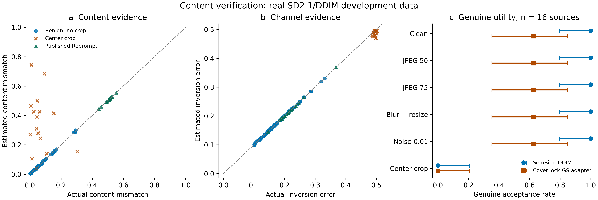

# 内容认证验证：真实信道与标准基线评测

日期：2026-11-10（Asia/Shanghai）。本轮完成仓库与资产审视、原始文献核对、216 个合法开发查询和 36 个已发表 Reprompt 基线候选的真实 SD2.1 生成／反演／验证。

**结论：现有载体能够提供可准确估计的内容差异与反演噪声两类证据，但本轮未测得统计内容验证器优于校准后 SemBind 的防御收益。** 当前结果支持机制研究，尚不足以形成超越 SemBind 的方法论文。独立校准和确认数据未评分。

## 研究主线与创新判断

统一问题是：纠错应该消除通信噪声，而认证需要保留内容差异。SemBind 的身份多数投票将两类变化混合；恢复语义重复组后，可以分别估计内容不一致率 d 和反演错误率 e。候选不改变生成图像、不增加生成 NFE，只改变最终验证决策。[方法、可辨识性推导与先例](method.md)给出具体公式及其适用条件。

已核对 SemBind、SEAL、CoverLock、Geometry、PGID、PAI、CSGuard、SLICE、GS++、Sign Clamping，以及 TIFS/TIP 的半脆弱认证与哈希辅助检测。消息包装、区域语义绑定、纠错、软判决和似然检验均有先例；这些操作本身不作为首创。SemBind 最终会议版与本项目 DDIM 适配的反演设置不同。CoverLock 官方哈希头的辅助图 GS 适配不代表其原生后处理系统。IRIS 当前 arXiv 版本已撤回。

潜在贡献应落在真实载体的统计可辨识性及其带来的同等效用收益。此次前一项获得支持，后一项没有建立。因此不把该版本视为已经足够新颖、已经达到 SOTA 的最终方法。

## 数据与实现边界

- 16 个开发来源；每个来源分别有 SemBind-DDIM 与 CoverLock-GS 适配参考图，另有 4 张普通 GS 控制图。
- 每张参考图有原图、JPEG Q50、JPEG Q75、模糊加 0.8 倍缩放、标准差 0.01 噪声、90% 中心裁剪六种版本，共 216 个合法查询。逐图分数和哈希见 [genuine_full_domain.json](genuine_full_domain.json)。
- Reprompt 使用 CVPR 2025 的单候选反演—重生成算法，固定 SD2.1/DDIM50、生成 CFG 7.5、反演空提示 CFG 1；每个参考仅一个候选，无优化、重采样、候选筛选或检测反馈。16 个目标提示词按开发 COCO 清单的固定顺序选择，不用语义近邻或验证器分数配对。
- 该基线采用无害 COCO 提示词、公开 PNG 参考和 fp16 模型／fp32 反演状态，属于已发表方法的开发适配，不是原论文 I2P 或 SemBind 精确反演的完整复现。36 张候选先固定哈希，再由验证进程评分。
- 验证密钥仅在评分阶段读取。生成基线进程只获得公开图像派生反演与目标提示词；当前是进程职责分离，未实施操作系统访问沙箱。
- 普通 GS 工作点保持严格 `BA > 181/256`。理想独立公平位尾概率不能替代实测或多身份误报率。
- 249 的 0–5、7 号 GPU 均有其他任务；6 号始终排除。本轮服务器 GPU 使用为零，服务器仅运行四线程低优先级 CPU 特征提取。本机 RTX 4070 Laptop 按 UUID 运行 GPU 实验。

## 合法图检出率

| 方法 | 原图 | JPEG Q50 | JPEG Q75 | 模糊缩放 | 噪声 | 中心裁剪 | 全部查询 |
|---|---:|---:|---:|---:|---:|---:|---:|
| SemBind-DDIM 适配 | 16/16 | 16/16 | 16/16 | 16/16 | 16/16 | 0/16 | 80/96 |
| CoverLock-GS 适配 | 10/16 | 10/16 | 10/16 | 10/16 | 10/16 | 0/16 | 50/96 |
| 普通 GS 控制 | 4/4 | 4/4 | 4/4 | 4/4 | 4/4 | 0/4 | 20/24 |

所有分母保留原图未通过的参考，不使用“各方法已经接受的样本”作为共同分母。全部查询下，SemBind 的基础合法检出率为 83.33%，CoverLock-GS 适配为 52.08%。保留基础 GS 判定的附加过滤无法达到整体 90% 或 95% 合法检出率，校准程序明确报告不可行。

裁剪后，SemBind 的真实平均反演符号错误率为 49.52%，而语义码平均一致率仍为 93.29%；普通 GS 也全部失败。这说明此处存在底层几何／反演失效，不能把它解释为语义提取失败，也不能声称统计验证已解决裁剪鲁棒性。

CoverLock-GS 适配有六张原图未通过，平均辅助图—最终图内容码一致率仅 72.58%。该头的稳定性不能直接从“同一图的失真”推广到“同提示词的另一张生成图”。这些数字只评价本适配，不否定 CoverLock 原论文。

## 真实信道机制

在 80 个非裁剪 SemBind 查询上，内容差异率估计 MAE 为 **0.001757**，反演错误率估计 MAE 为 **0.001270**。16 张 Reprompt 候选对应 MAE 分别为 **0.001731** 和 **0.001257**。这些是直接对已知源语义码进行的开发诊断；源语义码不进入候选检测器。

当反演错误率接近 1/2 时，内容参数不可辨识。裁剪点的内容估计明显失真，支持区间应保守，不能据有利点估计接受。统计实现允许内容差异率覆盖 [0,1]，反演错误率限制在小于 1/2 的定向信道；跨图码差异不能被武断限制到 50% 以下。该边界的回归测试及完整数值对照已保存。渐近似然支持区间不作为具有保证覆盖率的置信区间。

图 a、b 展示 96 个 SemBind 合法查询和 16 张 Reprompt 候选的逐图观测。裁剪样本全部保留。图 c 为每种失真下 16 个来源的检出率，误差线为双侧 95% Clopper–Pearson 区间；失真条件之间是同一来源的重复测量。图为通用研究审查输出，未声明满足特定期刊制图要求。

## 标准 Reprompt 比较

默认工作点：普通 GS 控制接受 **4/4**；SemBind-DDIM 接受 **1/16**；CoverLock-GS 适配接受 **0/16**。后者的合法检出率明显较低，因此不能根据 0/16 宣称其防御更强。这里报告验证器接受，尚未人工盲标提示词内容达成。

下表的阈值仅根据合法开发查询确定，并在读取候选结果前冻结。全部 96 个 SemBind 合法查询参与分母：

| SemBind 验证规则 | 合法查询接受 | Reprompt 接受 |
|---|---:|---:|
| 默认 BA | 80/96 | 1/16 |
| 更严格 BA，阈值 0.9609375 | 77/96 | 0/16 |
| 原始符号一致率 | 77/96 | 0/16 |
| 内容多数票 | 77/96 | 0/16 |
| 内容混合似然点估计 | 77/96 | 0/16 |
| 内容支持区间下界 | 79/96 | 0/16 |

最后一行因分数并列而保留了更多合法查询，不能称作与 77/96 完全相同的工作点。更强的诊断是：所有 80 张非裁剪合法查询的最小 BA 为 **0.85546875**，唯一通过默认阈值的 Reprompt 候选 BA 为 **0.71875**，因此本批数据中更严格 BA 已能将它们分开。没有证据表明额外统计建模带来了防御收益。

16 张候选中 0 次接受的双侧 95% 二项精确区间上限约为 **20.59%**，不能解释为真实失败概率为零。此开发评测不提供独立确认或极低误报结论。[逐图候选分数与比较](reprompt_full_domain.json)保留全部结果。

## 下一阶段的研究门槛

当前可检验的后续问题是：**如何让绑定表达最终图像的来源内容，同时保留对允许失真的稳定性？** 本轮数据说明辅助图与最终图的合法漂移，以及裁剪造成的反演失步，是两个真实限制。输出绑定需要正面比较 CoverLock、SEAL、SLICE 与已有轨迹方法，不能把“使用最终图哈希”或“增加分块”直接作为创新。

1. 先完成 SemBind 官方反演组件及生成协议的闭环核验，区分论文系统和 DDIM 适配；当前真实主表不能冒充完整官方复现。
2. 新防御需给出单一机制和可证伪收益，例如在不额外改变合法生成分布的条件下减少辅助—最终漂移，或对允许几何变化保持可辨识内容证据。实现前先说明其与先例的具体差别。
3. 只有在合法稳定性门槛和已发表标准开发基线上优于简单 BA／内容多数票后，再投入独立校准、确认和完整预算 Imprint；不在确认集上选择方法。
4. 最终论文应报告相同绝对合法检出率、图像质量、计算预算、跨模型标准基线、内容盲标和来源聚类不确定性。没有这些证据，不作 SOTA 声明。

## 可复查产物

- [机制与相关工作](method.md)、[引用文件](references.bib)、[引用字段核验](citation_validation.json)、[OpenAlex 检索](openalex.json)。引用工具及图表工作使用的 Scientific Agent Skills 已作为方法资源列入参考。
- [冻结开发协议](../../protocols/content_verifier_development_20261110.json)、[合法阈值](frozen_development_thresholds.json)、[运行环境](execution_environment.json)、[图表来源](figure_provenance.json)。
- `score_content_development.py`、`absolute_calibration.py`、`published_reprompt_cached.py`、`evaluate_content_reprompt.py` 与 `plot_content_verification.py` 位于 `scripts/defense/`。
- 模型、图像、语义特征、反演缓存与私有材料保留于本地 `work/independent_research`；公开报告仅包含分数、协议和哈希。此轮 36 个候选、216 个合法查询均已完成评分，无未结束实验任务。
