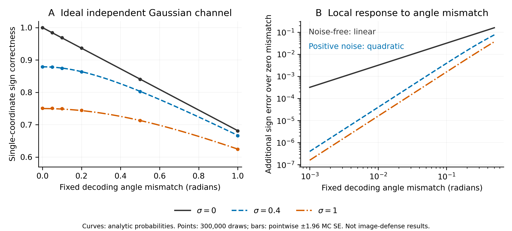

# 连续语义解码区域：生成端机制筛选

研究对象是**内容变化如何改变水印的解码区域**。当前辅助图登记系统把语义码变化变成一组载体符号的翻转；本轮让语义特征连续地旋转二维解码坐标系，检验轻微登记偏差能否产生较小的译码损失。仍使用256位身份、64次重复、16384个载体坐标及原始BA > 181/256，不增加检测网络或额外认证阈值。

## 来自失败结果的约束

对共享语义实验全部336条已消费记录重新分析：使用归一化hash-head连续logits，到辅助图的欧氏距离仍有8条原BA接受的合法查询不小于唯一被接受的最终Imprint；改用实际发布图登记后仍有1条官方裁剪查询重叠。[完整诊断](continuous_semantics.json)保留原判决与文件哈希。这证明距离单阈值无法解决这些具体重叠，不能当成连续嵌入有效或无效的直接证明。

所以本轮同时检验**生成后的登记偏差**与**实际反演后的译码**。若只是数学映射平滑，却在干净图上失效，就不推进昂贵的完整基线研究。

## 编码与解码

设辅助潜变量为Z，辅助图为G(Z)，v为已发布SemBind hash-head的1024维logits归一化结果。用逐图独立秘密binding key生成1024个高斯频率ω_j、8192个独立均匀相位β_k及秘密坐标配对。每个频率用于8个二维对，定义：

```
θ_k(v) = β_k + α ω_(k mod 1024)^T v,  α=2
R(v) = 配对后各二维旋转构成的正交变换
U = R(v)^T Z
W_i = Φ⁻¹((Φ(U_i)+C_i)/2)
Y = R(v) W
```

C为完整GS加密重复载荷。验证时从查询图提取v_q，对反演结果施加R(v_q)^T，再执行原始硬多数投票。秘密相位与频率由HMAC域分离的ChaCha20流生成；逐图密钥保留在249的private_eval，不入库。幅值独立对照沿用项目的固定种子采样设置，不主张其提供新的密码学保证。

α=2在读取本轮图像结果前固定：对于正交单位特征，理想频率平均方向相关为exp(−4)。这是预先选择的示例工作点，不是最优性结论，也不根据既有伪造端点调参。

## 统一机制与可证明边界

**解码区域。** 身份定义一个高斯正交象限，语义定义该象限的朝向；嵌入把辅助噪声传输到这一内容条件区域。旋转、传输与验证描述的是同一个区域及其坐标变换，不是多个独立检测器投票。

**高斯分布。** 给定频率与配对，即使v依赖Z，逐对独立均匀β使R与Z独立。于是U=R^T Z仍为标准联合高斯且与R独立。理想新鲜独立均匀C下，条件分位映射对C取平均得到标准联合高斯W，且W与R独立，故Y也为标准联合高斯。论证对秘密随机量取平均，不能解释成固定密钥、nonce复用或查询自适应条件下的安全证明；浮点与伪随机实现也不等于理想模型。没有β时，“正交所以保持高斯”的论证并不成立：依赖Z的旋转可以把所有二维向量转到同一半平面。

**局部译码损失。** 在固定语义角差δ、W为标准二维高斯且测量误差为独立N(0,σ²I)的理想信道下，单坐标符号正确率为：

```
p(δ,σ)=1/2+arcsin(cos(δ)/sqrt(1+σ²))/π
p(0,σ)−p(δ,σ)=δ²/(2πσ)+O(δ⁴),  σ>0
```

σ=0时损失为|δ|/π（局部范围），不能声称普遍二阶鲁棒性。二值随机超平面码的翻转概率与特征夹角成正比，因此此分析提出了不同的局部误差响应。高斯符号概率和随机超平面夹角关系是经典结论，可见[Goemans作者论述](https://math.mit.edu/~goemans/PAPERS/icm98.pdf)，不作为新的概率定理。真实生成及反演中，语义角差、载体与误差相关，公式不是实际BA、伪造拒绝率或全局单调性的保证；64次重复也不能自动假定独立。

**语义尺度。** 高斯频率下E cos(θ(v)−θ(v'))=exp(−α²||v−v'||²/2)，是已有随机Fourier特征恒等式。此恒等式描述方向相关，不直接等于认证概率。分位传输也是已有映射；其期望平方代价最优性限于固定旋转下指定的条件分布，并不证明真实图像的语义最优性。

## 冻结实验

六个新的提示词与种子，四组配对，每个来源共享辅助图。四组分别为：

| 组别 | 语义区域与耦合 | 作用 |
|---|---|---|
| full | 原SemBind项目适配器二值掩码及独立幅值 | 基线 |
| quantized_geometry | 同一频率、配对和β；内容角为(π/2)sign(ω^T v)，使用条件传输 | 硬量化区域对照；不是原生SemBind |
| continuous_independent | 连续角度；独立全码字符号幅值 | 区分连续区域与辅助图耦合 |
| continuous_transport | 连续角度；上述完整条件传输 | 主候选 |

本轮只筛选干净生成闭环：30次完整50步生成、24次完整50步反演及100步VAE decoder优化、120次错误身份判决。不是缩减攻击预算；协议中没有攻击作业。使用249空闲GPU7、5、4并按UUID绑定，最多三卡，排除GPU6。在前一实验进程退出后由内核事件启动，不轮询分数。

门槛在运行前冻结：主候选干净图6/6；平均连续登记距离不高于full与连续独立对照；平均干净BA不低于量化区域对照；LPIPS比连续独立对照至少低0.05；错误身份接受不高于所有对照。全部通过仅表示值得进一步检验，不能声称防御优于SemBind。完整合法条件与已发表Imprint须另行冻结全部预算；不在这六个来源上调参后称独立确认。

249上的实现检查已覆盖48次身份往返且原始符号错误为0、旋转逆运算与能量、域分离随机流、18个理想信道设置及小角度极限。[数值检查](unit_checks.json)中的高斯矩仅作诊断，不代替分布证明。实验审计用独立复数旋转、直接CDF和硬投票重算，秘密相位生成助手与工作进程共用，审计边界明确记录。



图中曲线为解析概率，点为每个设置300,000次抽样的数值检查，误差线为点态1.96倍Monte Carlo标准误。不同角度共享抽样，不是独立重复；图中没有真实图像或防伪成绩。[数据与绘图清单](figures/ideal_figure_manifest.json)记录来源与哈希。

## 查新边界

| 原始来源 | 已公开内容 | 本轮不能主张 |
|---|---|---|
| [SemBind，ICML2026](https://proceedings.mlr.press/v306/zhang26hj.html) | 语义绑定扩散载体 | 内容绑定首次提出 |
| [Mathon等，TIP2014作者稿](https://scispace.com/pdf/optimal-transport-for-secure-spread-spectrum-watermarking-of-1831ieowih.pdf) | 本轮使用的半高斯分位映射及运输最优性 | 该映射为新算法 |
| [Rahimi与Recht，NIPS2007](https://proceedings.neurips.cc/paper_files/paper/2007/hash/013a006f03dbc5392effeb8f18fda755-Abstract.html) | 随机Fourier特征逼近平移不变核 | 高斯方向相关核为新结果 |
| [LAW，2026预印本](https://arxiv.org/html/2607.22386v1) | 相对参考对的角度载荷与稳定性分析 | 角度载体或高斯旋转首次用于水印 |
| [LatentSeal，2025预印本](https://arxiv.org/html/2510.00799v1) | 连续文本载荷与秘密可逆旋转 | 连续语义载荷或秘密旋转本身新颖 |
| [Tzeng等，IEEE TSP2005作者稿](https://scholars.lib.ntu.edu.tw/bitstreams/db8a4814-be6e-4372-b7fd-40be0ac11a57/download) | 内容相关正交子空间与转置提取 | 内容相关正交编码的一般思想新颖 |

待验证的具体命题是：在扩散图像自身的登记循环中，以平滑内容相关的解码区域替代离散调制，能否改善真实合法通信与已发表伪造之间的取舍。当前查新与数学分析不足以确立首创性；本轮干净图实验也不提供防伪结论。预印本只用于查新，攻击来源仍限定为顶刊顶会已发表的固定基线。

## 执行兼容记录

初次协调进程37733在等待阶段因服务器Python没有`os.pidfd_open`接口退出，尚未创建GPU工作进程、生成图像或评分；[失败状态](initial_launch_state.json)及原冻结协议保留。执行版本v2改用前面流水线已采用的Linux syscall434，并在独立短生命周期子进程上验证退出事件，不轮询。方法、提示词、种子、α及门槛不变；逐图秘密身份重新生成。新协议为[执行协议v2](../../protocols/continuous_geometry_screen_20261113_v2.json)，服务端目录`runs/continuous_geometry_screen_20261113_v2`。
