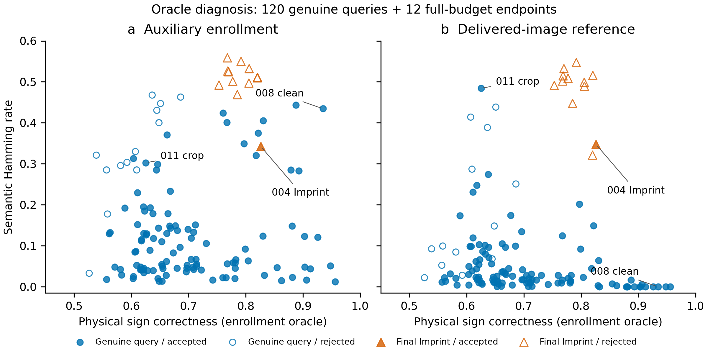

# 生成端失败结果的配对证据

本表来自249上对三项已完成实验的660条已审计记录重新汇总。它是历史实验的配对分析，没有重新执行模型。来源、协议与文件哈希保存在[完整配对记录](embedding_failure_pairs.json)；不同实验使用不同来源，不能把跨行数值作为同一测试集排名。

| 实验内比较 | full合法接受 | 候选合法接受 | 恢复full拒绝 | 丢失full接受 | 机制观察 |
|---|---:|---:|---:|---:|---|
| 共享低频锚 vs full，第一批 | 53/60 | 53/60 | 3 | 3 | 绑定差异0.09505→0.05876；该方案同时改变载体并将重复次数减至32 |
| 共享低频锚 vs full，另一批 | 59/60 | 54/60 | 0 | 5 | 同方向绑定改善0.07227→0.04639，仍未保留合法接受 |
| 分位耦合 vs full | 59/60 | 48/60 | 0 | 11 | LPIPS0.82813→0.64385，但绑定差异升至0.09652；预览更近不能替代认证证据 |
| 三轮反馈 vs full | 58/60 | 56/60 | 0 | 2 | 绑定差异0.10547→0.09391；额外生成没有带来新的合法恢复 |

“恢复”与“丢失”按同来源、同条件配对。第一批共享锚的三个恢复来自亮度、JPEG与随机丢弃；三个丢失来自高斯噪声、随机裁剪与随机丢弃。随机丢弃一栏总接受数相等，但对应样本不同，说明仅比较总数会掩盖取舍。反馈的两个丢失分别发生于高斯噪声与随机丢弃。这些都是Gaussian Shading官方既有条件，参数未改动。

因此，当前证据没有支持“只要提升辅助图保真或语义一致性，防御就会更好”。本轮解码区域实验保留全部16384个符号坐标、64次重复、语义网络和原验证器，单独检验每组的有限符号选择自由度是否能改善这种取舍。它仍主动消耗了一部分译码余量，不能仅凭相同物理坐标数就声称信息传输能力不变。

检测端的共享语义证据与重复观测二阶矩实验另有完整报告：其主要问题是合法接受下降，不能用更低的伪造接受数替代匹配TPR比较。上述生成端与检测端结果共同支持当前的评估要求；它们没有确立任何单一方法的因果优越性。

## 已发表Imprint端点的内容绑定诊断

进一步对共享语义证据实验中全部12个既有151更新端点读取保存的语义码和反演潜变量，结果见[诊断记录](published_forgery_binding_diagnostic.json)。这次分析没有生成、修改或增强攻击；全部图像及原判决保持原样。

以真实登记语义码替换查询语义码时，12个端点的载荷BA均为1；使用实际查询码时，默认验证器接受1/12。因此，在这批样本上，内容码差异承担了拒绝伪造的作用，不能把拒绝结果归因于无法转移载荷。登记码oracle在部署时不可用，也不能作为防御成绩。

唯一默认接受的task004：登记码与未加水印封面Hamming差异0.253906，与最终候选差异0.342773，最终BA0.910156。其余11个端点的登记码到最终候选差异均至少0.46875。对原始图像的人工查看显示，参考图是林间桥与溪流，封面和候选是林间有人行走的场景。此观察与语义区分粒度有限的解释一致，但单个接受案例不能证明唯一原因、普遍漏洞或某种新方法的收益。

task008还说明比较对象必须明确：其最终候选到水印参考图的码差异为0.321289，比task004的0.347656更小；然而它到实际登记辅助图码的差异为0.509766，因而并未被接受。只比较“查询—水印图”的内容相似度会遗漏辅助图绑定偏差。

完整防御设计因此需要同时检验登记到合法查询的一致性，以及登记到既有伪造端点的分离程度。本轮最小反射改变的是嵌入引起的偏差；它保持原语义组件，尚未证明能改善组件本身的语义区分粒度。

## 重复观测的可识别性诊断

对60条校准记录及336条既有开发/Imprint验证记录，进一步拟合每个查询的16次重复符号计数分布：`(1−ε) Binomial(16,r) + ε Binomial(16,1−r)`。其中r是同质物理信道正确率，ε是登记码与查询码差异；每个查询单独用六个初值拟合两个参数，不选择检测阈值。结果见[全部396条参数与直方图](replica_identifiability.json)。

| 查询集 | 数量 | ε估计对真实登记差异的平均绝对误差 | r估计平均绝对误差 |
|---|---:|---:|---:|
| 校准合法查询 | 60 | 0.006081 | 0.001135 |
| 开发合法查询 | 120 | 0.008769 | 0.001316 |
| 最终Imprint | 12 | 0.018325 | 0.000226 |
| 未加水印封面 | 12 | 0.183757 | 0.008762 |

这表明，在这些有清晰载荷的开发样本上，简单重复计数模型已能较准确地估计总体语义差异；无水印封面的r接近0.5时，ε不可识别。它不证明符号独立、分布完全拟合或估计器能给出有效置信区间。开发合法查询的最大ε误差为0.186314，平均误差不能掩盖单例失败；参数搜索也不保证全局最优。

更关键的是，task004最终伪造的真实ε为0.342773，估计为0.342495；默认接受的合法查询中仍有8条真实ε更高，来自task000的一项噪声条件和task008的七项条件，包括干净图。因此，对这批样本，**在保留原BA门槛的前提下，任何仅按真实语义Hamming距离设单一接受上限的规则，只要拒绝该伪造，就至少丢失这8条原本接受的合法查询。** 此结论限定于该类单阈值规则与这批数据，不是所有防御的不可能性证明。

task008的原始辅助图和水印图都符合“登山靴、帐篷、山谷”的提示词，但构图显著不同，干净图登记码差异达0.434570。它为生成端绑定偏差提供了可检查的具体例子。这也是继续研究保持完整译码余量的内容耦合编码、而不是单纯替换检测分数的直接动机。

## 实际发布图登记与局部内容缺失

对全部336条记录追加[参考登记诊断](registration_reference_diagnostic.json)：比较查询到辅助图、以及到实际发布图的语义Hamming差异，保留原始BA判决，不选择新阈值。全部120条合法查询的均值从0.142277降至0.061580；原BA接受的107条中，从0.119926降至0.046848。这说明登记对象对观测差异影响很大，但此干预需要额外提供发布图语义码，不能当作当前盲验证器的成绩。

以发布图码作参考时，仍有一条原本通过的合法查询`011_full_01`，距离0.484375，高于默认通过的最终Imprint距离0.347656。因此，保留原BA门槛且仅加单一发布图Hamming上限的规则，在拒绝该端点时至少损失这一条合法接受。人工查看对应的公开失真输出：原图含棋盘、桌子和吊灯；官方随机裁剪0.6保留了吊灯与墙面，棋盘已不在可见部分。全局语义码的明显改变与可见内容减少一致，不能将它认定为伪造。

另一方面，task008的干净图、亮度与JPEG三条合法查询，在真实物理符号正确率和辅助码差异两个维度上都高于被接受的Imprint端点。由此可直接排除这一狭义规则族：若“可疑度”随**物理正确率与辅助码差异均单调增加**，拒绝该端点就会同时拒绝上述三条合法查询。该结论只涉及这类单调规则；不是所有二维检测器的不可能性证明。

图中显示全部120条合法查询及12个151更新端点，填充表示原BA接受，空心表示原BA拒绝。两轴均使用登记oracle信息；右图额外依赖实际发布图参考。来源仅12个，条件间相关，无置信区间或拟合分类边界。由249生成的[逐点数据](figures/registration_source_data.csv)、[绘图与分析清单](figures/registration_figure_manifest.json)随图归档，PNG已检查。

下一种防御需要同时解释两件不同的事：同一完整图的登记偏差，以及授权局部可见性变化。当前记录不支持只优化全局码距离，也不支持仅把高物理恢复与高语义差异解释为伪造。局部内容对应关系是待检验的研究问题；其实现不能偷用未知参考图、真实失真参数或未计入预算的元数据，也不能通过放松既定合法分母获得表面收益。
