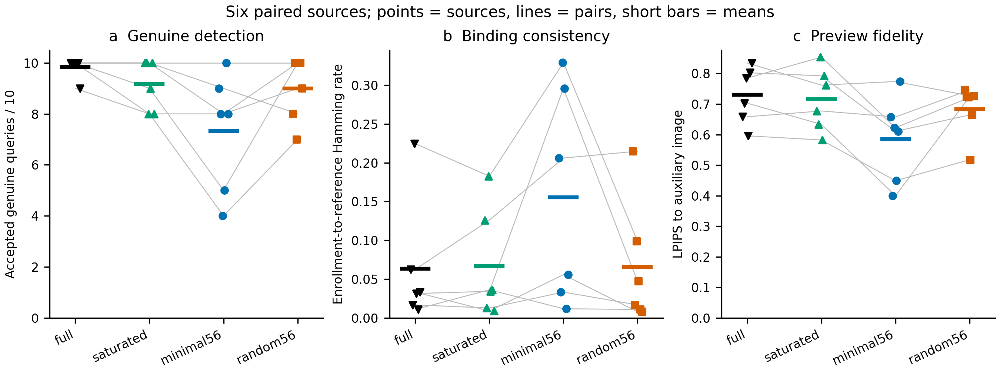

# 解码区域约束嵌入：完整模型验证

2026-11-12 23:28（中国时间），六个新来源、四组配对的240次完整验证完成，1200个错误身份判决及全部初始载体通过独立审计。每次生成/反演50步，解码器优化100步；仅使用249的GPU7、5、4。原始BA > 181/256门槛保持不变。

| 组别 | 合法接受 | 干净图 | 登记到参考图码差异 | 辅助图LPIPS | 初始潜变量均方改动 | 错误身份接受 |
|---|---:|---:|---:|---:|---:|---:|
| full，SemBind项目适配器 | 59/60 | 6/6 | 0.063151 | 0.729771 | 1.990057 | 0/300 |
| saturated | 55/60 | 6/6 | 0.066732 | 0.716744 | 2.000050 | 0/300 |
| minimal56，主候选 | 44/60 | 6/6 | 0.155273 | 0.585440 | 0.589659 | 0/300 |
| random56 | 54/60 | 6/6 | 0.065918 | 0.683347 | 1.503016 | 0/300 |

主候选达到潜变量改动和辅助图保真的目标，但语义绑定差异增大，合法接受下降。相对full，它恢复0条、丢失15条合法查询；相同反射数量的random56也比主候选多接受10条。它未通过合法保留和绑定两项冻结门槛，按协议未执行Imprint扩展。伪造结果为**未运行**，不能记作零次接受。

## 全部官方条件

每个单元格分母均为6个来源；这些条件来自相同来源，不能视为独立样本。

| 条件 | full | saturated | minimal56 | random56 |
|---|---:|---:|---:|---:|
| 干净图 | 6 | 6 | 6 | 6 |
| 随机裁剪0.6 | 6 | 6 | 5 | 6 |
| 随机丢弃0.8 | 5 | 4 | 2 | 4 |
| 亮度6 | 6 | 6 | 5 | 5 |
| JPEG25 | 6 | 6 | 5 | 6 |
| 高斯模糊4 | 6 | 6 | 5 | 6 |
| 高斯噪声0.05 | 6 | 4 | 3 | 4 |
| 中值滤波7 | 6 | 6 | 6 | 6 |
| 椒盐噪声0.05 | 6 | 5 | 3 | 5 |
| 缩放0.25 | 6 | 6 | 4 | 6 |

参数与实现均来自冻结的Gaussian Shading官方条件。没有新攻击或组合优化。

## 机制检验

逐位核对通过：最终符号残差等于“有意保留不符位 XOR 物理信道翻转 XOR 语义绑定差异”。该分解保留相互抵消，不将误差率简单相加。

| 组别 | 实际接受 | 登记码oracle接受 | oracle恢复 | oracle丢失 |
|---|---:|---:|---:|---:|
| full | 59 | 60 | 1 | 0 |
| saturated | 55 | 59 | 4 | 0 |
| minimal56 | 44 | 56 | 12 | 0 |
| random56 | 54 | 59 | 5 | 0 |

登记码oracle仅供诊断，部署时不可获得。主候选有12条查询在去除绑定差异后恢复，但仍有4条未通过，说明本轮既存在绑定偏差，也存在形状约束与物理信道的损失。不能把oracle计入可实现的防御成绩。

主候选中，已反射坐标的物理翻转率为0.362970，保留且符合的坐标为0.330427，保留但不符的坐标为0.234749；random56对应0.319659、0.318474、0.319491。小幅值反射形成的正确证据更易丢失，而被保留的大幅值不符符号更稳定，方向与[理想信道的排序推导](mechanism.md)一致。它是描述性机制证据，不证明真实反演满足独立高斯误差假设。

图中每个点为一个来源，灰线连接同来源，短横线为六来源均值。全部原始来源均显示；没有按条件行作独立置信区间。图表、[源数据](figures/source_data.csv)及[绘图清单](figures/model_figure_manifest.json)由249生成，PNG已人工检查。

## 证据与结论范围

- [完整240条查询与24张参考图](genuine_verified.json)、[载体重建及错误身份审计](projection_audit.json)。
- [逐位信道诊断](channel_diagnostic.json)、[冻结门槛结果](pilot_decision.json)、[完成状态](pipeline_state.json)。
- [冻结方案](plan.md)、[相关工作](related_work.md)、[此前失败机制诊断](failure_evidence.md)。

预启动提交为`7d2b430`，原执行源码及协议保存在服务器运行目录，后续通用调度器扩展没有修改该快照。该实验未支持扩展minimal56，也未建立优于SemBind的结论。六来源是机制筛选，零错误身份接受不是极低FPR证明。后续[条件高斯传输实验](../semantic_transport_pilot_20261112/plan.md)采用新的来源，并在本轮结果读取前冻结公式、对照和门槛；其结果单独报告。
