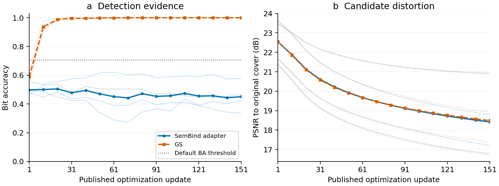

# 完整预算 Imprint 与冻结几何验证器评测

日期：2026-11-11。全部计算、评分和作图在 249 完成。

**8 个案例均完成官方 151 次更新及全部检查点评测。SemBind 项目适配器拒绝最终 4/4 个候选，普通 GS 接受 4/4。冻结几何验证器与原始规则在全部 144 张图上的接受判决完全相同，没有新增防伪收益。**

## 完整执行范围

固定四个开发来源，SemBind 与 GS 配对，使用 CVPR2025 官方 Imprint 版本 `ca68950cd7b53b8438a49580f134b2a0db28d778` 的既定更新逻辑。每例 151 次更新，每次完整 50 步代理反演，保存更新次数 1、11、…、151 的全部 16 个检查点。没有提前停止、候选筛选或检测反馈。

独立验证覆盖 128 张候选、8 张合法参考和 8 张原始载体，共 144 张图。采用完整 DPM50、空提示 CFG3、inv_order=0 与 100 步 VAE decoder inversion；计算官方 PSNR、SSIM、MS-SSIM、LPIPS。完成标记和全部结果见 [baseline_results.json](baseline_results.json)，原协议见 [published_imprint_dpm_full_20261110.json](../../protocols/published_imprint_dpm_full_20261110.json)。

这是完整**单例计算预算**下的小规模开发比较。SemBind 语义头为发布组件，载体与绑定采用项目适配；不是论文规模或原生全流程的完整复现。四个来源的连续检查点是重复观测，不能当作 64 个独立候选来源。

## 最终检查点（151 次更新）

| 载体 | 合法参考通过 | 原始载体通过 | 候选被接受 | 候选平均 BA | PSNR/dB | SSIM | MS-SSIM | LPIPS |
|---|---:|---:|---:|---:|---:|---:|---:|---:|
| SemBind 项目适配 | 4/4 | 0/4 | 0/4 | 0.451172 | 18.4174 | 0.410387 | 0.636740 | 0.278269 |
| GS | 4/4 | 0/4 | 4/4 | 1.000000 | 18.4884 | 0.414824 | 0.642208 | 0.270749 |

质量指标相对各自的原始载体计算。两组质量指标接近，但该小样本并不是严格的等失真统计证明，也没有人工内容达成标注。候选接受是验证器端点，不直接代表所有内容目标均达成。

## 全部轨迹与简单对照

SemBind 的 64 个保存候选全部拒绝。GS 第 1 次更新为 0/4 接受；第 11 次至第 151 次的每个保存检查点均为 4/4 接受，共 60/64。全部轨迹见 [trajectory.csv](trajectory.csv)。

五种规则分别是默认 BA、单位几何的可判定组二项分数、该分数乘 251、全组几何拟合并作搜索校正、分组拟合并作双折校正。所有规则对全部 144 张图的判决一致，逐例证据见 [frozen_geometry_results.json](frozen_geometry_results.json)。

细线为四个来源的逐例轨迹，粗线为四个来源的算术平均；无平滑、无排除、无总体置信区间。水平虚线表示默认 BA 阈值。图 a 展示原始 BA，不将几何校正概率转换为 BA。图 b 的 PSNR 纵轴为局部范围，用于显示连续轨迹变化。该图用于研究审查，未声明符合具体期刊规范。[矢量 PDF](trajectory.pdf)与[图表来源及汇总](summary.json)保留。

## 数值兼容性与后续计算

评分开始前出现过严格浮点相等检查失败：SciPy 1.13.1 的理论概率为 `5.634806966794081e-12`，冻结协议为 `5.634806966794078e-12`，相对差约 `5.7343e-16`。修复只允许 `1e-12` 相对容差内的库舍入差异，并把所有规则实际使用的阈值明确绑定为协议原值；绝对容差为零。阈值没有重新校准。

六项服务器测试通过：完整检查点序列、缺少最终检查点、重复检查点、缺少参考图、浮点舍入兼容、真正阈值变化拒绝。所有 144 个默认 BA 重算均与原评分完全相等。旧失败记录保留，修复版本使用新运行目录。

32 个此前未评分的校准来源、192 个合法查询的首个分片已完成反演，但跨设备桥接未通过原有 0.001 容差，评分被阻止。恢复 batch=2 后仍有约 0.18%–0.20% 的相对潜变量差异。目前服务器正在建立记录的 PyTorch 2.1.2 / Diffusers 0.30.3 隔离环境，原门限通过后才在空闲 GPU5 顺序执行全部分片和 6,144 次身份判决。详见[运行环境核验](../geometry_calibration_20261111/runtime_audit.md)和[冻结回放协议](../../protocols/geometry_calibration_replay_20261111.json)。本报告没有有效校准分数，独立确认集未评分。

## 对防御研究的含义

本次完整预算结果支持该 SemBind 适配器抵御既定 Imprint 的能力，没有显示几何验证器比它更强。开发集中的潜在收益仍是合法裁剪图恢复，必须在新来源和实际身份组合上验证，并与同等阈值的简单对照比较。

论文主张需要围绕明确机制及可重复收益建立。不能以本次相同拒绝率宣称防伪提升，也不能把四个来源上的 0/4 解释为可靠的超低误报或 SOTA 证明。相关方法与下一项可证伪问题见 [research_direction.md](research_direction.md)。
