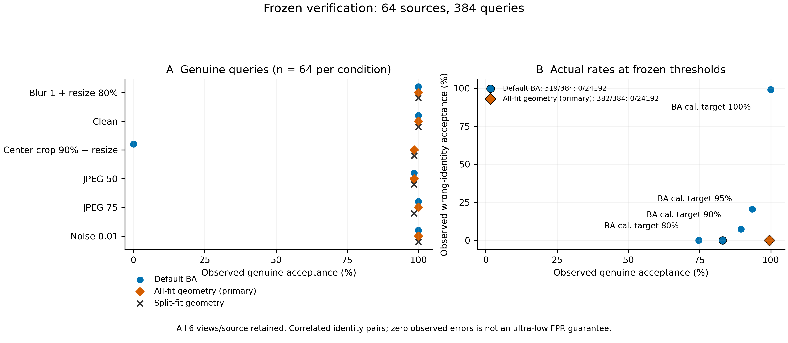

# 冻结几何验证器的独立来源确认

64 个此前未评分的来源、384 张合法查询全部完成完整 DDIM50 反演和 64 身份交叉验证。主要方法全组几何验证通过 **382/384（99.48%）**，默认 `BA > 181/256` 通过 **319/384（83.07%）**；增加 63 张合法接受，没有丢失默认已接受样本。两者在 **24,192 次错误身份判决中均为 0 次接受**。此结果支持当前六种条件下的新来源合法编辑恢复，不证明新增伪造攻击拒绝能力或 SOTA。

## 冻结与执行

任务48–111与开发、校准来源不重叠。协议及校准阈值在 Git 提交 `1dee4bc` 中先于确认评分发布；协议 SHA256 为 `27b2773e8e4e96148766bc143e5342ed243672ecbfea9a3766420824e73e99b2`。主要方法为 all-fit，split-fit 为预先固定的次要对照。全程没有根据确认结果修改检测规则或阈值。

服务器249使用GPU7、5，完整50步、batch2，复用已核验的DDIM模型与固定软件环境。开发桥接维持相对L2门限0.001且语义码逐位相同。输入、代码、缓存、完整身份组合、默认门限与校正概率判决均通过[审计](audited_summary.json)。共有24,576次判决，其中384次正确身份、24,192次错误身份。模型及私钥不在仓库中。

## 逐条件结果

| 条件 | 查询数 | 默认 BA | 全组几何（主要） | 分组几何（次要） |
|---|---:|---:|---:|---:|
| 原图 | 64 | 64 | 64 | 64 |
| JPEG50 | 64 | 63 | 63 | 63 |
| JPEG75 | 64 | 64 | 64 | 63 |
| Blur1 + resize80 | 64 | 64 | 64 | 64 |
| 中心crop90后放大 | 64 | 0 | 63 | 63 |
| Noise0.01 | 64 | 64 | 64 | 64 |
| **总计** | **384** | **319** | **382** | **381** |

身份位置固定的两个统计对照与默认 BA 均为319/384。五种检测规则均为0/24,192错误身份接受；按查询统计，“任意错误身份接受”也均为0/384。这些查询共享来源和身份，零观察值不能解释成极低误报率保证。

图中为观察计数，不绘制独立试验误差条；[PDF](confirmation.pdf)、[源数据](condition_counts.csv)与[绘图来源记录](figure_provenance.json)一并提供。

以来源为重采样单位，保留每个来源的六种视图，共10,000次配对bootstrap（seed20261111）：默认合法接受率95%百分位区间为82.55%–83.33%，全组为98.44%–100%，分组为97.66%–100%。全组相对默认的配对增益为16.41个百分点，区间15.89–16.67个百分点。区间以已冻结校准与本次来源总体为条件，不涵盖校准不确定性或跨模型推广。

## 校准冻结的简单 BA 对照

下表的目标接受率仅用于32来源校准集的阈值选择；确认集实际接受率由数据决定，不能称为精确等TPR比较。所有补充阈值的比较符号为 `>=`，官方默认 `>` 工作点不变。

| 校准目标 | BA阈值 | 确认合法接受 | 错误身份接受 | 任意错误身份被接受的查询 |
|---|---:|---:|---:|---:|
| 80% | 0.9921875 | 287/384（74.74%） | 0/24,192 | 0/384 |
| 90% | 0.546875 | 344/384（89.58%） | 1,778/24,192 | 381/384 |
| 95% | 0.52734375 | 359/384（93.49%） | 4,962/24,192 | 384/384 |
| 100% | 0.4296875 | 384/384（100%） | 23,950/24,192 | 384/384 |
| 全组几何 | 固定校正概率门限 | 382/384（99.48%） | 0/24,192 | 0/384 |

结果说明在本次固定工作点中，降低 BA 门限恢复裁剪接受会伴随大量错误身份接受；几何恢复可保留更有区分力的证据。100%合法接受的BA对照与99.48%的几何结果仍有实际TPR差异，不能略去。

## 失败样本与机制边界

全组的两次失败均来自任务108：JPEG50（BA0.6875，校正p=7.61e-8）和crop90（BA0.515625，校正p=9.73e-9）。后者选出scale0.9、left/top25.6的正确中心裁剪位置，但207个可判消息组中仅150个匹配，未达到冻结门限。几何定位成功并不保证认证证据充分。

分组方法另在同一来源的JPEG75上失败；全组接受该查询。当前数据没有支持引入分组结构的实证收益。

[事后描述分析](failure_description.json)仅比较查询语义码与同来源原图查询码：任务108的crop90、JPEG50、JPEG75分别变化45、22、24位（共1024位）。它们并非对应条件中最大漂移，故这些差异不能单独解释失败。该比较不向检测器提供原图码，也不等同于与嵌入时语义码的比较；不能作为因果分解或在确认集上调参的依据。

## 后续检验

该确认集已经使用，后续方法修改须新增独立验证数据。已冻结的[Gaussian Shading官方九条件评测](../gs_published_conditions_20261111/plan.md)沿用64来源并单独报告，检验更完整的已发表失真设置；不能把两轮当作128个独立来源。官方九条件协议在查看本轮判决前已发布。

当前方法仍是SemBind语义组件结合项目SD2.1/DDIM适配器。已有[完整Imprint预算实验](../full_imprint_20261111/report.md)没有显示几何验证器额外拒绝伪造的收益。原生SemBind、GaussMarker、ROAR的同条件完整比较尚未完成，坐标恢复和多重搜索校正本身不作为首创主张。

证据：[原始判决](results.json)、[完整性记录](complete.json)、[审计汇总](audited_summary.json)、[冻结协议](../../protocols/geometry_confirmation_20261111.json)、[评分前回归核验](scorer_regression.json)。审计脚本与失败描述脚本均在服务器CPU执行。
