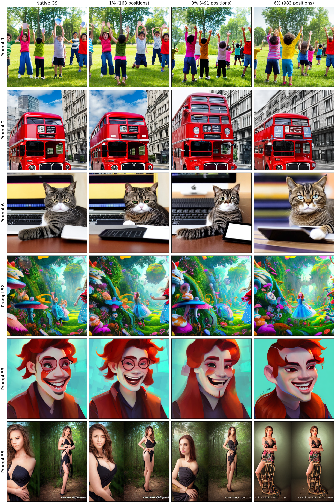

# 256位GS随图指纹：生成稳定性

结论：三个比例均未通过不动点收敛门槛。1%、3%、6%各50个提示词，三轮内收敛均为0/50；不是只差一两位，而是第三轮平均仍有56.78、70.58、85.66位不一致。

| 写入比例 | 三轮内256位完全一致 | 第三轮剩余翻转位数均值（最少–最多） | 第三轮非对称距离均值 | 距离小于合法阈值1/3 |
|---|---:|---:|---:|---:|
| 1% | 0/50 | 56.78（17–103） | 0.4061 | 1/50 |
| 3% | 0/50 | 70.58（32–122） | 0.4952 | 0/50 |
| 6% | 0/50 | 85.66（35–128） | 0.6193 | 0/50 |

距离上限事先固定为0.2364334146。每个比例要求至少45/50个提示词同时达到逐位收敛和距离上限，本次均为0/50。三个收敛率的Wilson95%区间均为0%–7.1%；不把零次观察解释为数学上的绝无可能。

完成50次原生GS生成和450次写入生成，全部50步，共25000次UNet调用。生成阶段约1284.90秒。249 CPU已从保存的连续SSCD特征重新投影，复核全部450轮的指纹、位翻转数与精确收敛状态，差异为0，见[generation_audit.json](generation_audit.json)。

这套冻结实现未通过生成稳定性门槛。反演读码、九类合法处理和画质测量均已完成，见[完整报告](report.md)。生成、传输和GS检测代价分别记录；该机制筛查已结束。

450轮的初始噪声另经CPU独立核对，写入后原生GS水印均为256/256位正确。三个比例实际平均改变121.52、245.45、492.72个坐标；相对原始噪声的L2改变量均值分别为13.93%、24.50%、34.57%。少量位置的符号覆盖仍产生明显数值变化，不能将位置占比直接理解为相同幅度的生成扰动。见[噪声通道复核](noise_channel_audit.json)。

每行依次为原生GS、1%、3%、6%。任务1、2、6、52、53、55在看结果前选定；不调色，统一显示尺寸。可见人物朝向、车辆比例、猫和电脑的外观与位置等实例细节发生变化。这是描述性目测，尚不构成绝对画质偏好的盲评结论。

1%使用163个高斯四区间位置（每位置两位）；3%/6%分别使用491/983个符号位位置及循环重复。该容量差异及固定密钥掩码的范围见[协议说明](../../docs/GS_FINGERPRINT_FIXEDPOINT_PROTOCOL.md)。所有50个提示词均保留，统一比较与SEAL校准仍为主线。
