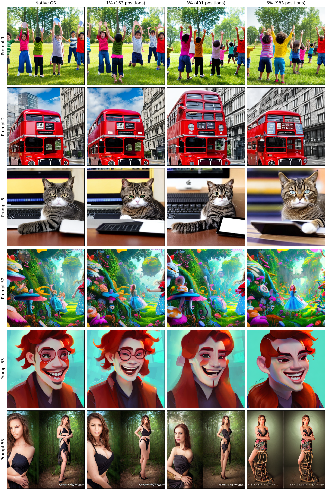
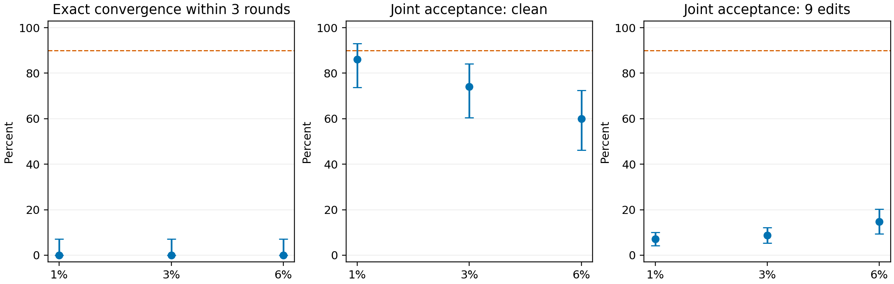

# 256位GS随图指纹机制验证

结论：三个写入比例均未达到通过标准，这条不动点写入实现停止，不继续扩大实验或运行攻击。

50个提示词全部完成，每个比例最多三轮。判据是256位逐位完全一致，不把相似度过线当成收敛。未收敛样本保留在所有联合通过率的分母中。

| 写入比例 | 三轮内逐位收敛 | 同时满足漂移限制 | 原图联合通过 | 九类处理联合通过 | 达标 |
|---|---:|---:|---:|---:|---|
| 1% | 0/50 | 0/50 | 43/50 | 32/450（7.1%） | 否 |
| 3% | 0/50 | 0/50 | 37/50 | 39/450（8.7%） | 否 |
| 6% | 0/50 | 0/50 | 30/50 | 66/450（14.7%） | 否 |

目标分别为：收敛且漂移达标至少45/50；原图联合至少45/50；九类处理联合至少405/450；每类GS检测数均不下降。联合通过指“GS检测通过，且反演读回的码与查询图指纹匹配”。

## 稳定性：噪声改动后还有多少位在变

| 比例 | 第1/2/3轮累计收敛 | 首轮翻转位数均值 | 停止轮翻转位数均值 | 停止轮非对称距离均值 | 相对基准图SSCD距离均值 |
|---|---:|---:|---:|---:|---:|
| 1% | 0/0/0 | 67.42 | 56.78 | 0.4061 | 0.3195 |
| 3% | 0/0/0 | 78.68 | 70.58 | 0.4952 | 0.4566 |
| 6% | 0/0/0 | 95.56 | 85.66 | 0.6193 | 0.5753 |

匹配分数阈值固定为0.2906997563；合法距离阈值的三分之一为0.2364334146。二值码与连续查询比较即使是自身也有量化距离，所以上表的非对称距离不等于纯粹新增的图像变化；连续SSCD距离和位翻转数同时保留。

这一步的问题是：写入的是上一张图的指纹，而写入动作又会改变下一张图。小比例的噪声位置不意味着小比例的图像变化。三轮的平均翻转位数虽有下降，但没有提示词达到逐位一致；1%从67.42降至61.20、56.78位，3%从78.68降至71.82、70.58位，6%从95.56降至88.44、85.66位。现有证据支持“这套实现不能在三轮内完成自洽写入”，不支持关于任意实现或无限轮迭代的结论。

写入噪声的450轮中，原生GS水印在生成前均为256/256位正确。独立重算没有差异，说明原有GS重复编码在初始噪声中仍可解码。相对L2噪声改变量分别为13.9%、24.5%、34.6%；位置比例虽小，数值扰动仍足以改变生成实例。详见[噪声通道复核](noise_channel_audit.json)。

## 读回与联合合法率

| 处理 | 原生GS | 1% GS | 3% GS | 6% GS | 1% 联合 | 3% 联合 | 6% 联合 |
|---|---:|---:|---:|---:|---:|---:|---:|
| 未处理原图 | 50/50 | 50/50 | 50/50 | 50/50 | 43/50 | 37/50 | 30/50 |
| 保留区域0.6 | 50/50 | 50/50 | 50/50 | 50/50 | 0/50 | 0/50 | 0/50 |
| 抹除区域0.8 | 50/50 | 50/50 | 50/50 | 50/50 | 0/50 | 0/50 | 0/50 |
| 亮度参数6 | 49/50 | 49/50 | 49/50 | 49/50 | 13/50 | 13/50 | 11/50 |
| JPEG25 | 50/50 | 50/50 | 50/50 | 50/50 | 6/50 | 7/50 | 11/50 |
| 高斯模糊4 | 50/50 | 50/50 | 50/50 | 50/50 | 0/50 | 1/50 | 8/50 |
| 作者高斯噪声0.05 | 50/50 | 50/50 | 50/50 | 50/50 | 0/50 | 1/50 | 4/50 |
| 中值滤波7 | 50/50 | 50/50 | 50/50 | 50/50 | 3/50 | 9/50 | 15/50 |
| 椒盐噪声0.05 | 50/50 | 49/50 | 50/50 | 50/50 | 0/50 | 1/50 | 2/50 |
| 缩小0.25再还原 | 50/50 | 50/50 | 50/50 | 50/50 | 10/50 | 7/50 | 15/50 |

| 处理 | 1% 平均误码率 | 3% 平均误码率 | 6% 平均误码率 |
|---|---:|---:|---:|
| 未处理原图 | 17.73% | 14.10% | 5.55% |
| 保留区域0.6 | 40.50% | 39.09% | 33.51% |
| 抹除区域0.8 | 40.28% | 37.75% | 31.85% |
| 亮度参数6 | 33.56% | 28.91% | 22.12% |
| JPEG25 | 35.53% | 31.34% | 22.75% |
| 高斯模糊4 | 40.53% | 34.99% | 27.80% |
| 作者高斯噪声0.05 | 39.60% | 36.39% | 29.60% |
| 中值滤波7 | 32.84% | 27.87% | 17.77% |
| 椒盐噪声0.05 | 41.80% | 39.80% | 32.34% |
| 缩小0.25再还原 | 35.18% | 30.17% | 20.84% |

误码率以实际写入的256位明文码为真值。它和“生成后指纹已经改变了多少”是两个独立问题。全部条件使用同一提示词的相同处理种子。常规处理保持已有GS作者函数的原始行为，包括亮度随机采样和高斯噪声uint8运算；没有改成另一种同名操作。

原图的读码误码率均值为17.73%、14.10%、5.55%；九类处理后升至37.76%、34.03%、26.51%。原生GS每位有64次空间重复，新指纹平均只有约1.27、1.92、3.84个原始位槽。增加写入比例确实改善了读回，但同时加重了生成端指纹漂移；本次三个配置都无法同时满足两项要求。

GS自身在未处理图上均为50/50；九类处理中原生基准449/450，1%为448/450（椒盐处理少1张），3%和6%均为449/450。保留区域和抹除区域两项中，GS检测仍各为50/50，但三个比例的联合通过都为0/50。上述数字直接定位了新增指纹链路的失败；没有把它归咎于原生GS检测整体失效。

全部输出均纳入诊断分母。由于没有一个提示词逐位收敛，若发布规则要求先达到不动点再发布，本次每个比例的可发布数量均为0/50。

## 画面变化

| 比例 | PSNR均值（dB） | LPIPS均值 | LPIPS中位数 | LPIPS最大值 |
|---|---:|---:|---:|---:|
| 1% | 18.82 | 0.2687 | 0.2659 | 0.5826 |
| 3% | 16.22 | 0.3709 | 0.3653 | 0.6505 |
| 6% | 14.47 | 0.4623 | 0.4522 | 0.6922 |

这些指标衡量与同提示词、同初始噪声原生GS图的差异，不是绝对画质评价，也不是FID。预先选定的六组对照已逐图查看：变化肉眼可见，包括任务1中人物的姿势和朝向、任务2中巴士的比例与街景、任务6中猫和电脑的外观与摆放，以及任务53中脸部造型和眼镜。1%也能改变实例细节，3%/6%的部分样本出现更明显的构图变化。这是描述性目测，没有进行画质偏好的人工盲评。

图中每行从左到右为原生GS、1%、3%、6%。展示任务在看结果前固定为1、2、6、52、53、55；原图不调色，统一显示尺寸。另提供[LPIPS变化最大的三个提示词](figures/largest_lpips_comparison.png)，这张补充图按结果事后选择。

## 样本量与不确定性

| 比例 | 收敛率及Wilson95%区间 | 原图联合率及Wilson95%区间 | 九类联合率及提示词bootstrap95%区间 |
|---|---|---|---|
| 1% | 0.0% [0.0%, 7.1%] | 86.0% [73.8%, 93.0%] | 7.1% [4.2%, 10.0%] |
| 3% | 0.0% [0.0%, 7.1%] | 74.0% [60.4%, 84.1%] | 8.7% [5.3%, 12.2%] |
| 6% | 0.0% [0.0%, 7.1%] | 60.0% [46.2%, 72.4%] | 14.7% [9.3%, 20.2%] |

九类处理共450次查询，但只有50个独立提示词；区间按提示词成组重采样5000次。这里是既有拆分上的机制筛查，不是独立确认或普遍安全性保证。

虚线为90%目标。收敛与原图联合的误差棒是50个提示词的Wilson95%区间；九类合计是按提示词成组重采样的95%区间。

## 资源与复核

只使用249的GPU3；累计GPU分配时间上界1.3980小时，包含两次启动失败约13.57秒。完成500次生成、2000次反演，每次完整50步，记录125000次UNet调用。除规定九类常规处理外，没有运行攻击实验。SEAL的GPU7/5/4未被迁移或终止。LPIPS、统计、图表和独立复核均使用249 CPU，没有额外GPU任务。

独立复核重新计算了2000条GS判定、1500次读码、1500个指纹分数，以及450轮的指纹变化。判定差异为0。详细记录见[results.json](results.json)和[independent_audit.json](independent_audit.json)。

[输入关联复核](lineage_audit.json)确认200对最终生成图与未处理查询逐像素相同，连续SSCD特征最大绝对差为0；150条停止轮记录与对应生成轮记录一致。

## 实现范围与结论边界

三个写入比例分别占163、491、983个噪声位置。1%只有163个位置，单靠正负号装不下256位，因此使用每位置两位的高斯四区间；3%/6%使用符号位及循环重复。它们不是仅改变比例的纯消融。使用固定GS密钥派生的异或掩码，不加认证和额外纠错；验证端只用供应方密钥、图中读回的码、查询图特征和公开投影，不使用逐图登记的参考。保存的完整参考和明文码仅用于实验误码/漂移审计。

50个提示词来自既有评估拆分，COCO/SDP各25个。3个超长提示词由原管线按77-token上限截断，各比例一致。模型SD2.1，生成CFG7.5、反演空提示词CFG1，均为50步DDIM；未使用PGID防御或VAE优化。GS固定历史阈值BA>181/256，未宣称已经完成统一自然图FPR校准。

此次结论只针对这套冻结实现和预算，未评估伪造攻击下的防御能力。机制筛查已结束，不追加变体或攻击；统一SemBind/PGID/SEAL对比仍是主线。

协议SHA256：`c46dfc434096ab7cda5e25306e1ee3ed22d9e00c5cd07b183b471de7d6d1e29e`。服务器资产：`/data0/liyanlei/watermark_research/runs/gs_fingerprint_fixedpoint_20261116_v3`。代码：[执行脚本](../../scripts/defense/gs_fingerprint_fixedpoint.py)、[独立分析](../../scripts/defense/analyze_gs_fingerprint_fixedpoint.py)、[协议说明](../../docs/GS_FINGERPRINT_FIXEDPOINT_PROTOCOL.md)。
