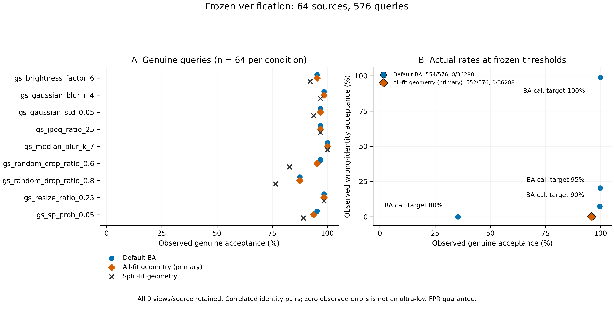

# Gaussian Shading官方九条件结果

64个来源、576张查询、36,864次身份判决已完整完成。默认BA通过**554/576（96.18%）**，主要全组几何方案通过**552/576（95.83%）**，次要分组方案通过**529/576（91.84%）**。五种规则均为**0/36,288错误身份接受**。本轮没有观察到几何搜索收益，不能把六条件确认的中心裁剪恢复结果外推为普遍鲁棒性提升。

## 实现与完整性

直接调用Gaussian Shading CVPR2024官方提交`09c678fadc7545acf7be12647ddf2a5e66f6a9dc`中的`image_distortion`及官方`run.sh`九项参数；函数与强度均未修改。每个条件单独应用。协议先于六条件确认结果发布于`8b7246d`，SHA256为`0db61d41945a0a993a22a9c8c2d49dee39c39f15640f9efd96b338262c8dc050`。

服务器249的GPU7、5完成全部DDIM50/batch2缓存，随后CPU自动评分与完整性审计。该轮与六条件确认共享64来源，不是第二组独立来源。水印载体为项目SemBind/DDIM适配器；这里只复现官方失真组件，不宣称完整Gaussian Shading或SemBind方法复现。详见[协议说明](plan.md)和[上游来源](upstream.json)。

## 全部条件

| 官方参数 | 每项查询数 | 默认BA | 身份位置统计检验 | 全组几何 | 分组几何 |
|---|---:|---:|---:|---:|---:|
| brightness_factor=6 | 64 | 61 | 61 | 61 | 59 |
| gaussian_blur_r=4 | 64 | 63 | 63 | 63 | 62 |
| gaussian_std=0.05 | 64 | 62 | 62 | 62 | 60 |
| jpeg_ratio=25 | 64 | 62 | 62 | 62 | 62 |
| median_blur_k=7 | 64 | 64 | 64 | 64 | 64 |
| random_crop_ratio=0.6 | 64 | 62 | 62 | 61 | 53 |
| random_drop_ratio=0.8 | 64 | 56 | 56 | 56 | 49 |
| resize_ratio=0.25 | 64 | 63 | 64 | 63 | 63 |
| sp_prob=0.05 | 64 | 61 | 62 | 60 | 57 |
| **总计** | **576** | **554** | **556** | **552** | **529** |

身份位置统计检验加同样251倍惩罚后也为552/576，并与全组几何在全部36,864次判决上相同。全部规则的“任意错误身份接受”查询数均为0/576。错误身份判决共享查询、来源和身份，不能解释为36,288次独立试验或极低FPR保证。

[图PDF](confirmation.pdf)、[逐条件数据](condition_counts.csv)、[绘图来源](figure_provenance.json)。图中为观察计数；无独立试验误差条。

以64来源为单位、每来源九视图整体重采样，10,000次配对bootstrap：全组相对默认增益为**−0.35个百分点**，95%百分位区间**−0.87至0个百分点**。全组本身区间92.53%–98.26%，默认93.06%–98.44%。这些区间以固定阈值和当前来源总体为条件。

## 简单BA对照

校准目标不是本轮实际TPR，四个冻结补充门限均使用`>=`。

| 校准目标 | 阈值 | 合法接受 | 错误身份接受 | 任意错误身份接受的查询 |
|---|---:|---:|---:|---:|
| 80% | 0.9921875 | 204/576 | 0/36,288 | 0/576 |
| 90% | 0.546875 | 574/576 | 2,678/36,288 | 572/576 |
| 95% | 0.52734375 | 575/576 | 7,426/36,288 | 576/576 |
| 100% | 0.4296875 | 576/576 | 35,894/36,288 | 576/576 |

## 机制解释与研究判断

全组没有恢复任何默认漏检，反而丢失两张默认接受图：任务084的官方crop0.6与任务097的椒盐噪声0.05。官方crop保留随机窗口并将其余位置填黑，原像素坐标不发生中心裁剪后放大那样的重映射；所以六条件的对齐收益不应直接迁移到这个条件。相同搜索惩罚的身份位置对照与全组完全等效，说明本轮搜索没有产生额外接受收益。分组进一步损失功效。

目前证据支持特定坐标失配的修复，尚不支持新的普适防御。[未加水印负例评估](../unwatermarked_validation_20261111/report.md)已完成；当前研究顺序见[研究计划](../../docs/RESEARCH_PLAN.md)。不能在已看过的确认结果上调阈值并仍称其为独立验证；也不以扩大姿态网格或叠加恢复模块本身作为创新。

证据：[原始判决](results.json)、[完整性记录](complete.json)、[审计](audited_summary.json)、[分析完成记录](analysis_complete.json)。已发表失真条件完整保留，不创造或改进攻击。
