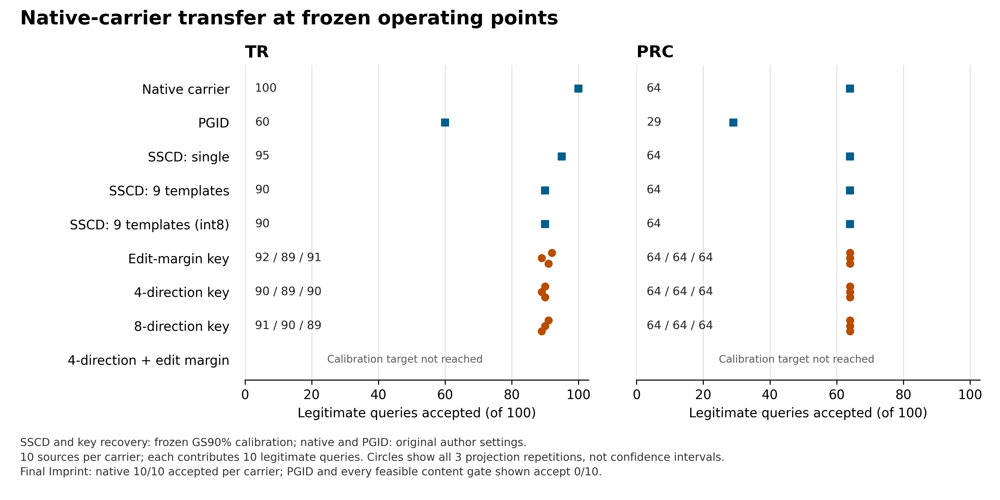

# TR/PRC原生验证材料的实际恢复

已完成20个TR/PRC来源的280次原生反演和3360次真实128位密钥恢复。2179次恢复成功的密钥与原生验证材料全部准确一致；190次不同查询的原作者检测直接使用恢复材料，指标与同次反演的原生对照一致。每张查询均先取得原生结果，恢复失败的查询也保留在分母内。

## 冻结迁移与强对照

四种方法和三组私有投影来自[GS实例恢复实验](../instance_edit_quotient_20261113/report.md)，参数和90%/95%校准阈值在查看TR/PRC结果前冻结。登记使用最终发布图及八张官方处理视图；单参考SSCD、九模板float32/int8和同变换连续SSCD共享这些像素。每载体10个来源，各含10张合法查询、一个自然封面及三个完整Imprint检查点，共140张。

完整Imprint由作者原样入口执行151次更新。[攻击结果](../pgid_carrier_coverage_20261113/report.md)中，TR和PRC在全部三个检查点的原生接受均10/10，PGID和固定SSCD门控后均0/10。本轮四个恢复版本在这些攻击图上的最大恢复半径均失败，从而拒绝全部输出；攻击算法和预算没有改动。

PRC采用PGID作者配置的DPM精确反演；TR采用作者DDIM路径。两种载体保持原生。项目分别从恢复出的密钥解封完整作者验证器状态，然后调用其检测方法。函数边界位于同一进程内，尚未做操作系统级私有输入隔离。

## 最大恢复半径127

合法分母每载体100，含10张干净图和90张处理图。三个数对应投影0、1、2。

| 方法 | TR密钥恢复及最终接受 /100 | PRC密钥恢复 /100 | PRC最终接受 /100 |
|---|---|---|---|
| 编辑裕量固定恢复 | 95 / 94 / 93 | 88 / 89 / 91 | 64 / 64 / 64 |
| 四方向切空间恢复 | 96 / 94 / 97 | 88 / 88 / 88 | 64 / 64 / 64 |
| 八方向切空间恢复 | 97 / 97 / 97 | 89 / 90 / 91 | 64 / 64 / 64 |
| 四方向＋编辑裕量恢复 | 89 / 90 / 89 | 83 / 84 / 82 | 64 / 64 / 64 |

TR原生合法检测100/100，PRC原生合法检测64/100；两种载体干净图各10/10、自然封面各0/10。PRC检测限制了当前完整系统的合法通过数：即使内容密钥恢复成功，载体未检出的查询仍会被拒绝。

## 冻结GS校准阈值迁移

下表使用同一个GS开发集的90%绝对合法图校准目标，所有阈值直接迁移。本批TR/PRC的实际合法通过数由结果决定。

| 方法 | TR最终接受 /100 | PRC最终接受 /100 |
|---|---|---|
| 编辑裕量固定恢复 | 92 / 89 / 91 | 64 / 64 / 64 |
| 四方向切空间恢复 | 90 / 89 / 90 | 64 / 64 / 64 |
| 八方向切空间恢复 | 91 / 90 / 89 | 64 / 64 / 64 |
| SSCD单参考 | 95 | 64 |
| SSCD九模板float32 / int8 | 90 / 90 | 64 / 64 |
| 四方向连续SSCD | 89 | 64 |
| 八方向连续SSCD | 90 | 64 |

GS的95%校准目标对这四种恢复版本均不可行，故不补造相应工作点。可行的连续对照迁移后，SSCD单参考为TR97/100、PRC64/100，九模板为TR94/100、PRC64/100，四/八方向连续SSCD为TR97/100、PRC64/100。最大半径表与校准表采用不同工作点，各自保留。

[来源配对重采样](source_uncertainty.json)以10个来源为单位，每次同时保留其10张合法查询，重复10000次。TR八方向恢复相对int8九模板的差值为+1、0、−1个百分点，95%描述性区间分别为[−2,4]、[−3,3]、[−5,3]个百分点。PRC两种方法在本批来源上的联合接受集合相同，差值均0；相应退化区间只反映这批数据。该分析固定GS校准阈值，未纳入校准不确定性或多重比较校正，数据属于开发来源。

## 载体瓶颈与完整汇总

PRC九类处理的原生通过数依次为：裁剪0/10、随机丢弃0/10、亮度5/10、JPEG9/10、模糊5/10、高斯噪声9/10、中值10/10、椒盐7/10、缩放9/10，加干净图10/10。TR全部条件均10/10。当前PRC系统的改进空间首先受原生检测限制；单纯增加内容恢复覆盖不会提高这批查询的最终通过数。

合法图PGID对照和[完整配对审计](audited_scores_v3.json)已完成。440条合法图与封面对照逐像素匹配，280张查询的原生跨运行判定差异为0。每载体合法分母100，完整Imprint终点分母10。

| 方法与工作点 | TR合法 /100 | PRC合法 /100 | TR最终Imprint /10 | PRC最终Imprint /10 |
|---|---|---|---|---|
| 原生检测，作者设置 | 100 | 64 | 10 | 10 |
| PGID-F，作者设置 | 60 | 29 | 0 | 0 |
| SSCD单参考，冻结GS90%校准点 | 95 | 64 | 0 | 0 |
| SSCD九模板int8，同校准目标 | 90 | 64 | 0 | 0 |
| 八方向实际恢复，同校准目标，三组投影 | 91 / 90 / 89 | 64 / 64 / 64 | 0 / 0 / 0 | 0 / 0 / 0 |

PGID的干净图通过数为TR8/10、PRC10/10；九类编辑合计为TR52/90、PRC19/90。PGID保持作者防御设置，SSCD与恢复方法使用每图登记记录，输入权限与存储开销不同。表格给出各自冻结工作点的绝对结果；完整论文规模与统一工作点复现仍需另行完成。

[相同合法通过数的描述性比较](comparison_analysis.json)覆盖210组候选/强对照组合。每组在评估合法图上选择强对照达到候选通过数的最小阈值；全部组合中，强对照达到至少相同的合法通过数，封面与三个Imprint检查点的接受数均不高于候选。这里的阈值用于描述当前数据的可分性，独立校准结果仍以前文冻结GS表为准。当前开发来源上的恢复方法没有取得强对照之外的防伪收益。

图的[原始数据](figures/source_data.csv)、[PDF](figures/carrier_comparison.pdf)和[来源清单](figures/manifest.json)一并保存。PNG已检查标签、脚注与缺失点显示；PDF的两种字体均为嵌入的TrueType。三个恢复点分别表示投影重复。

## 证据与开销

[完成记录](complete.json)记录280次反演和3360次恢复；[逐查询结果](rows.json)、[连续强对照](controls.json)、[登记记录清单](enrollment.json)保留指标及哈希。2179个成功恢复事件共享190次对应查询的恢复材料检测，加280次已知材料原生检测，共470次原作者检测调用。

本轮序列化完整作者对象用于确认接口完整性：TR原生状态149336字节、PRC10041440字节，实例辅助记录另计。它们尚未压缩为部署所需的最小验证字段。存储比较应给双方计入同样的原生材料；内容特征本身的九模板int8成本为4608字节。本轮没有更改图像或载体，也没有新增攻击。

完整执行协议、运行边界和来源见[协议说明](protocol_note.md)。当前执行队列统一见[project_state.json](../../project_state.json)。
