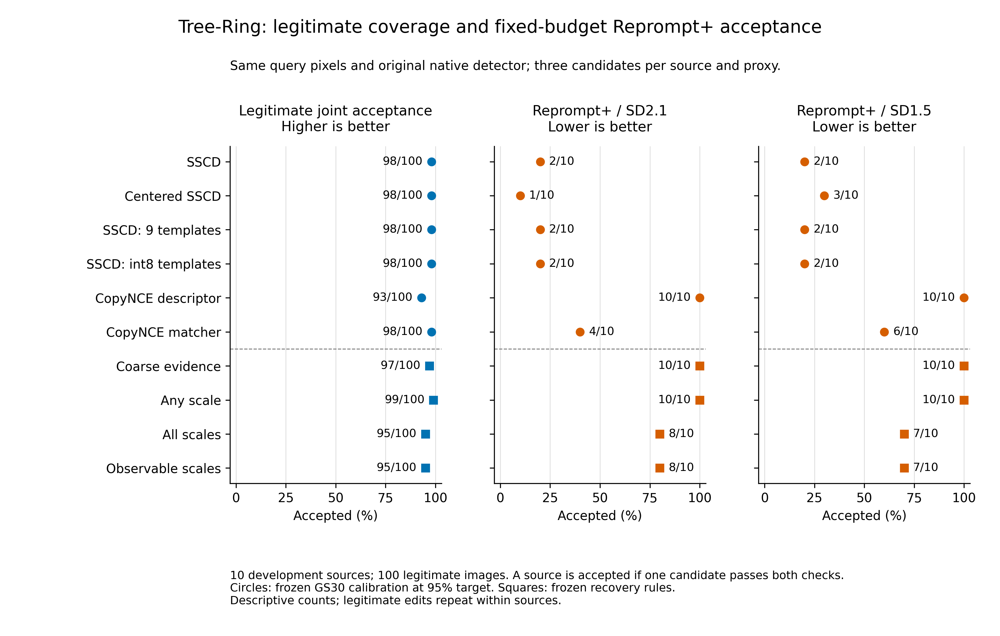

# Reprompt+ 完整候选预算下的实例密钥恢复

249 完成 240 张作者 Reprompt+ 候选、480 条唯一原生/PGID 判定，以及四种冻结规则的 960 次实际密钥恢复。473 次成功均返回登记时的准确密钥与验证材料；202 张候选使用恢复出的材料重新调用原生检测器。全部原生候选通过，因而本批内容恢复通过数与联合通过数相同。

完整候选预算进一步暴露了当前原型的实例混淆：TR 合法图通过 95/100 时，可观察尺度规则接受 SD2.1、SD1.5 代理下的 8/10、7/10 个来源；相同合法通过数的 SSCD 为 1/10、1/10。固定三尺度交集与可观察规则在全部 240 张候选上判定一致。当前收益来自细节约束，观察状态的选择没有增加有效恢复能力。

## 实验范围与判定方式

GS/TR 各 10 个来源，两种代理。GS 每来源、每代理有 9 张候选，TR 有 3 张候选，均按原作者固定预算执行。先对每张图计算“内容检查或密钥恢复通过，并且该图的原生载体通过”，再在同来源的固定候选集合中取任一通过。来源接受率的分母是来源数。

主要内容比较沿用既有划分：GS 为 3 个评估来源、30 张合法图，TR 为 10 个迁移来源、100 张合法图。GS 其他 7 个来源也执行恢复并保存逐张结果，但属于拟合/校准部分。原生和 PGID 的全 10 来源结果另列。合法图与已完成的 [多尺度恢复](../observable_evidence_recovery_20261115/report.md) 使用同一记录和查询；本批复用其冻结合法结果。

攻击调用作者代码，50 步 DDIM 反演、50 步 float32 生成，GS 使用原始重采样。实现、哈希和已审阅提示词子集见 [攻击报告](../author_reprompt_plus_20261115/report.md)。本批目标模型是 SD2.1，SD1.5 为补充代理；论文的大样本、多目标模型矩阵尚未完成。目标提示词实现程度尚未标注，以下统计的是水印接受。没有为 PRC 扩展新的 Reprompt+ 行为；PRC 的 basic Reprompt 与合法对照见 [此前完整结果](../author_reprompt_control_20261114/report.md)。

## 冻结工作点结果

六个连续强对照使用事先在 GS 的 30 张合法校准图上确定的 95% 目标阈值；四种恢复规则使用冻结的代数恢复条件。表中合法通过率是各工作点迁移后的实际结果，保留其差异。

| 方法 | TR 合法联合通过 | Reprompt+ SD2.1 来源接受 | Reprompt+ SD1.5 来源接受 |
|---|---:|---:|---:|
| SSCD 单参考 | 98/100 | 2/10 | 2/10 |
| 中心化 SSCD | 98/100 | 1/10 | 3/10 |
| SSCD 九模板 | 98/100 | 2/10 | 2/10 |
| SSCD int8 九模板 | 98/100 | 2/10 | 2/10 |
| CopyNCE 描述子 | 93/100 | 10/10 | 10/10 |
| CopyNCE 匹配器 | 98/100 | 4/10 | 6/10 |
| 粗尺度恢复 | 97/100 | 10/10 | 10/10 |
| 任一尺度恢复 | 99/100 | 10/10 | 10/10 |
| 固定三尺度交集 | 95/100 | 8/10 | 7/10 |
| 可观察尺度恢复 | 95/100 | 8/10 | 7/10 |

图中每列保留完整比例轴和分母，合法图越高越好，攻击接受越低越好。合法处理共享来源，图展示开发队列的描述性计数。可下载 [PDF](figure/tr_reprompt_plus.pdf) 与 [绘图源数据](figure/source_data.csv)。

| 方法 | GS 合法联合通过 | Reprompt+ SD2.1 来源接受 | Reprompt+ SD1.5 来源接受 |
|---|---:|---:|---:|
| SSCD 单参考 | 29/30 | 0/3 | 0/3 |
| 中心化 SSCD | 30/30 | 0/3 | 0/3 |
| SSCD 九模板 | 29/30 | 0/3 | 0/3 |
| SSCD int8 九模板 | 29/30 | 0/3 | 0/3 |
| CopyNCE 描述子 | 30/30 | 3/3 | 3/3 |
| CopyNCE 匹配器 | 29/30 | 0/3 | 2/3 |
| 粗尺度恢复 | 30/30 | 3/3 | 3/3 |
| 任一尺度恢复 | 30/30 | 3/3 | 3/3 |
| 固定三尺度交集 | 30/30 | 1/3 | 1/3 |
| 可观察尺度恢复 | 30/30 | 1/3 | 1/3 |

全部 90% 与 95% 校准结果及恢复规则见 [aggregate.json](aggregate.json)。GS 的 Reprompt+ 含原作者噪声重采样，候选集合不同于 basic Reprompt；两者分别报告。

## 相同合法通过数的比较

另用既有合法评估分数把每个强对照匹配到候选的绝对合法通过数。阈值选择只读取合法分数，工作点来自评估队列，因此作为描述性比较。96 组比较均实现精确合法计数匹配。

| 载体与合法工作点 | 可观察恢复 SD2.1 / SD1.5 | SSCD SD2.1 / SD1.5 |
|---|---:|---:|
| GS，30/30 | 1/3、1/3 | 0/3、0/3 |
| TR，95/100 | 8/10、7/10 | 1/10、1/10 |

96 项比较中，候选 10 项接受更少、8 项相同、78 项更多。10 项较好中，8 项相对 CopyNCE 描述子，2 项相对 CopyNCE 匹配器；四类 SSCD 对照的 64 项比较全部优于相应恢复规则。逐项结果见 [matched.json](matched.json)，逐来源配对见 [decision_audit.json](decision_audit.json)。

## 原生载体与 PGID

| 载体 | 代理 | 原生候选接受 | PGID 候选接受 | 原生来源接受 | PGID 来源接受 |
|---|---|---:|---:|---:|---:|
| GS | SD2.1 | 90/90 | 83/90 | 10/10 | 10/10 |
| GS | SD1.5 | 90/90 | 85/90 | 10/10 | 10/10 |
| TR | SD2.1 | 30/30 | 20/30 | 10/10 | 8/10 |
| TR | SD1.5 | 30/30 | 18/30 | 10/10 | 8/10 |

TR 同来源合法图中，原生检测为 100/100，原工作点 PGID 为 60/100。PGID 与上述 95/100、98/100 的内容方法处于不同合法工作点。PGID 的过程与参数保留原作者定义；GS 保留项目默认 `BA > 181/256`，TR 保留阈值 `0.053849971492007605`。

480 是唯一决策数。GS 并行分片产生了 23 条重复已执行决策，重复指标完全一致；本轮实际保存 503 条原生/PGID 推理决策。重复项和分片成本见 [合并审计](../reprompt_plus_evaluation_20261115_v2/merge_audit.json)。

## 密钥恢复与可追溯证据

使用登记的同一 128 位密钥、三个 RS(255,16) 码字和认证辅助记录。查询恢复接口读取查询图、认证记录、服务端秘密和冻结规则；评估器单独核对准确密钥及载体材料。成功包括被错误接受的攻击，因此准确返回统计与防伪指标分别报告。

- 960 次恢复接口判定、473 次准确返回、202 次恢复材料原生调用，CPU249 用时约 168.5 秒。四条规则共用尺度译码；这些计数包含重复规则和 GS 拟合/校准来源。
- 240 个候选逐张匹配内容与原生检测像素；40 个来源—代理组合的 9/3 候选预算全部核对。
- 固定交集与可观察规则的恢复及联合判定在 240/240 张候选上一致。1348 项成功尺度代数检查含规则间重复使用。
- TR 第一提示词与既有 basic Reprompt 的 20 张图像一致；四规则共 80 项恢复、联合判定全部一致。完整预算让三尺度规则从 basic 的 4/10、6/10 来源接受增加至 8/10、7/10。
- 使用认证原生材料在 CPU249 独立重放全部 480 条检测，通过/拒绝判定全部一致，GS 指标数值完全一致。TR 指标的最大绝对差约为 1.24e-6，未改变判定；逐条数值保存在 [原生重放审计](../reprompt_plus_evaluation_20261115_v2/native_replay_audit.json)。此次重放用时约 443.7 秒，另核验 240 组攻击图像/像素/latent 和 20 份原生材料记录。
- 辅助记录约 71.5KB，另有 GS 222 字节、TR 149364 字节的原生材料加密块。CopyNCE 匹配器保留完整参考图；SSCD 向量与模板的成本另计。

[complete.json](complete.json) 保存输入及输出哈希，[public_manifest.json](public_manifest.json) 核验恢复结果，[final_public_manifest.json](final_public_manifest.json) 核验独立重放、决策审计和最终图表。[rows.json](rows.json) 和 [controls.json](controls.json) 保存逐张决策与六种对照分数。[恢复入口](../../scripts/defense/evaluate_reprompt_plus_recovery.py)、[决策审计](../../scripts/defense/audit_reprompt_plus_recovery.py) 和 [绘图代码](../../scripts/defense/plot_reprompt_plus_comparison.py) 均在249执行。最终图为3300×2100像素，PDF已嵌入字体；数据保持全部十种方法与完整分母。原始图像、私有记录、密钥和模型留在服务器。

## 对后续机制的要求

本轮确定了当前瓶颈：合法图和重新生成图仍可落入同一个可恢复区域。较强纠错改善容错，额外尺度收紧区域；两者都依赖输入证据是否保留实例差异。当前无符号幅度阈值与固定三尺度交集的决定完全一致，继续围绕该阈值调参缺少机制依据。

下一候选需要先给出可独立检验的证据关系：允许合法编辑破坏部分细节，同时让仍可见的实例变化阻止恢复。该关系必须与直接内容门控在相同合法通过率、参考信息和计算成本下比较，再接入真实密钥恢复。已查看的编辑方向、分层认证、编辑估计译码、双通道潜变量绑定和秘密投影均有直接先例，详见 [文献边界](../../docs/RECOVERY_MECHANISM_PRIOR_ART.md)。新的可发表主线仍需机制与独立数据支持。
