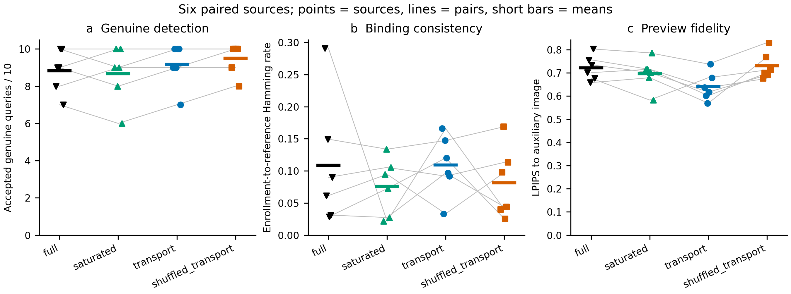

# 条件高斯传输：完整预算实验结果

249上的六来源配对实验已完成，全部240条合法查询、1200条错误身份判决通过审计。主候选接受55/60，比full适配器多2条，但少于同符号重排对照的57/60，且未改善登记参考的语义绑定。冻结的合法接受及绑定门槛未通过，完整Imprint分支未启动。当前结果不支持防御优越性或SOTA结论。

| 方法 | 合法接受 | 干净图 | 参考图绑定差异 | 辅助图LPIPS | 初始潜变量MSE | 错误身份接受 |
|---|---:|---:|---:|---:|---:|---:|
| full | 53/60 | 6/6 | 0.108561 | 0.721866 | 1.995762 | 0/300 |
| saturated | 52/60 | 6/6 | 0.075846 | 0.696837 | 1.989787 | 0/300 |
| transport | 55/60 | 6/6 | 0.109212 | 0.640350 | 0.836517 | 0/300 |
| shuffled_transport | 57/60 | 6/6 | 0.081543 | 0.729928 | 2.005350 | 0/300 |

所有组使用相同辅助图、256位身份、64次重复、16384个坐标及原始BA > 181/256。生成和反演均为50步，VAE decoder优化100步；合法处理来自Gaussian Shading官方九项条件，参数与实现未改动。六个来源分别提供干净图与九项条件，不能按60个独立来源估计不确定性。full是SemBind发布组件的项目适配器，不是完整原生论文复现。

## 配对差异与机制判断

主候选相对full恢复3条、丢失1条：恢复task000的官方裁剪、task001的随机丢弃、task005的椒盐条件；丢失task005的模糊条件。相对saturated恢复4条、丢失1条。相对同符号重排对照仅恢复1条、丢失3条；损失来自task002亮度、task005模糊及高斯噪声。全部配对见[逐条记录](paired_completion.json)。

同符号重排精确保留目标码字和各符号组的幅值多重集，仅改变幅值与辅助坐标的对应关系。传输显著减少潜变量MSE，并降低辅助图LPIPS，但这些变化没有转化为优于此对照的合法检测或参考绑定。它支持“对应关系影响生成”的观察，不能支持“更小潜变量距离足以改善认证”的结论。LPIPS是与辅助预览的配对距离，不是FID或图像总体质量排名。

以真实登记码替换查询码的oracle接受数依次为57、58、59、59；实际为53、52、55、57。transport和重排对照在oracle下相同，实际检测仍相差2条。oracle只用于解释现象，不能提供给部署验证器，也不构成新增防御成绩。

全部合法条件的平均语义差异与干净参考差异也应区分：transport查询平均差异0.105029，重排0.110938，尽管前者略低，实际接受仍较少。总体均值不能替代逐查询、逐重复组的译码行为。

## 查新与结论范围

本轮使用的正态到半正态分位映射已见于Mathon等TIP2014，不是新算法；[计划与原始公式核对](plan.md)记录这一边界。当前实验检验的是该既有映射对扩散语义登记的适用性。结果不支持把此映射单独作为论文核心创新，也不支持继续扩充其防伪实验。

另一项[连续语义解码区域筛选](../continuous_geometry_screen_20261113/plan.md)的编码、来源及门槛已在读取本轮结果前冻结。它研究语义变化到解码区域的响应方式，仍须通过真实生成闭环；不将本轮未通过的结果转换为其有效性证据。

## 可复核材料

服务端目录为`/data0/liyanlei/watermark_research/runs/semantic_transport_pilot_20261112`。完成时间2026-11-12T16:32:31Z（北京时间11月13日00:32）；仅使用空闲GPU7、5、4，未使用GPU6。预启动提交`da91c9d`；[冻结协议](../../protocols/semantic_transport_pilot_20261112.json)SHA256为`df38260a3811a858c10c02c1af4287ec145515108842ca612891d515de95b464`。

- [全部合法结果与图像/潜变量哈希](genuine_verified.json)
- [初始码字重构与全部错误身份判决](projection_audit.json)
- [信道与登记oracle诊断](channel_diagnostic.json)
- [冻结门槛判决](pilot_decision.json)与[完成状态](pipeline_state.json)
- [源图级绘图数据](figures/source_data.csv)及[图形清单](figures/model_figure_manifest.json)

