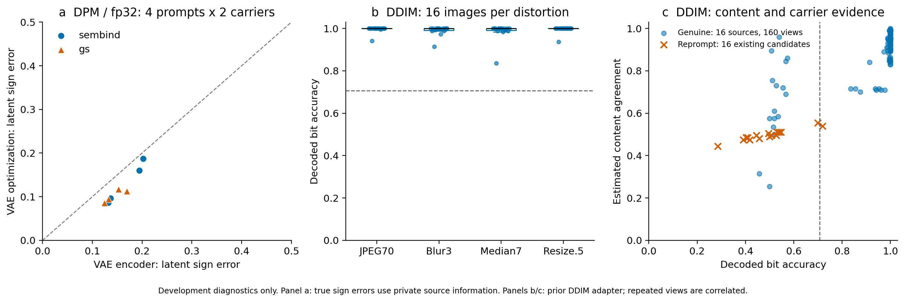

# SemBind 官方组件检查与合法扰动扩展

日期：2026-11-10。结论：全精度 DPM 正常图组件检查通过，新增四类合法扰动 80/80 通过默认 GS 检测；在相同合法图通过数量下，现有内容验证器仍未优于校准后的 BA。独立校准与确认集尚未评分，不能据此宣称 SOTA。

## 实验范围

本轮包含两套独立开发实验，不能混合为同一管线的结果。

| 实验 | 生成／反演 | 样本单位 | 用途 |
|---|---|---|---|
| 官方组件检查 | SD2.1、DPM、float32；官方生成和反演组件 | 4 个固定开发提示词 × SemBind/GS 两载体，共 8 张交付图 | 检查正常图生成和检测闭环 |
| 合法扰动扩展 | 已有 SD2.1、DDIM50 项目适配；模型 fp16、反演状态 fp32 | 16 张 SemBind 与 4 张 GS，各 4 个新视图，共 80 个查询 | 扩大合法失真覆盖，检验内容统计的额外判别价值 |

本轮没有执行新攻击。比较使用上一轮已生成的 16 个标准 CVPR 2025 Reprompt 候选。额外失真在早期开发结果已知后加入，因此整项扩展属于探索性开发，不能视为独立确认。重复视图相关，不能把 160 个查询当成 160 个独立来源。

## 全精度 DPM 正常图结果

生成设置为 50 步、CFG 7.5、solver_order=1。检测使用空提示词、CFG 3、50 步、inv_order=0；比较普通 VAE 编码与官方 100 步 VAE decoder inversion。发布实现中 inv_order=0 关闭扩散固定点修正，VAE 优化是单独的步骤。

| 载体 | 普通 VAE 编码通过数 | VAE 优化通过数 | 普通编码平均符号错误率 | 优化后平均符号错误率 |
|---|---:|---:|---:|---:|
| SemBind-GS 适配 | 4/4 | 4/4 | 16.6443% | 13.2629% |
| GS 对照 | 4/4 | 4/4 | 14.4882% | 10.2066% |

上述 16 次检测的最终 BA 均为 1。另对首个提示词、两种载体各做一次已知提示词诊断，也均为 BA=1；这两次不是实际盲检测结果。合计 18 次反演只涉及 8 张交付图和 4 个提示词。所有 18 条结果的输入／输出哈希核验通过；无噪声载体自检为 8/8。

SemBind 辅助图与最终图的语义码一致率为 0.9814、0.9189、0.9277、0.8115。此处的语义漂移未导致最终消息错误。真实符号错误率使用私有源信息作诊断，不能作为部署检测器输入。VAE 优化的平均误差下降不是防伪优势，且当前没有对应 DPM 攻击结果。

### 实现和复现边界

使用 SemBind 固定源码版本 `337c9f90a150157ac1d410208ae20e6530ca8cdd`。其 GS 载体、密钥排列和评分仍为项目适配，不是论文主表的完整复现。[SemBind 论文](https://proceedings.mlr.press/v306/zhang26hj.html)与 [Hong 等 CVPR 2024 官方实现](https://github.com/smhongok/inv-dpm)是组件来源。

本机 diffusers 0.30.3 与显式时间步调用不兼容，最小检查已记录错误；采用 inv-dpm 原依赖对应的 diffusers 0.21.4 调度器源码，未改变其算法逻辑。实际 torch 2.1.2、transformers 4.46.3 与 SemBind 声明环境不同。版本、源码标识、模型修订和运行参数见 [execution_environment.json](execution_environment.json)。模型全精度权重与服务器逐文件 SHA256 相符。

本机 RTX 4070 Laptop 执行 float32 推理，关闭 TF32、采用 attention slicing 和 CPU 卸载。后 9 条反演启用 VAE decoder 激活检查点以适应显存；前 9 条使用原执行路径，逐项标识保留。真实 512 分辨率 VAE 检查中，前向最大差为 0，梯度最大差为 1.1444e-5，通过 atol/rtol=1e-5 的逐元素比较；显存分配峰值由约 6.45 GB 降至 3.63 GB。这是单输入数值检查，不是所有输入或整条管线逐位一致的证明。续跑阶段计时不代表整个实验耗时。

## 新增合法扰动结果

扰动取自 SemBind Tables 5/6 公开设置：JPEG Q70、PIL GaussianBlur radius=3、MedianFilter size=7、双三次 512→256→512。实现细节固定于 [开发清单](../../protocols/paper_distortions_development_20261110.json)；PIL 实现不是论文未公开细节的逐位复现。没有明确强度的亮度设置未纳入。检测保持默认严格阈值 `BA > 181/256`。

| 扰动 | SemBind 通过 | 平均 BA | 最低 BA | GS 对照通过 |
|---|---:|---:|---:|---:|
| JPEG Q70 | 16/16 | 0.996094 | 0.941406 | 4/4 |
| Gaussian blur 3 | 16/16 | 0.990723 | 0.914063 | 4/4 |
| Median 7 | 16/16 | 0.986572 | 0.835938 | 4/4 |
| Resize 0.5 | 16/16 | 0.996094 | 0.937500 | 4/4 |

新增 80 个特征由服务器 CPU 提取，未使用服务器 GPU；80 个反演在本机完成，批量为 2，反演阶段约 179.9 秒。完整结果和输入指纹见 [paper_distortions.json](paper_distortions.json)。

将新增 64 个 SemBind 查询与此前 96 个合并，每个来源有 10 种等权合法条件。默认检测通过 144/160，全部 16 个中心裁剪仍失败。裁剪的平均语义码一致率约 0.9329，但真实反演符号错误率约 0.4952；这一结果支持进一步研究几何变化造成的载体恢复失配，不能据此认定已有解决方案。

## 与简单检测器的公平比较

阈值仅依据合法开发图设置，再评估已经存在的 Reprompt 候选。各附加检测器均保留基础 GS 判定约束，分母包含所有合法查询。

| 合法查询通过数 | 校准 BA 接受候选 | 原始符号一致率 | 内容多数估计 | Profile 内容估计 | Profile 支持下界 |
|---|---:|---:|---:|---:|---:|
| 136/160（85%） | 0/16 | 0/16 | 0/16 | 0/16 | 0/16 |
| 144/160（90%） | 0/16 | 0/16 | 0/16 | 0/16 | 0/16 |
| 152/160（95%） | 不可达 | 不可达 | 不可达 | 不可达 | 不可达 |

80% 目标点因离散分数产生不同实际通过数（128、129 或 132），不作为严格相等通过数的比较。90% 是保持基础 GS 判定时当前合法分布的最高通过率。Profile 支持范围不是在相关错误条件下保证覆盖率的置信区间。

结论是当前复杂统计模型没有展示额外防御价值，而不是所有条件下都不可能有价值。16 个候选不足以估计低概率失败；这里的 0/16 也不是零风险或经验假阳性率。尚无多身份、独立确认或完整质量预算结果。

图 a 是 DPM/fp32 的 8 张正常图配对诊断；图 b/c 是 DDIM 的合法视图与已有候选，不能跨面板合并估计方法效果。虚线表示相等误差或默认 BA 阈值，未表示校准后的附加阈值。SVG 与数据指纹见 [figure_provenance.json](figure_provenance.json)。

## 研究判断与下一项证据要求

现阶段可检验的防御问题是：在内容保持而几何关系变化时，如何恢复可认证的载体证据，同时保持对已发表伪造基线的拒绝能力。当前只是定位瓶颈；几何对齐、语义区域、软译码、消息包装均有先例，不能仅组合这些模块就主张创新。当前实施顺序见[研究计划](../../docs/RESEARCH_PLAN.md)。

下一项有效研究必须解释其机制为何提供 BA 之外的信息，预先冻结合法分布与标准攻击预算，并在相同绝对合法检出率、质量和计算成本下验证。当前不以独立确认集反复筛选方案。

现有 30 对历史 Imprint 的执行步数尚无可核验启动记录，短时 2 步探针也不是完整预算实验；具体证据缺口见 [imprint_provenance_audit.json](imprint_provenance_audit.json)。补齐标准基线是必要条件，不应把现有结果升级为完整论文预算结论。

## 证据与运行状态

- DPM 逐项结果：[dpm_results.json](dpm_results.json)，汇总：[summary.json](summary.json)。
- 失真扩展状态：[paper_extension_progress.json](paper_extension_progress.json)；模型和源码环境：[execution_environment.json](execution_environment.json)。
- 当前批次全部完成，无正在运行的实验。服务器 GPU 使用为零，GPU6 未使用。
- 249 的 SSH 在本轮归档时关闭连接，新增本地结果尚未同步回服务器；服务器此前已经保存新增查询与 CPU 特征。本地资产和不含私钥的证据归档保留供恢复同步。
- 本文不报告新的防御胜出、完整 SemBind 复现或独立确认结果。
