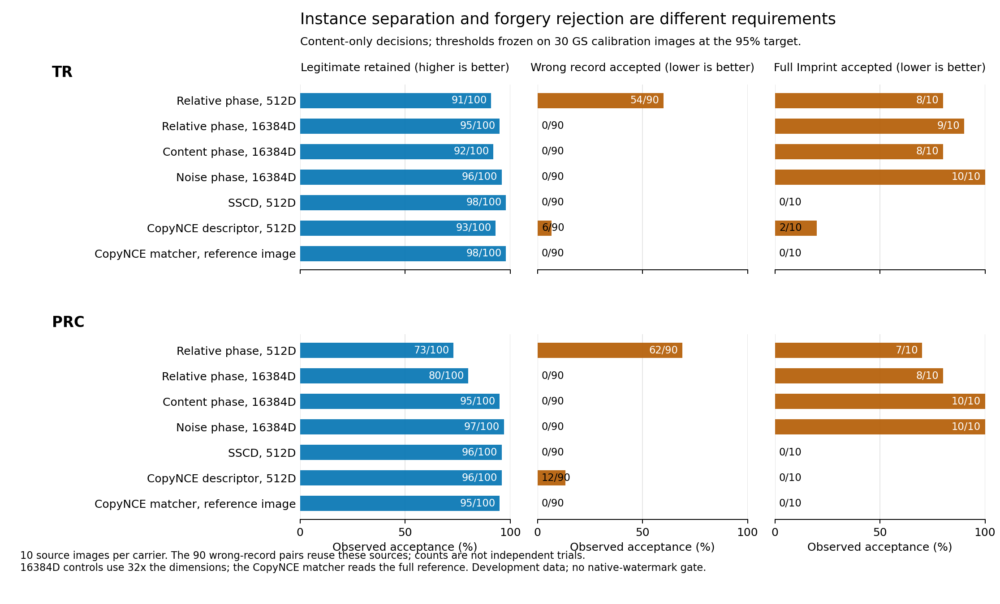

# 共同频谱实例绑定：完整恢复与机制检验

本轮完成17730次真实密钥恢复判定，其中主实验17040次、划分内部配对消融690次。共同频谱恢复的合法覆盖低于同一码器的SSCD，90%和95%校准目标均未达到。连续特征结果定位了另外两处失败：512维池化丢失实例细节；保留完整频谱后，已有Imprint输出仍大量落入接受区域。强对照新增ICCV2025 CopyNCE作者公开的描述子与匹配器。

## 机制与完整验证路径

设内容VAE潜变量的频谱为A，原生反演噪声的频谱为B。主候选使用`unit(A) × conjugate(unit(B))`，另一候选使用`log|A| − log|B|`。若同一处理在两路上乘以相同非零频率响应H，这两种关系能消去H。实验检验真实图像处理经过VAE和扩散反演后是否仍满足足够近似的共同响应。

恢复路径为：查询图→512维表示→私有投影与登记可靠位→BCH译码→恢复128位实例密钥→认证解封数据密钥→解密完整原生验证材料→作者原生检测函数。恢复函数只接收查询表示、辅助记录和服务端秘密；辅助记录不保存参考图特征。码长1023、码维数133、设计距离255，最大纠错半径127。登记采用参考图的可靠位，未针对评估结果调节。

该实现是带服务端秘密的计算型密钥绑定。128位密钥长度与图像特征的条件熵是不同参数；本轮验证实际恢复正确性和图像接受集合。原生GS、TR、PRC的嵌入与检测规则沿用冻结版本。

## 数据和公平比较

GS来源0–3用于拟合，4–6的30张合法图用于校准，7–9用于评估；TR/PRC各10个来源直接迁移冻结阈值。30张校准合法图全部通过原生检测，因此此处内容校准与联合合法通过数一致。90%与95%目标分别取第27、29个合法距离；少量校准来源造成的阈值变化需要在新来源上继续检验。本批属于已观察开发资产。

九种处理全部使用原GS函数和固定参数。登记处理为裁剪、随机丢弃、高斯噪声和椒盐噪声；未登记处理为亮度、JPEG、模糊、中值滤波和缩放。“未登记”指未用于建立实例的处理模板，校准集中仍含九类处理；本轮测试编辑迁移，不是对全部未知处理的保证。

同提示词对照来自10张新生成的独立seed普通图片，无水印噪声复用。它们用于测量实例区分。伪造对照沿用已完成的CVPR2025 Imprint作者实现，151次实际更新，保留51/101/151检查点。完整预算Imprint与完整攻击方法矩阵分别记录；本轮未新增Reprompt攻击。

相同像素、来源划分和校准规则下，比较两路单独使用、普通拼接、SSCD、中心化SSCD、九模板float32/int8和CopyNCE。全局配对打乱跨越GS划分，只保留为诊断；正式配对消融使用划分内部打乱。所有合法图进入分母，包括原生检测失败的图片。

## 实际密钥恢复结果

下表使用最大半径127，列出三次私有投影的合法密钥恢复数。这是译码器最大覆盖诊断；达到校准目标的情况另列。每组投影使用同一批图片，不是独立数据重复。

| 表示 | GS密钥恢复 /30 | TR密钥恢复 /100 | PRC密钥恢复 /100 | PRC联合通过 /100 | 90%校准可行投影 /3 | 95%校准可行投影 /3 |
|---|---|---|---|---|---:|---:|
| 共同相位 | 4 / 4 / 5 | 21 / 19 / 20 | 16 / 15 / 16 | 16 / 15 / 16 | 0 | 0 |
| 共同对数增益 | 10 / 9 / 9 | 32 / 33 / 33 | 29 / 30 / 28 | 29 / 30 / 28 | 0 | 0 |
| 内容相位 | 18 / 18 / 17 | 67 / 65 / 64 | 75 / 75 / 74 | 61 / 58 / 58 | 0 | 0 |
| 噪声相位 | 14 / 14 / 13 | 58 / 59 / 59 | 53 / 55 / 53 | 43 / 45 / 43 | 0 | 0 |
| 普通拼接 | 15 / 15 / 15 | 62 / 63 / 62 | 64 / 61 / 63 | 51 / 48 / 50 | 0 | 0 |
| SSCD | 26 / 27 / 26 | 84 / 83 / 84 | 79 / 80 / 80 | 64 / 64 / 64 | 0 | 0 |
| 中心化SSCD | 27 / 27 / 26 | 89 / 90 / 88 | 85 / 85 / 84 | 64 / 64 / 64 | 3 | 0 |

划分内部打乱配对的GS合法恢复为5/4/4，对应正确配对4/4/5；这项消融没有显示配对关系的恢复收益。共同增益差还在TR错误记录上恢复并联合接受2–4/90，在PRC为9–10/90。完整逐条件、负例和校准表见[结果表](result_tables.md)。

主实验4103次成功恢复、补充消融40次成功恢复，密钥及载体材料全部逐字节一致。执行710次原生检测、401次由恢复材料触发的原生检测，以及补充消融14次恢复材料检测；主实验720条辅助记录、30个原生材料封装通过哈希审计，60项认证拒绝检查通过。恢复判定与规定半径在全部17730条查询上相符。CPU重放127条连续原生数值出现微小差异，最大约1.96e-6，接受判定差异为0。

对可行恢复点，按评估集合法联合通过数选择SSCD系列阈值，288组描述性比较全部满足：强对照的合法通过数至少相同，负例接受数不高于恢复方法。[审计](audit.json)和[汇总](review_summary.json)保存每组比较。

每条辅助记录2217–2220字节，另有原生材料的认证封装：GS222字节、TR149364字节、PRC10041468字节。当前封装保存完整原生状态以验证作者检测器兼容性；这些共同载体成本不能从总存储中省略。主恢复阶段3615.93秒，完整CPU流水线3748.95秒，运行在249；全部GPU提取使用GPU7。

## 真实处理是否具有共同响应

在未登记的五类处理上，相对相位漂移同时小于两条单路的次数为GS4/15、TR23/50、PRC10/50。对数增益差的平均漂移RMS分别为0.920、0.930、0.969，均高于各自内容单路与噪声单路。因此，共同滤波的数学恒等式没有转化成这两条神经处理链上稳定的编辑消除。完整条件见[audit.json](audit.json)。

## 实例细节与伪造区分

下面使用相同GS95%校准规则，列出连续内容判断。完整频谱为16384维，是512维的32倍，用于定位池化损失；该补充没有重新训练或修改冻结恢复方法。

| 表示 | TR合法 /100 | TR错误记录 /90 | TR完整Imprint /10 | PRC合法 /100 | PRC错误记录 /90 | PRC完整Imprint /10 |
|---|---:|---:|---:|---:|---:|---:|
| 共同相位512维 | 91 | 54 | 8 | 73 | 62 | 7 |
| 共同相位完整频谱 | 95 | 0 | 9 | 80 | 0 | 8 |
| 内容单路完整频谱 | 92 | 0 | 8 | 95 | 0 | 10 |
| 噪声单路完整频谱 | 96 | 0 | 10 | 97 | 0 | 10 |
| SSCD单参考 | 98 | 0 | 0 | 96 | 0 | 0 |
| CopyNCE描述子 | 93 | 6 | 2 | 96 | 12 | 0 |
| CopyNCE匹配器 | 98 | 0 | 0 | 95 | 0 | 0 |

这组结果将两件事分开了。去掉池化后，错误记录从大量接受降到0，说明普通实例区分受到了信息压缩的影响。但完整Imprint的接受仍为8–10/10，说明频谱保留的关系本身对当前伪造不够敏感。增加纠错能力只会扩大这个区域。

CopyNCE匹配器读取完整参考图；描述子和单参考SSCD使用512维向量。匹配器的结果用于给出更强的实例匹配参照，存储和输入信息优势单列。[CopyNCE完整对照](../copynce_control_20261114/report.md)给出联合检测、相同合法通过数和来源层面的重采样。

图为内容判断，百分比的分母和原始计数同时标注。90个错误记录配对来自10个来源，不能按90个独立来源解释。图源[CSV](information_figure/source_data.csv)、[PDF](information_figure/instance_and_forgery.pdf)和[生成清单](information_figure/manifest.json)均保存；计算与绘图在249执行，PNG经视觉检查，PDF验证了嵌入字体。

## 研究判断

共同频谱路线的核心假设是“合法处理变化能够相消，同时保留实例关系”。目前连续数据给出的主要障碍是，普通实例可分以后，Imprint仍能保留这些关系。下一机制需要新增对真实实例的可辨认证据，继续扩大恢复半径或提高频谱维数没有解决该障碍。

CopyNCE说明局部对应关系值得作为更强的起点；它本身已有成熟的局部监督与配对匹配机制。模糊金库、局部几何不变量以及编辑估计结合译码也已有直接先例。后续值得检验的贡献是：在限定登记信息和查询成本下，能否保留强配对匹配器的实例间隔，并直接恢复密钥。该问题尚待新机制与独立实验回答。[相关工作及阅读范围](related_work.md)记录了具体先例。

补充的[逐类留出校准](heldout_edit_calibration_with_negatives.json)将五类未登记处理分别从GS校准集中排除，再测试该类处理；每次27张校准图。CopyNCE匹配器的内容判断为GS15/15、TR50/50、PRC50/50，联合通过为15/15、50/50、38/50；每个留出阈值下，同提示词其他实例、错误记录和完整Imprint均0接受。SSCD对应内容判断14/15、47/50、45/50。共同相位为15/15、43/50、38/50，同时保留大量负例接受。真实恢复的95%校准目标仍未覆盖全部五类留出。这是已观察开发数据上的补充分析，未重新训练表示或更改解码结果。

## 可复核资产

- [冻结协议](../../protocols/shared_channel_binding_20261114_v2.json)、[协议说明](protocol_note.md)、[输入复用检查](io_preflight.json)。
- [连续距离结果](continuous_separation.json)、[完整频谱诊断](spectral_information.json)。
- [主实验逐条恢复](rows.json)、[连续控制及原生判定](controls.json)、[登记记录摘要](enrollment.json)、[配对消融](pairing_control_complete.json)、[完成记录](pipeline_state.json)。
- 服务器执行目录：`/data0/liyanlei/watermark_research/runs/shared_channel_binding_20261114_v2`；私有辅助记录、投影、密钥与原生材料不进入Git。
- 图表工具记录：Kassis等，ScientificAgentSkills，2026，[软件说明](https://arxiv.org/abs/2609.00065)。该引用对应图表制作工作流。
